# JWT Todo API on AWS: VPC (2 public + 2 private subnets), ALB, and an Auto Scaling Group in private subnets

Build a very small Express + MongoDB Atlas (Mongoose) todo API with JWT auth, bake it into an AMI, and run it on EC2 instances in **private subnets** behind an **Application Load Balancer** that lives in the **public subnets**. An **Auto Scaling Group (ASG)** adds and removes instances automatically. Secrets live in a `.env` file that a **user data script** writes when each instance boots (no SSM Parameter Store, no Secrets Manager).

The console flow (AMI, launch template, target group, load balancer, ASG, cleanup) follows Shivam Bhadani's article [AWS Part 4: Step-by-Step Guide to Create Your First AWS Auto Scaling Group](https://medium.com/@shivambhadani_/aws-part-4-step-by-step-guide-to-create-your-first-aws-auto-scaling-group-826c1effc0ec). This guide adds a custom VPC with private subnets and a NAT gateway, a JWT todo API, and the `.env` user data approach. The article's screenshots are not embedded here, see [Screenshots](#screenshots) for how to add them.

```
                          Internet
                             │
                    ┌────────▼────────┐
                    │ Internet Gateway│
                    └────────┬────────┘
┌────────────────────────────┼──────────────────────────────────────────┐
│ VPC todo-vpc  10.0.0.0/16  │                                          │
│                            │                                          │
│   ┌────────────────────────▼───────────────────────┐                  │
│   │  Application Load Balancer (todo-alb, :80)     │  PUBLIC subnets  │
│   │  public-a 10.0.1.0/24     public-b 10.0.2.0/24 │                  │
│   │  [NAT Gateway lives in public-a]               │                  │
│   └────────────┬──────────────────────┬────────────┘                  │
│                │ :3000 (from ALB SG only)                             │
│   ┌────────────▼────────────┐ ┌───────▼─────────────────┐             │
│   │ private-a 10.0.11.0/24  │ │ private-b 10.0.12.0/24  │  PRIVATE    │
│   │ EC2 (ASG) Node + PM2    │ │ EC2 (ASG) Node + PM2    │  subnets    │
│   └────────────┬────────────┘ └───────────┬─────────────┘             │
│                └──────────┬───────────────┘                           │
│                           │ outbound via NAT (fixed Elastic IP)       │
└───────────────────────────┼───────────────────────────────────────────┘
                            ▼
                    MongoDB Atlas (allow-list = NAT Elastic IP)
```

## Table of contents

1. [What you will build and naming cheat sheet](#1-what-you-will-build-and-naming-cheat-sheet)
2. [Screenshots](#screenshots)
3. [Step 1: MongoDB Atlas](#step-1-mongodb-atlas)
4. [Step 2: The API code](#step-2-the-api-code)
5. [Step 3: Push the code to GitHub](#step-3-push-the-code-to-github)
6. [Step 4: Create the VPC (2 public + 2 private subnets)](#step-4-create-the-vpc)
7. [Step 5: Allow the NAT IP in Atlas](#step-5-allow-the-nat-ip-in-atlas)
8. [Step 6: Security groups](#step-6-security-groups)
9. [Step 7: Key pair and optional private-instance access](#step-7-key-pair-and-optional-private-instance-access)
10. [Step 8: Build the AMI](#step-8-build-the-ami)
11. [Step 9: The user data script (.env)](#step-9-the-user-data-script-env)
12. [Step 10: Launch template](#step-10-launch-template)
13. [Step 11: Target group](#step-11-target-group)
14. [Step 12: Application Load Balancer](#step-12-application-load-balancer)
15. [Step 13: Auto Scaling Group](#step-13-auto-scaling-group)
16. [Step 14: Test the API](#step-14-test-the-api)
17. [Step 15: Watch it scale](#step-15-watch-it-scale)
18. [Updating the app later](#updating-the-app-later)
19. [Troubleshooting](#troubleshooting)
20. [Cleanup (stop the billing)](#cleanup)
21. [Notes and trade-offs](#notes-and-trade-offs)

---

## 1. What you will build and naming cheat sheet

Region used throughout: **Asia Pacific (Mumbai) `ap-south-1`**, with Availability Zones `ap-south-1a` and `ap-south-1b`. Use another region if you like and adjust the AZ names.

| Thing | Name | Value |
|---|---|---|
| VPC | `todo-vpc` | `10.0.0.0/16` |
| Public subnet A | `todo-public-a` | `10.0.1.0/24` in `ap-south-1a` |
| Public subnet B | `todo-public-b` | `10.0.2.0/24` in `ap-south-1b` |
| Private subnet A | `todo-private-a` | `10.0.11.0/24` in `ap-south-1a` |
| Private subnet B | `todo-private-b` | `10.0.12.0/24` in `ap-south-1b` |
| Internet gateway | `todo-igw` | for the public subnets |
| NAT gateway | `todo-nat` | in `todo-public-a`, with an Elastic IP |
| Security group (build box) | `todo-build-sg` | SSH from your IP |
| Security group (ALB) | `todo-alb-sg` | HTTP 80 from the internet |
| Security group (instances) | `todo-app-sg` | TCP 3000 from `todo-alb-sg` only |
| AMI | `todo-api-ami` | Ubuntu 24.04 + Node 22 + PM2 + app code |
| Launch template | `todo-lt` | AMI + instance type + SG + user data |
| Target group | `todo-tg` | HTTP, port 3000, health check `/health` |
| Load balancer | `todo-alb` | internet-facing, public subnets |
| Auto Scaling Group | `todo-asg` | min 2, desired 2, max 4, CPU target 60% |

Why this layout:

- **Public subnets** have a route to the internet gateway. Only the load balancer (and the NAT gateway) sit there.
- **Private subnets** have no inbound path from the internet. Their route table sends outbound traffic through the **NAT gateway**, so instances can reach MongoDB Atlas, and Atlas sees one fixed IP (the NAT's Elastic IP). That makes the Atlas allow-list simple and safe.
- Two AZs means the app survives the loss of one AZ.

---

## Screenshots

I could not pull the screenshots out of the Medium page. The page text was readable, but its image links came back empty, and the sandbox cannot download from Medium's image servers. So every console step below has an `` slot pointing at a file name. To fill them:

1. Create an `images/` folder next to this file.
2. Save the matching screenshot into it with the file name shown. For steps that exist in the Medium article, use its screenshot (the table below says which section). For steps the article does not cover (custom VPC, NAT, private subnets, `.env` user data), take your own from the AWS console.
3. Until a file exists, that slot shows as a broken image. That is expected.

Header image from the original article (the only image URL the page exposed): 

| Image file | Used in | Source |
|---|---|---|
| `atlas-01-network-access.png`, `atlas-02-db-user.png` | Step 1, 5 | Take your own (Atlas) |
| `vpc-01-wizard.png`, `vpc-02-preview.png`, `vpc-03-route-private.png` | Step 4 | Take your own |
| `sg-01-create.png`, `sg-02-alb-sg.png`, `sg-03-app-sg.png` | Step 6 | Medium: "Launch Template", SG steps 1 to 2 (adapt) |
| `ami-01-ubuntu-picker.png` | Step 8 | Medium: "Amazon Machine Images (AMIs)", Ubuntu image picker |
| `ami-02-build-commands.png` | Step 8 | Medium: "Tutorial on Creating AMI", step 1 |
| `ami-03-create-image-menu.png` | Step 8 | Medium: "Tutorial on Creating AMI", step 2 |
| `ami-04-create-image-form.png` | Step 8 | Medium: "Tutorial on Creating AMI", step 3 |
| `ami-05-ami-list.png` | Step 8 | Medium: "Tutorial on Creating AMI", step 4 |
| `lt-01-create.png` | Step 10 | Medium: "Tutorial on Creating Launch Template", step 2 |
| `lt-02-name.png`, `lt-03-ami.png`, `lt-04-type-key.png`, `lt-05-sg.png` | Step 10 | Medium: launch template steps 3 to 6 |
| `lt-06-user-data.png` | Step 10 | Medium: launch template step 7 (use your `.env` script) |
| `lt-07-created.png` | Step 10 | Medium: launch template step 8 |
| `tg-01-create.png`, `tg-02-health.png` | Step 11 | Medium: "Create Target Group and Load Balancer", step 1 |
| `alb-01-create.png`, `alb-02-listener.png` | Step 12 | Medium: same section, step 4 |
| `asg-01-create.png` | Step 13 | Medium: "Creating Auto Scaling Group", step 1 |
| `asg-02-name-template.png` | Step 13 | Medium: ASG step 2 |
| `asg-03-network.png` | Step 13 | Medium: ASG step 3 (choose private subnets) |
| `asg-04-load-balancer.png` | Step 13 | Medium: ASG step 4 |
| `asg-05-size-scaling.png` | Step 13 | Medium: ASG steps 5, 8, 10 |
| `asg-06-ready.png` | Step 13 | Medium: ASG step 7 |
| `test-01-alb-dns.png` | Step 14 | Medium: "Hit load balancer DNS from browser" |
| `cleanup-*.png` | Cleanup | Medium: "Cleanup all resources" |

---

## Step 1: MongoDB Atlas

1. In Atlas create a cluster (the free M0 tier is fine). Pick a region close to `ap-south-1` (Mumbai).
2. **Database Access → Add New Database User.** Username `todo_app`, a long random password, built-in role **Read and write to any database** (or restrict it to the `tododb` database).

   

3. **Connect → Drivers** and copy the connection string. Insert the database name before the `?`:

   ```
   mongodb+srv://<db-user>:<db-password>@<cluster-host>/tododb?retryWrites=true&w=majority
   ```

   If the password contains special characters, URL-encode them (`@` becomes `%40`, `/` becomes `%2F`, `#` becomes `%23`). A simple alphanumeric password avoids the problem.
4. Leave **Network Access** alone for now. You will add the NAT gateway's IP in [Step 5](#step-5-allow-the-nat-ip-in-atlas).

---

## Step 2: The API code

Everything here is ES modules (`"type": "module"`). The project layout:

```
todo-api/
├── .gitignore
├── .env.example
├── package.json
├── ecosystem.config.cjs
├── deploy/
│   ├── build-ami.sh
│   └── user-data.sh
└── src/
    ├── server.js
    ├── config.js
    ├── models/
    │   ├── User.js
    │   └── Todo.js
    ├── middleware/
    │   └── auth.js
    └── routes/
        ├── auth.js
        └── todos.js
```

### `package.json`

```json
{
  "name": "todo-api",
  "version": "1.0.0",
  "private": true,
  "type": "module",
  "main": "src/server.js",
  "scripts": {
    "start": "node src/server.js",
    "dev": "node --watch src/server.js"
  },
  "engines": {
    "node": ">=20"
  },
  "dependencies": {
    "bcryptjs": "^2.4.3",
    "dotenv": "^16.4.5",
    "express": "^5.1.0",
    "jsonwebtoken": "^9.0.2",
    "mongoose": "^8.8.0"
  }
}
```

Express 5 forwards errors from `async` route handlers to the error middleware automatically, so the routes below need no try/catch wrappers.

### `.env.example`

```ini
PORT=3000
NODE_ENV=development
MONGODB_URI=mongodb+srv://<db-user>:<db-password>@<cluster-host>/tododb?retryWrites=true&w=majority
# openssl rand -base64 48
JWT_SECRET=change-me
JWT_EXPIRES_IN=1h
```

### `.gitignore`

```gitignore
node_modules/
.env
.deployed-commit
```

### `src/config.js`

```js
import path from 'node:path';
import { fileURLToPath } from 'node:url';
import dotenv from 'dotenv';

const __dirname = path.dirname(fileURLToPath(import.meta.url));

// .env sits in the project root, one level above src/
dotenv.config({ path: path.join(__dirname, '..', '.env') });

for (const key of ['MONGODB_URI', 'JWT_SECRET']) {
  if (!process.env[key]) {
    console.error(`Missing required environment variable: ${key}`);
    process.exit(1);
  }
}

export default {
  nodeEnv: process.env.NODE_ENV || 'development',
  port: Number(process.env.PORT) || 3000,
  mongoUri: process.env.MONGODB_URI,
  jwtSecret: process.env.JWT_SECRET,
  jwtExpiresIn: process.env.JWT_EXPIRES_IN || '1h',
};
```

### `src/models/User.js`

```js
import mongoose from 'mongoose';

const userSchema = new mongoose.Schema(
  {
    email: {
      type: String,
      required: true,
      unique: true,
      lowercase: true,
      trim: true,
      match: [/^[^\s@]+@[^\s@]+\.[^\s@]+$/, 'Invalid email address'],
    },
    passwordHash: { type: String, required: true, select: false },
  },
  { timestamps: true }
);

export default mongoose.model('User', userSchema);
```

### `src/models/Todo.js`

```js
import mongoose from 'mongoose';

const todoSchema = new mongoose.Schema(
  {
    title: { type: String, required: true, trim: true, maxlength: 200 },
    completed: { type: Boolean, default: false },
    owner: { type: mongoose.Schema.Types.ObjectId, ref: 'User', required: true, index: true },
  },
  { timestamps: true }
);

export default mongoose.model('Todo', todoSchema);
```

### `src/middleware/auth.js`

```js
import jwt from 'jsonwebtoken';
import config from '../config.js';

export function signToken(userId) {
  return jwt.sign({ sub: userId }, config.jwtSecret, {
    algorithm: 'HS256',
    expiresIn: config.jwtExpiresIn,
  });
}

// Expects "Authorization: Bearer <token>"
export function requireAuth(req, res, next) {
  const [scheme, token] = (req.headers.authorization || '').split(' ');
  if (scheme !== 'Bearer' || !token) {
    return res.status(401).json({ error: 'Authentication required' });
  }
  try {
    const payload = jwt.verify(token, config.jwtSecret, { algorithms: ['HS256'] });
    req.userId = payload.sub;
    next();
  } catch {
    res.status(401).json({ error: 'Invalid or expired token' });
  }
}
```

### `src/routes/auth.js`

```js
import express from 'express';
import bcrypt from 'bcryptjs';
import User from '../models/User.js';
import { signToken } from '../middleware/auth.js';

const router = express.Router();

// POST /api/auth/register  { "email": "...", "password": "..." }
router.post('/register', async (req, res) => {
  const { email, password } = req.body ?? {};
  if (typeof email !== 'string' || typeof password !== 'string') {
    return res.status(400).json({ error: 'email and password are required' });
  }
  if (password.length < 8) {
    return res.status(400).json({ error: 'Password must be at least 8 characters' });
  }

  const passwordHash = await bcrypt.hash(password, 10);
  const user = await User.create({ email, passwordHash }); // duplicate email -> 409 via error handler
  res.status(201).json({ id: user.id, email: user.email, token: signToken(user.id) });
});

// POST /api/auth/login  { "email": "...", "password": "..." }
router.post('/login', async (req, res) => {
  const { email, password } = req.body ?? {};
  if (typeof email !== 'string' || typeof password !== 'string') {
    return res.status(400).json({ error: 'email and password are required' });
  }

  const user = await User.findOne({ email: email.toLowerCase().trim() }).select('+passwordHash');
  const ok = user && (await bcrypt.compare(password, user.passwordHash));
  if (!ok) return res.status(401).json({ error: 'Invalid credentials' });

  res.json({ id: user.id, email: user.email, token: signToken(user.id) });
});

export default router;
```

### `src/routes/todos.js`

```js
import express from 'express';
import Todo from '../models/Todo.js';
import { requireAuth } from '../middleware/auth.js';

const router = express.Router();
router.use(requireAuth); // every todo route needs a valid JWT

// GET /api/todos?completed=true|false
router.get('/', async (req, res) => {
  const filter = { owner: req.userId };
  if (req.query.completed === 'true') filter.completed = true;
  if (req.query.completed === 'false') filter.completed = false;

  const todos = await Todo.find(filter).sort({ createdAt: -1 });
  res.json({ todos });
});

// POST /api/todos  { "title": "..." }
router.post('/', async (req, res) => {
  const { title } = req.body ?? {};
  const todo = await Todo.create({ title, owner: req.userId });
  res.status(201).json({ todo });
});

// GET /api/todos/:id
router.get('/:id', async (req, res) => {
  const todo = await Todo.findOne({ _id: req.params.id, owner: req.userId });
  if (!todo) return res.status(404).json({ error: 'Todo not found' });
  res.json({ todo });
});

// PUT /api/todos/:id  { "title"?: "...", "completed"?: true }
router.put('/:id', async (req, res) => {
  const { title, completed } = req.body ?? {};
  const update = {};
  if (title !== undefined) update.title = title;
  if (completed !== undefined) update.completed = Boolean(completed);

  const todo = await Todo.findOneAndUpdate(
    { _id: req.params.id, owner: req.userId },
    update,
    { new: true, runValidators: true }
  );
  if (!todo) return res.status(404).json({ error: 'Todo not found' });
  res.json({ todo });
});

// DELETE /api/todos/:id
router.delete('/:id', async (req, res) => {
  const todo = await Todo.findOneAndDelete({ _id: req.params.id, owner: req.userId });
  if (!todo) return res.status(404).json({ error: 'Todo not found' });
  res.status(204).end();
});

export default router;
```

### `src/server.js`

```js
import os from 'node:os';
import express from 'express';
import mongoose from 'mongoose';
import config from './config.js';
import authRoutes from './routes/auth.js';
import todoRoutes from './routes/todos.js';

const app = express();

app.set('trust proxy', 1); // one proxy hop: the Application Load Balancer
app.use(express.json({ limit: '100kb' }));

// Load balancer health check. Does NOT touch MongoDB, so an Atlas hiccup
// doesn't make the ALB mark every instance unhealthy at once.
// The hostname shows which instance answered (handy to see load balancing).
app.get('/health', (_req, res) => res.json({ status: 'ok', host: os.hostname() }));

// Readiness: is MongoDB connected? (for manual debugging)
app.get('/ready', (_req, res) => {
  const connected = mongoose.connection.readyState === 1;
  res.status(connected ? 200 : 503).json({ db: connected ? 'connected' : 'disconnected', host: os.hostname() });
});

app.use('/api/auth', authRoutes);
app.use('/api/todos', todoRoutes);

app.use((_req, res) => res.status(404).json({ error: 'Not found' }));

// eslint-disable-next-line no-unused-vars
app.use((err, _req, res, _next) => {
  if (err.name === 'ValidationError') {
    return res.status(400).json({ error: 'Validation failed', details: Object.values(err.errors).map((e) => e.message) });
  }
  if (err.name === 'CastError') return res.status(400).json({ error: `Invalid ${err.path}` });
  if (err.code === 11000) return res.status(409).json({ error: 'Already exists' });
  if (err.type === 'entity.parse.failed') return res.status(400).json({ error: 'Malformed JSON body' });

  console.error(err);
  res.status(500).json({ error: config.nodeEnv === 'production' ? 'Internal server error' : err.message });
});

async function start() {
  await mongoose.connect(config.mongoUri, { serverSelectionTimeoutMS: 10000 });
  console.log('MongoDB connected');

  // 0.0.0.0 so the load balancer can reach the instance's private IP.
  // The security group only lets the ALB in on this port.
  const server = app.listen(config.port, '0.0.0.0', () =>
    console.log(`todo-api listening on :${config.port} (${config.nodeEnv})`)
  );

  const shutdown = (signal) => {
    console.log(`${signal} received, shutting down`);
    server.close(async () => {
      await mongoose.connection.close();
      process.exit(0);
    });
    setTimeout(() => process.exit(1), 8000).unref();
  };
  process.on('SIGINT', () => shutdown('SIGINT'));
  process.on('SIGTERM', () => shutdown('SIGTERM'));
}

start().catch((err) => {
  console.error('Failed to start:', err.message);
  process.exit(1);
});
```

### `ecosystem.config.cjs`

PM2 loads this file with `require()`, so it uses the `.cjs` extension even though the app is ESM.

```js
module.exports = {
  apps: [
    {
      name: 'todo-api',
      script: 'src/server.js',
      cwd: '/opt/todo-api',
      autorestart: true,
      max_memory_restart: '300M',
      kill_timeout: 10000,
    },
  ],
};
```

### Try it locally first

```bash
npm install
cp .env.example .env     # fill in MONGODB_URI and JWT_SECRET
# add your home IP in Atlas > Network Access for this local test
npm run dev
curl localhost:3000/health
```

Commit the generated `package-lock.json` too, because the AMI build uses `npm ci`.

---

## Step 3: Push the code to GitHub

```bash
cd todo-api
git init -b master
git add .
git commit -m "Todo API"
git remote add origin https://github.com/YOUR_GITHUB_USER/todo-api.git
git push -u origin master
```

Use `main` instead of `master` everywhere below if that is your branch name. If the repo is private, either use a read-only personal access token in the clone URL while building the AMI (and remove it afterwards, see the build script) or copy the project with `scp` instead of `git clone`.

---

## Step 4: Create the VPC

The console wizard builds everything in one go: VPC, 4 subnets, internet gateway, NAT gateway with an Elastic IP, and route tables.

1. AWS Console → **VPC** → **Create VPC** → choose **VPC and more**.

   

2. Fill in:

   | Setting | Value |
   |---|---|
   | Name tag auto-generation | tick it, enter `todo` |
   | IPv4 CIDR block | `10.0.0.0/16` |
   | IPv6 CIDR block | No IPv6 |
   | Tenancy | Default |
   | Number of Availability Zones | **2** (customize: `ap-south-1a`, `ap-south-1b`) |
   | Number of public subnets | **2** |
   | Number of private subnets | **2** |
   | Customize subnets CIDR blocks | public: `10.0.1.0/24`, `10.0.2.0/24`; private: `10.0.11.0/24`, `10.0.12.0/24` |
   | NAT gateways | **In 1 AZ** (cheapest) or **1 per AZ** (resilient, double the cost) |
   | VPC endpoints | None |
   | DNS options | keep both **Enable DNS hostnames** and **Enable DNS resolution** ticked |

3. Look at the **Preview** panel. You should see 4 subnets, 3 route tables (one public, two private, one per AZ), an internet gateway, and a NAT gateway.

   

4. Click **Create VPC** and wait until the NAT gateway finishes (a couple of minutes).

5. **Rename for clarity (optional).** The wizard names subnets like `todo-subnet-public1-ap-south-1a`. That is fine. This guide refers to them as `todo-public-a`, `todo-public-b`, `todo-private-a`, `todo-private-b`.

### Verify the routing

This is the part that makes subnets "public" or "private", so check it once.

- **VPC → Route tables**, open the public route table. It must contain `0.0.0.0/0 → igw-...` (the internet gateway), and be associated with both public subnets.
- Open each private route table. It must contain `0.0.0.0/0 → nat-...` (the NAT gateway), and be associated with one private subnet each.


If a private route table has no `0.0.0.0/0 → nat-...` route, instances in it cannot reach Atlas. Add the route (Edit routes → Add route → Destination `0.0.0.0/0` → Target NAT Gateway).

### Note the NAT gateway's public IP

**VPC → NAT gateways → `todo-nat-public1-ap-south-1a`**. Copy the **Primary public IPv4 address** (the Elastic IP). You need it in the next step.

---

## Step 5: Allow the NAT IP in Atlas

All outbound traffic from the private instances leaves through the NAT gateway, so Atlas sees that single IP.

1. Atlas → **Network Access → Add IP Address**.
2. Enter the NAT gateway's Elastic IP followed by `/32`, for example `13.201.10.20/32`. Add a comment like `todo-nat`.

   

3. Confirm and wait until the status is **Active**.

If you use **1 NAT gateway per AZ**, add both Elastic IPs.

---

## Step 6: Security groups

**EC2 → Security Groups → Create security group.** Choose VPC `todo-vpc` for every group. Create them in this order, because the third refers to the second.

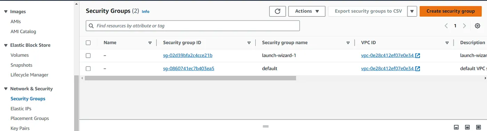

### 1. `todo-build-sg` (temporary box used to build the AMI)

| Direction | Type | Port | Source |
|---|---|---|---|
| Inbound | SSH | 22 | **My IP** |
| Outbound | All traffic | all | `0.0.0.0/0` (default) |

### 2. `todo-alb-sg` (load balancer)

| Direction | Type | Port | Source |
|---|---|---|---|
| Inbound | HTTP | 80 | Anywhere-IPv4 `0.0.0.0/0` |
| Inbound | HTTP | 80 | Anywhere-IPv6 `::/0` (optional) |
| Outbound | All traffic | all | `0.0.0.0/0` (default) |

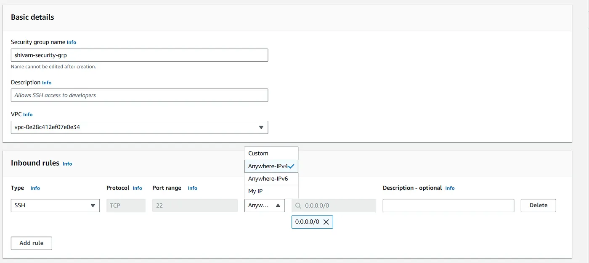

### 3. `todo-app-sg` (the ASG instances)

| Direction | Type | Port | Source |
|---|---|---|---|
| Inbound | Custom TCP | 3000 | **`todo-alb-sg`** (pick the security group, not an IP) |
| Outbound | All traffic | all | `0.0.0.0/0` (default, needed to reach Atlas through the NAT) |

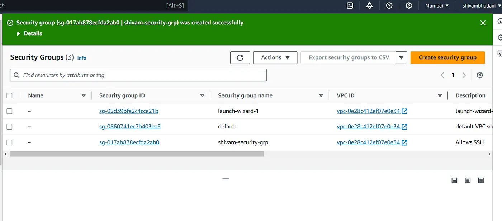

There is no SSH rule on `todo-app-sg`, and the instances have no public IPs. The only way to reach them is through the load balancer on port 3000. This is the key difference from the Medium article, where the instances were public.

---

## Step 7: Key pair and optional private-instance access

### Key pair (needed to SSH into the build box)

**EC2 → Key pairs → Create key pair.** Name `todo-key`, type RSA (or ED25519), format `.pem`. Save the file and run `chmod 400 todo-key.pem`.

### Optional: SSH into private instances later (EC2 Instance Connect Endpoint)

Private instances have no public IP, so for debugging you need a way in without a bastion host. An **EC2 Instance Connect Endpoint** gives you that from the console or CLI.

1. Create a security group `todo-eice-sg` in `todo-vpc` with no inbound rules and one outbound rule: SSH (22) to `todo-app-sg`.
2. Edit `todo-app-sg` and add an inbound rule: SSH (22) from `todo-eice-sg`.
3. **VPC → Endpoints → Create endpoint**, Service category **EC2 Instance Connect Endpoint**, VPC `todo-vpc`, security group `todo-eice-sg`, subnet `todo-private-a`.
4. Later, select an instance → **Connect → EC2 Instance Connect → Connect using EC2 Instance Connect Endpoint**. The instance needs a key pair in its launch template only if you want to use SSH with your own key; Instance Connect pushes a temporary key for you.

You can skip this and rely on logs through the ALB, but it makes troubleshooting much easier. There may be an hourly charge for the endpoint, check current pricing.

---

## Step 8: Build the AMI

An AMI is a snapshot of a configured server. You will configure one server (Ubuntu + Node.js + PM2 + your code), then turn it into an image that every ASG instance starts from.

### 8.1 Launch the build instance

**EC2 → Instances → Launch instances.**

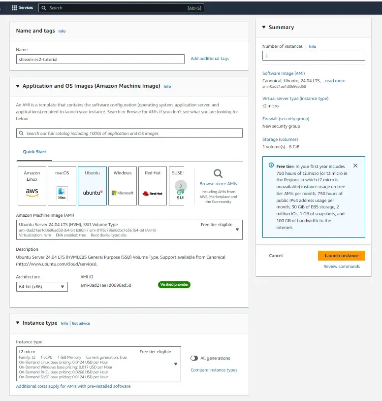

| Setting | Value |
|---|---|
| Name | `todo-build` |
| AMI | **Ubuntu Server 24.04 LTS** |
| Instance type | `t3.micro` (or `t2.micro` if that is your free-tier type) |
| Key pair | `todo-key` |
| Network | VPC `todo-vpc`, subnet **`todo-public-a`**, **Auto-assign public IP: Enable** |
| Security group | existing: `todo-build-sg` |
| Storage | default (8 GiB gp3) |

The build box goes in a **public** subnet only so you can SSH in and download packages. The final instances will be private.

### 8.2 SSH in

```bash
ssh -i todo-key.pem ubuntu@<build-instance-public-ip>
```

### 8.3 `deploy/build-ami.sh`

This script is in your repo under `deploy/`. Because the repo is not on the box yet, create the file by pasting it:

```bash
nano build-ami.sh      # paste the script below, save with Ctrl+O, Enter, Ctrl+X
```

```bash
#!/usr/bin/env bash
# Runs ON THE BUILD INSTANCE (as root) to prepare the golden image.
set -euo pipefail
export DEBIAN_FRONTEND=noninteractive

REPO_URL="${REPO_URL:?Set REPO_URL, e.g. https://github.com/you/todo-api.git}"
BRANCH="${BRANCH:-master}"
APP_DIR=/opt/todo-api

echo "==> System packages"
apt-get update -y
apt-get upgrade -y
apt-get install -y curl git ca-certificates gnupg

echo "==> Node.js 22 and PM2"
curl -fsSL https://deb.nodesource.com/setup_22.x | bash -
apt-get install -y nodejs
npm install -g pm2

echo "==> App code ($REPO_URL, branch $BRANCH)"
rm -rf "$APP_DIR"
git clone --depth 1 --branch "$BRANCH" "$REPO_URL" "$APP_DIR"
cd "$APP_DIR"
git rev-parse HEAD > .deployed-commit

# Do not keep a token inside the image: reset the remote to the plain URL
git remote set-url origin "${REPO_URL}" 2>/dev/null || true

echo "==> Production dependencies"
if [ -f package-lock.json ]; then npm ci --omit=dev; else npm install --omit=dev; fi

echo "==> PM2 starts on every boot (the app itself is started by user data, once .env exists)"
env PATH="$PATH:/usr/bin" pm2 startup systemd -u root --hp /root
systemctl enable pm2-root

echo "==> Done. Deployed commit: $(cat .deployed-commit)"
```

Run it as root:

```bash
sudo REPO_URL=https://github.com/YOUR_GITHUB_USER/todo-api.git BRANCH=master bash build-ami.sh
```

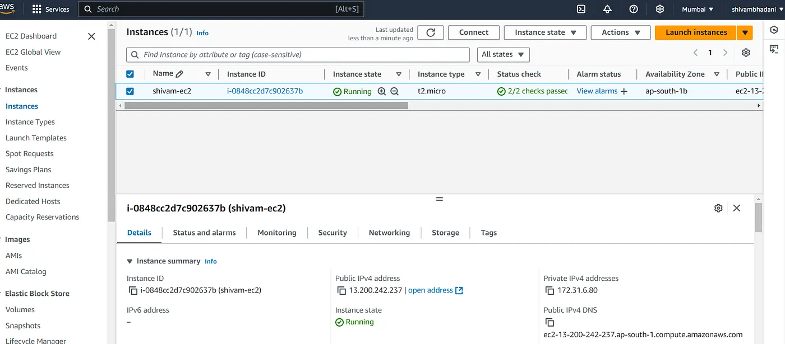

For a private repo, use `REPO_URL=https://<TOKEN>@github.com/YOUR_USER/todo-api.git` with a read-only token. The script resets the remote URL afterwards so the token is not left in `/opt/todo-api/.git/config`. Delete the shell history afterwards (`history -c`) too.

### 8.4 Optional smoke test (recommended once)

This proves the code works before you freeze it. It needs the build box to reach Atlas, so temporarily allow its public IP.

1. In Atlas Network Access, add the build box's public IP (`curl -s ifconfig.me` on the box).
2. On the box:

   ```bash
   cd /opt/todo-api
   sudo bash -c 'cat > .env <<EOF
   PORT=3000
   NODE_ENV=production
   MONGODB_URI=PASTE_YOUR_URI
   JWT_SECRET=temporary-test-secret
   EOF'
   sudo pm2 start ecosystem.config.cjs
   sleep 5
   curl -s localhost:3000/ready      # expect {"db":"connected", ...}
   ```
3. Remove the temporary Atlas entry afterwards.

### 8.5 Clean the box before imaging (do not skip)

Never bake secrets into an AMI. Remove the `.env`, stop PM2 and empty its saved process list, and reset cloud-init so user data runs again on every new instance.

```bash
sudo pm2 delete all || true
sudo pm2 save --force
sudo rm -f /opt/todo-api/.env
sudo cloud-init clean --logs
sudo rm -f /home/ubuntu/build-ami.sh
history -c
```

### 8.6 Create the image

1. Back in the console: select `todo-build` → **Actions → Image and templates → Create image**.

   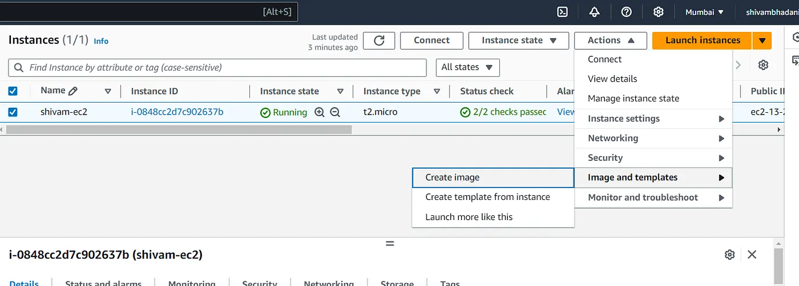

2. Image name `todo-api-ami`, description `Ubuntu 24.04 + Node 22 + PM2 + todo-api`. Leave **No reboot** unticked (a reboot makes the snapshot consistent). Click **Create image**.

   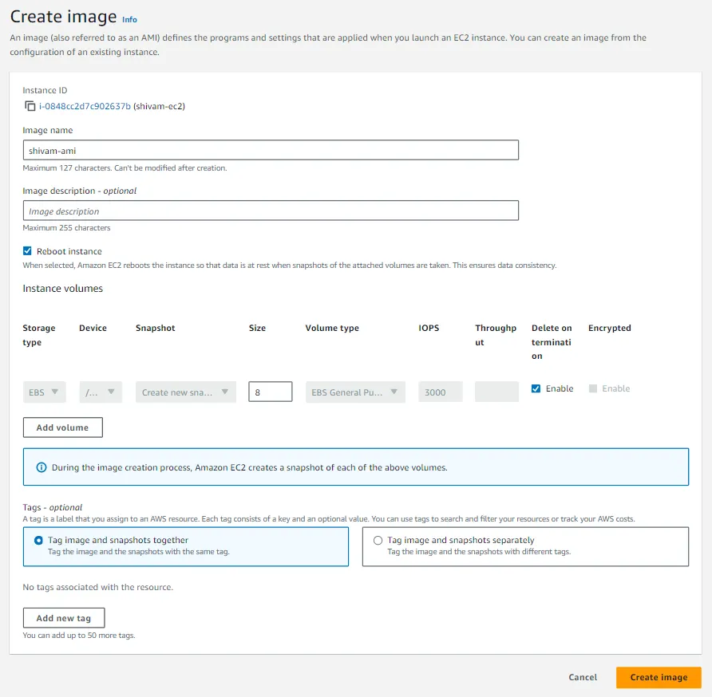

3. **EC2 → Images → AMIs**. Wait until `todo-api-ami` shows status **Available**.

   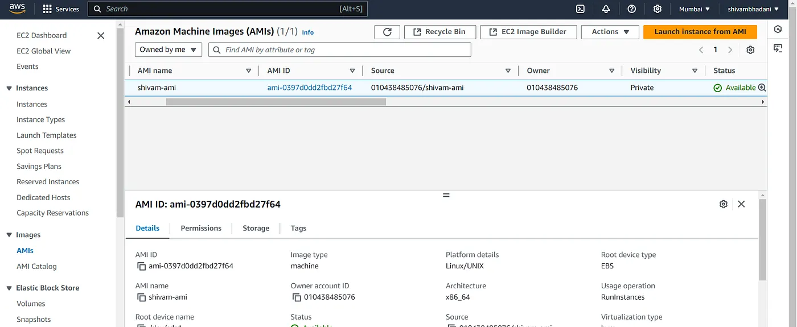

4. Terminate `todo-build` (**Instance state → Terminate instance**). You no longer need it, and it keeps billing while it runs.

---

## Step 9: The user data script (.env)

User data is a script that EC2 runs **once, as root, on the first boot** of each new instance. Here it writes the `.env` file with your secrets, then starts the app with PM2. Every instance the ASG launches does this automatically.

### `deploy/user-data.sh`

```bash
#!/bin/bash
# EC2 user data. Runs once, as root, on first boot of every instance.
# Do NOT add "set -x": it would print your secrets into the log.
set -eu

# ======== EDIT THESE VALUES, then paste the whole script into the launch template ========
MONGODB_URI='mongodb+srv://<db-user>:<db-password>@<cluster-host>/tododb?retryWrites=true&w=majority'
JWT_SECRET='PASTE_OUTPUT_OF__openssl_rand_-base64_48'
JWT_EXPIRES_IN='1h'
# ===========================================================================================

APP_DIR=/opt/todo-api
export HOME=/root

# Write the .env file the app reads (src/config.js loads <project root>/.env)
cat > "$APP_DIR/.env" <<EOF
PORT=3000
NODE_ENV=production
MONGODB_URI=${MONGODB_URI}
JWT_SECRET=${JWT_SECRET}
JWT_EXPIRES_IN=${JWT_EXPIRES_IN}
EOF
chmod 600 "$APP_DIR/.env"

# Start the app under PM2 and remember it across reboots
cd "$APP_DIR"
pm2 start ecosystem.config.cjs
pm2 save
```

Generate the JWT secret on your own machine and paste it into the script:

```bash
openssl rand -base64 48
```

Notes on this script:

- The heredoc is unquoted on purpose, so the shell inserts the values once and leaves special characters inside them untouched.
- Do not wrap the values in extra quotes inside the heredoc, and keep `#` out of the URI (URL-encode it as `%23`), because `.env` parsers treat an unquoted `#` as a comment.
- Output of the script is in `/var/log/cloud-init-output.log` on the instance.
- Anyone who can view the launch template, or who gets shell access to an instance, can read these secrets. See [Notes and trade-offs](#notes-and-trade-offs).
- Keep the real values out of Git. The copy in the repo should only contain the placeholders.

---

## Step 10: Launch template

A launch template is the blueprint the ASG uses for every instance: AMI, instance type, security group, user data.

1. **EC2 → Launch Templates → Create launch template.**

   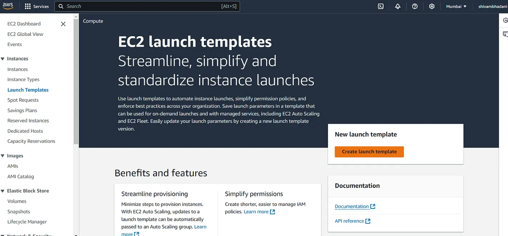

2. **Name and description.** Name `todo-lt`, description `Todo API v1`. Tick **Provide guidance to help me set up a template that I can use with EC2 Auto Scaling**.

   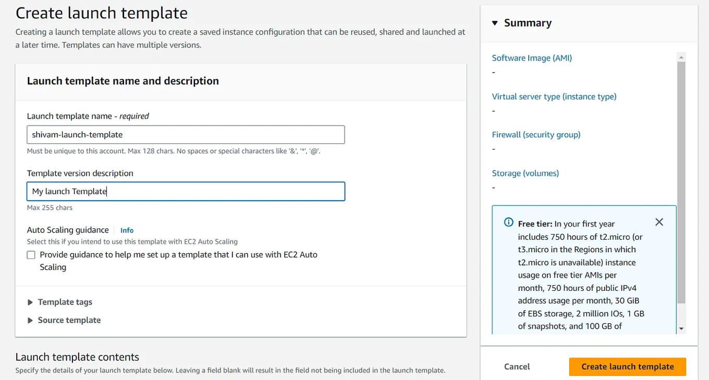

3. **Application and OS Images.** Open **My AMIs** and choose `todo-api-ami`.

   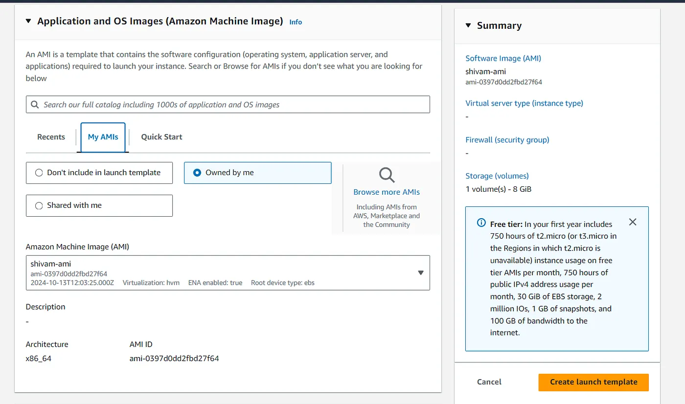

4. **Instance type** `t3.micro` (match what you used for the build box). **Key pair:** `todo-key`, or "Don't include in launch template" if you only use Instance Connect Endpoint.

   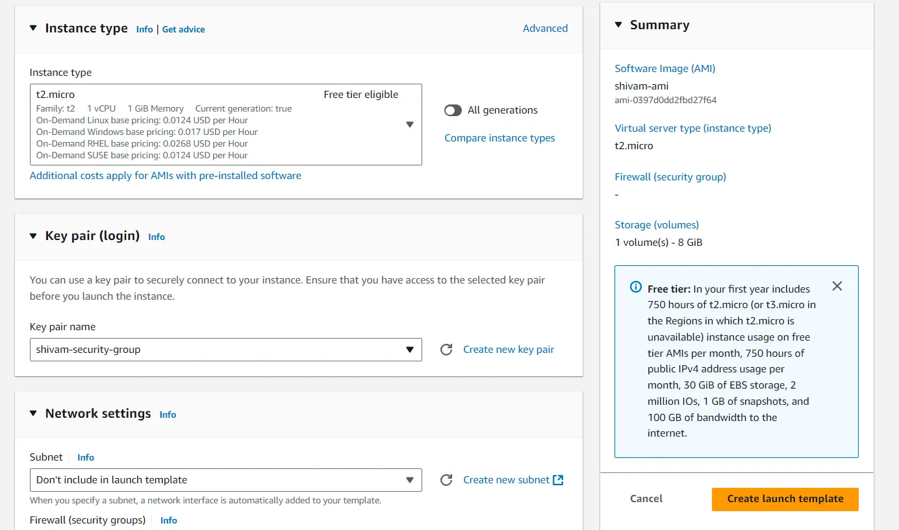

5. **Network settings.** Subnet: **Don't include in launch template** (the ASG chooses the subnets). Security groups: choose **`todo-app-sg`**. Do not enable a public IP.

   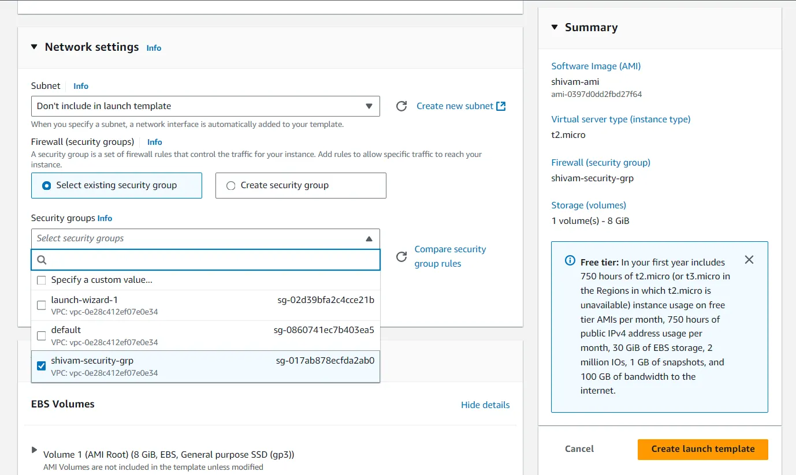

6. **Storage.** Keep the default.
7. **Resource tags** (optional): `Name = todo-api`, tag type Instances.
8. **Advanced details.** Scroll down and set:
   - **Metadata version:** `V2 only (token required)`. This is a security hardening for the instance metadata service, where user data is readable.
   - **User data:** paste your edited `user-data.sh` script.

   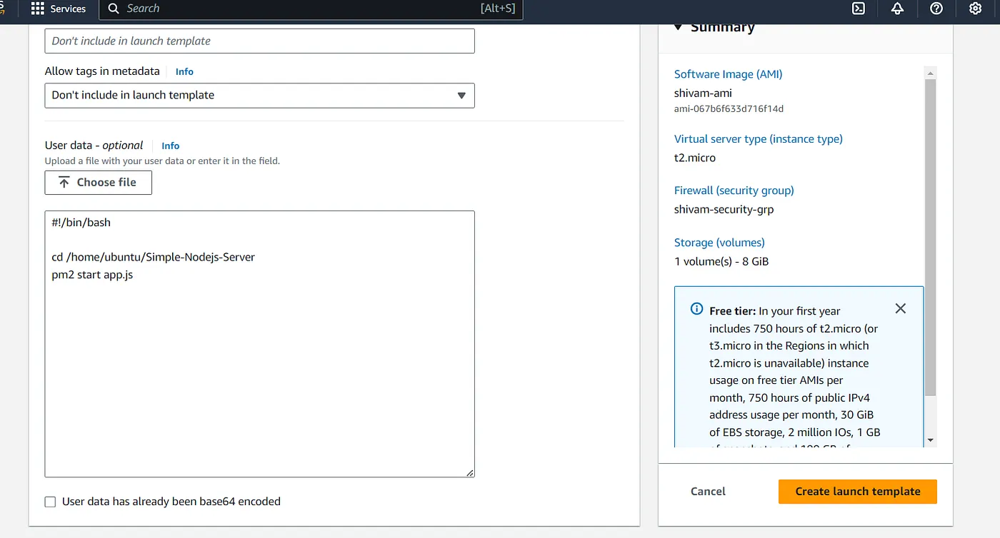

9. Click **Create launch template**.

   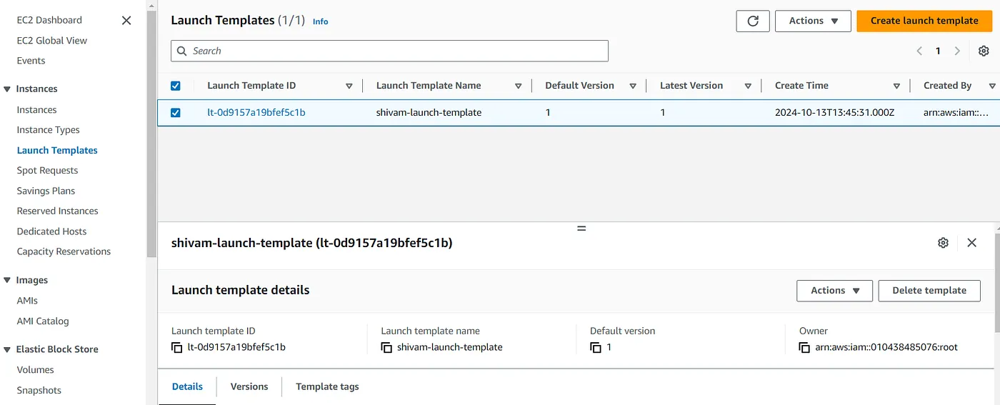

Optional sanity check: **Actions → Launch instance from template** into a private subnet and look at its logs. You can skip it, since the ASG will do exactly this in Step 13.

---

## Step 11: Target group

The target group is the list of instances the load balancer sends traffic to. The ASG will register and deregister instances in it for you, so you register nothing by hand.

1. **EC2 → Target Groups → Create target group.**

   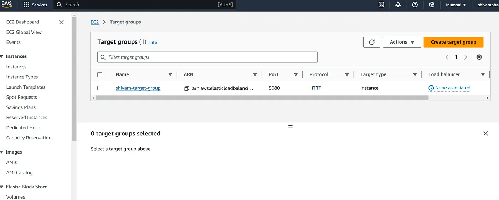

2. Settings:

   | Setting | Value |
   |---|---|
   | Target type | **Instances** |
   | Name | `todo-tg` |
   | Protocol : Port | `HTTP` : `3000` |
   | IP address type | IPv4 |
   | VPC | `todo-vpc` |
   | Protocol version | HTTP1 |
   | Health check protocol | HTTP |
   | Health check path | `/health` |
   | Advanced: healthy threshold | 2 |
   | Advanced: unhealthy threshold | 3 |
   | Advanced: timeout / interval | 5 s / 15 s |
   | Advanced: success codes | 200 |

   

3. Click **Next**, register **no** targets, then **Create target group**.
4. Optional: open the target group → **Attributes** → set **Deregistration delay** to `30` seconds, so scale-in finishes faster (the default is 300).

---

## Step 12: Application Load Balancer

1. **EC2 → Load Balancers → Create load balancer → Application Load Balancer → Create.**

   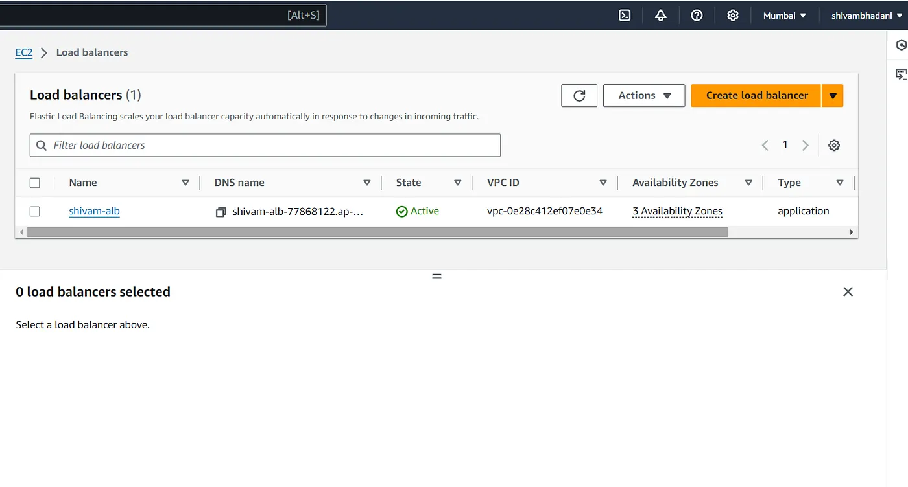

2. Settings:

   | Setting | Value |
   |---|---|
   | Name | `todo-alb` |
   | Scheme | **Internet-facing** |
   | IP address type | IPv4 |
   | VPC | `todo-vpc` |
   | Mappings | tick `ap-south-1a` → **`todo-public-a`** and `ap-south-1b` → **`todo-public-b`** |
   | Security groups | **`todo-alb-sg`** (remove the default one) |
   | Listener | `HTTP : 80` → **Forward to** `todo-tg` |

   The ALB must be placed in the **public** subnets, even though the instances behind it are private.

   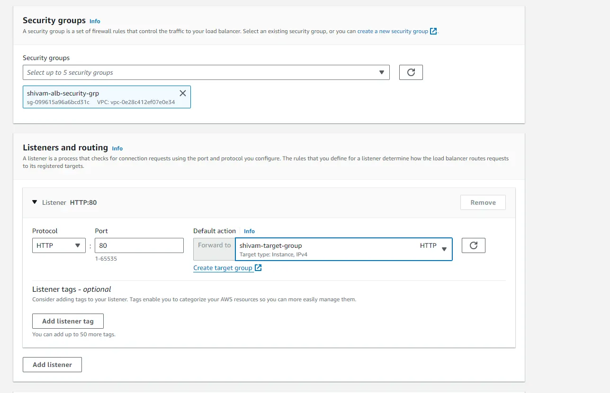

3. Click **Create load balancer**. Wait for the state to become **Active** and copy the **DNS name** (for example `todo-alb-123456789.ap-south-1.elb.amazonaws.com`).

---

## Step 13: Auto Scaling Group

1. **EC2 → Auto Scaling Groups → Create Auto Scaling group.**

   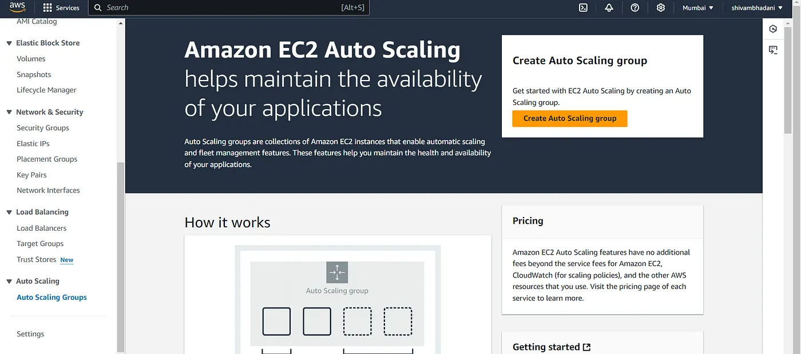

2. **Step 1, name and template.** Name `todo-asg`. Launch template `todo-lt`, version **Default** (or **Latest**). Click **Next**.

   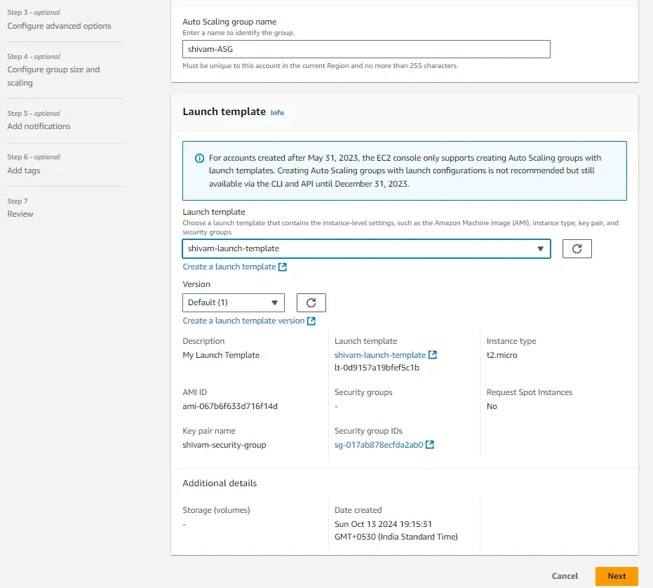

3. **Step 2, network.** VPC `todo-vpc`. **Availability Zones and subnets: select only `todo-private-a` and `todo-private-b`.** Leave **Balanced best effort** selected. Click **Next**.

   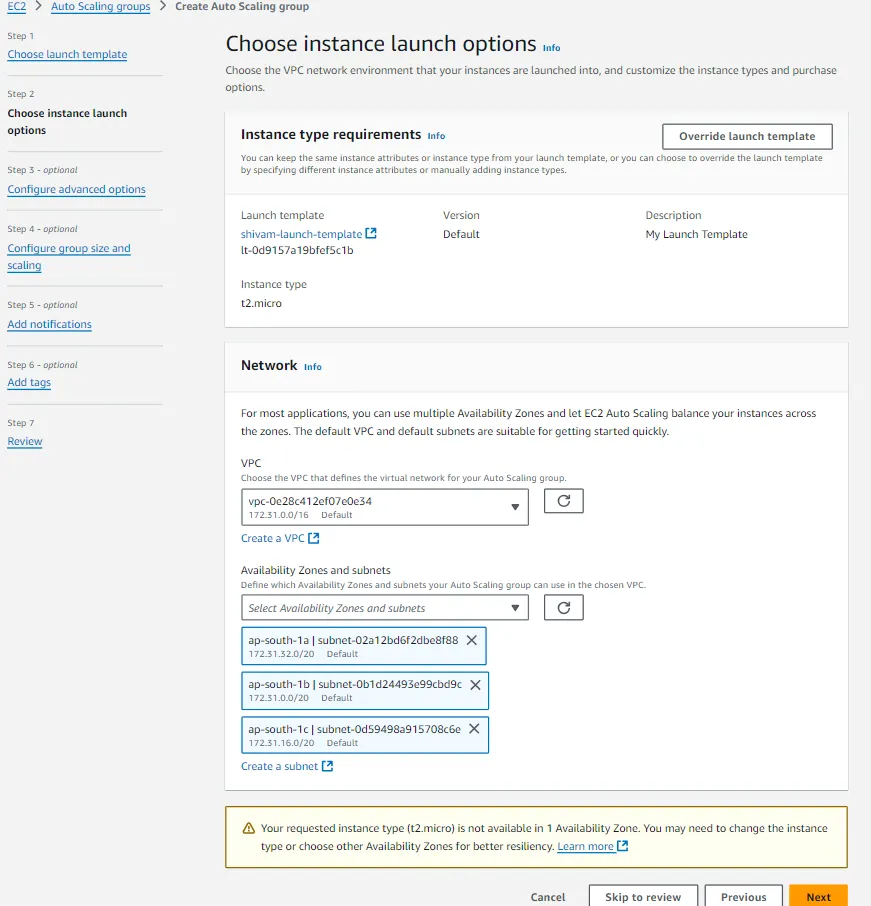

4. **Step 3, load balancing.** Choose **Attach to an existing load balancer → Choose from your load balancer target groups**, then select `todo-tg`. Under **Health checks** tick **Turn on Elastic Load Balancing health checks**. Set the **health check grace period** to `120` seconds. Click **Next**.

   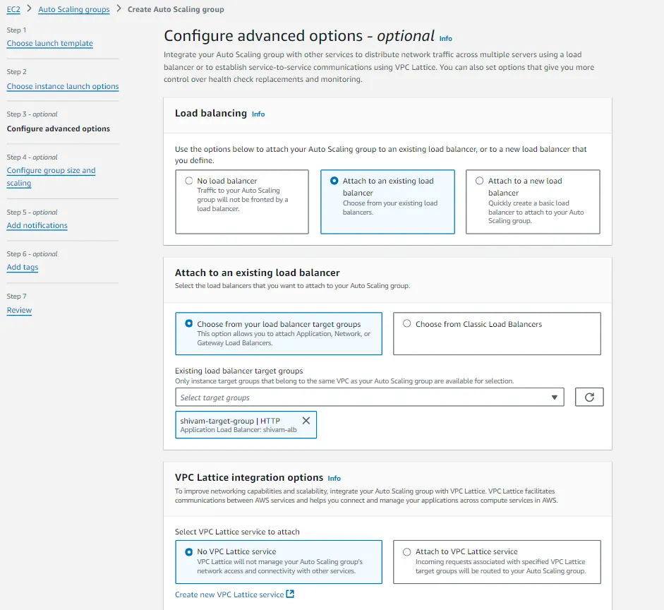

5. **Step 4, size and scaling.**

   | Setting | Value |
   |---|---|
   | Desired capacity | 2 |
   | Minimum capacity | 2 |
   | Maximum capacity | 4 |
   | Automatic scaling | **Target tracking scaling policy** |
   | Metric type | Average CPU utilization |
   | Target value | **60** |
   | Instance warmup | 120 seconds |

   Two instances (one per AZ) is the smallest setup that survives an AZ outage. Click **Next**.

   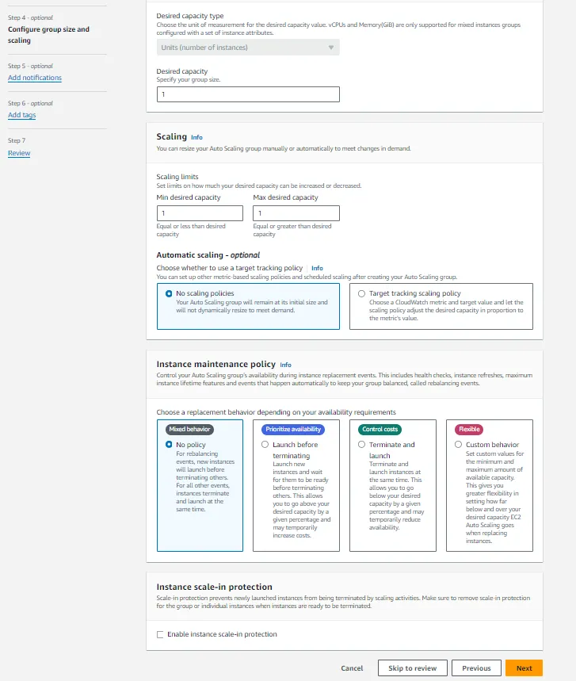

6. **Steps 5 to 6.** Skip notifications. Add the tag `Name = todo-api` (tick **Tag new instances**). Review and click **Create Auto Scaling group**.
7. Open the ASG → **Activity** tab. You will see two instances being launched. Open **Instance management** and wait until both show **InService** and **Healthy**. Then open **EC2 → Target Groups → `todo-tg` → Targets**, where both should be **healthy** within a couple of minutes.

   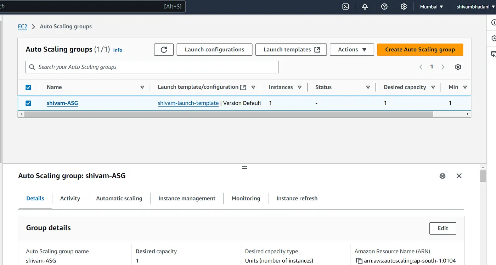

You never created or started an instance yourself. The ASG built them from the launch template, each wrote its own `.env` through user data, and each registered itself with the target group.

---

## Step 14: Test the API

Use the ALB's DNS name.


```bash
ALB=http://todo-alb-123456789.ap-south-1.elb.amazonaws.com

# health (shows which instance answered; run it a few times)
curl $ALB/health

# is the DB connected?
curl $ALB/ready

# register
curl -s -X POST $ALB/api/auth/register \
  -H 'Content-Type: application/json' \
  -d '{"email":"ada@example.com","password":"correct-horse-battery"}'

# login and keep the token
TOKEN=$(curl -s -X POST $ALB/api/auth/login \
  -H 'Content-Type: application/json' \
  -d '{"email":"ada@example.com","password":"correct-horse-battery"}' | jq -r .token)

# create a todo
curl -s -X POST $ALB/api/todos \
  -H "Authorization: Bearer $TOKEN" -H 'Content-Type: application/json' \
  -d '{"title":"Ship it to AWS"}'

# list todos (optionally ?completed=false)
curl -s $ALB/api/todos -H "Authorization: Bearer $TOKEN"

# update, then delete (replace <id>)
curl -s -X PUT $ALB/api/todos/<id> \
  -H "Authorization: Bearer $TOKEN" -H 'Content-Type: application/json' \
  -d '{"completed":true}'
curl -i -X DELETE $ALB/api/todos/<id> -H "Authorization: Bearer $TOKEN"

# no token -> 401
curl -i $ALB/api/todos
```

Run `curl $ALB/health` several times: the `host` value changes between two `ip-10-0-11-x` and `ip-10-0-12-x` names, proving the traffic is split across both private subnets. A token issued by one instance works on the other because both use the same `JWT_SECRET`.

### API reference

| Method | Path | Auth | Description |
|---|---|---|---|
| GET | `/health` | none | Liveness (ALB health check), shows instance hostname |
| GET | `/ready` | none | MongoDB connection status |
| POST | `/api/auth/register` | none | Create user, returns JWT |
| POST | `/api/auth/login` | none | Returns JWT |
| GET | `/api/todos` | JWT | Your todos, optional `?completed=true|false` |
| POST | `/api/todos` | JWT | Create a todo |
| GET | `/api/todos/:id` | JWT | One todo (yours only) |
| PUT | `/api/todos/:id` | JWT | Update `title` and/or `completed` |
| DELETE | `/api/todos/:id` | JWT | Delete a todo |

---

## Step 15: Watch it scale

The policy adds instances when **average CPU across the group** stays above 60%, and removes them when it drops well below.

**Option A, real traffic (simple, may not be enough):**

```bash
npx autocannon -c 200 -d 300 http://<alb-dns>/health
```

Small instances can serve this without reaching 60% CPU, so you may see no scale-out.

**Option B, reliable CPU load on the instances (needs the Instance Connect Endpoint from Step 7):**

1. Connect to each instance (or at least both of the two) using EC2 Instance Connect Endpoint.
2. Run a CPU burner (the private instance reaches the Ubuntu mirrors through the NAT gateway):

   ```bash
   sudo apt-get install -y stress-ng
   stress-ng --cpu 2 --timeout 600s
   ```

3. In the ASG, open **Monitoring** (EC2 tab shows CPU) and **Activity**. After the CloudWatch alarm fires (roughly 3 to 5 minutes of sustained load), the ASG launches extra instances, up to the maximum of 4. When the load stops, it scales back in toward the minimum of 2 after a cooldown.

**Try self-healing too:** terminate one instance from the EC2 console. The ASG notices and launches a replacement within minutes, and the ALB keeps serving from the other instance meanwhile.

---

## Updating the app later

Because the code is baked into the AMI, a code change needs a new image:

1. Push your change to GitHub.
2. Launch a new build instance (Step 8.1), run `build-ami.sh` again, clean it (8.5), create `todo-api-ami-v2` (8.6), terminate the build box.
3. **Launch Templates → `todo-lt` → Actions → Modify template (create new version).** Pick the new AMI. Keep the user data. Save, then set the new version as **default**.
4. **Auto Scaling Groups → `todo-asg` → Instance refresh → Start instance refresh.** Set **Minimum healthy percentage** to `50`, and a warmup of 120 seconds. The ASG replaces instances gradually, so the API stays up.

To change a secret only (no code change), edit the user data in a new launch template version (step 3) and run an instance refresh. Nothing needs rebuilding.

---

## Troubleshooting

| Symptom | Likely cause and fix |
|---|---|
| ALB returns `502` or `503` | No healthy targets yet. Check **Target groups → Targets** and the instance logs. |
| Targets stay **unhealthy** | `todo-app-sg` must allow TCP 3000 from `todo-alb-sg`. Check the target group port is 3000 and health path is `/health`. The app must listen on `0.0.0.0` (it does). |
| App crashes on start, `Failed to start` in logs | Atlas not reachable: the NAT Elastic IP is missing from Atlas Network Access, or the private route table has no `0.0.0.0/0 → nat-...` route. |
| `Missing required environment variable` | The user data script did not run or the `.env` is empty. Look at `/var/log/cloud-init-output.log`. |
| User data did not run on instances launched from the AMI | `cloud-init clean` was skipped before imaging. Rebuild the AMI with step 8.5. |
| ASG keeps launching and terminating instances | The health check grace period (120 s) is too short for boot plus start, or health checks fail. Raise the grace period, then fix the underlying health issue. |
| `Authentication required` on every call | Missing `Authorization: Bearer <token>` header, or the token expired (default 1 hour). |
| Login works on one call and fails the next | Instances have different `JWT_SECRET` values. They must all come from the same launch template user data. |
| `Duplicate`/409 on register | The email is already registered. |
| Can't SSH to ASG instances | By design they are private. Use the EC2 Instance Connect Endpoint (Step 7). |

Useful commands on an instance (through Instance Connect Endpoint):

```bash
sudo tail -100 /var/log/cloud-init-output.log   # user data output
sudo pm2 status
sudo pm2 logs todo-api --lines 100
curl -s localhost:3000/ready
cat /opt/todo-api/.deployed-commit
```

---

## Cleanup

Delete in this order so nothing blocks deletion, and so billing stops. The NAT gateway and load balancer charge by the hour even when idle.


1. **Auto Scaling group:** edit `todo-asg` and set minimum, desired and maximum to **0**. Wait for the instances to terminate, then **Delete** the group.
2. **Launch template:** delete `todo-lt`.
3. **Load balancer:** delete `todo-alb`.
4. **Target group:** delete `todo-tg`.
5. **Instances:** terminate anything left (for example `todo-build`).
6. **AMI:** **EC2 → AMIs → `todo-api-ami` → Deregister AMI**, then **EC2 → Snapshots**, delete the snapshot that belonged to it.
7. **NAT gateway:** **VPC → NAT gateways → Delete**. Wait until it shows **Deleted**, then **VPC → Elastic IPs → Release** the address.
8. **EC2 Instance Connect Endpoint** (if you made one): delete it under **VPC → Endpoints**.
9. **VPC:** **VPC → Your VPCs → `todo-vpc` → Actions → Delete VPC**. The console offers to delete the subnets, route tables and internet gateway with it. First delete the three security groups if the delete is blocked.
10. **Key pair:** delete `todo-key` if you are done with it.
11. **Atlas:** remove the NAT IP entry from Network Access, and remove the database user or the cluster if you no longer need them.

---

## Notes and trade-offs

- **Secrets in user data.** This is the approach you asked for, and it is simple, but understand it: the secrets are stored in the launch template (visible to anyone with EC2 read access to it) and readable from inside any instance. IMDSv2 only (set in the template) reduces SSRF risk, and `.env` is mode 600. Limit IAM access to launch templates, rotate the DB password and JWT secret if exposure is suspected, and consider Secrets Manager or Parameter Store later if the team grows.
- **Running as root.** The app, PM2 and `.env` run as root, which matches the simple setup above. If the app were compromised, the attacker would control the instance. The private subnet and security group limit what can reach it, but a dedicated unprivileged user is a sensible hardening step.
- **One NAT gateway is a single point of failure.** If its AZ goes down, the other AZ's private instances lose outbound access to Atlas. A second NAT (one per AZ) fixes that and doubles the NAT cost. Add its Elastic IP to Atlas too.
- **HTTPS.** The ALB listener is HTTP only. For anything real, request a free certificate in **AWS Certificate Manager**, add an **HTTPS : 443** listener to `todo-alb` (and open 443 in `todo-alb-sg`), and redirect port 80 to 443. JWTs in headers should never travel over plain HTTP.
- **Cost.** The NAT gateway, the ALB and the EC2 instances all bill per hour, and the NAT also bills per GB. Always run the cleanup steps when you are done experimenting, and check current AWS pricing for your region.
- **Burstable instances.** `t3` instances can run in "unlimited" credit mode and bill for extra CPU if they stay busy. That is fine for a demo, but keep it in mind for sustained load.
- **Scaling signal.** CPU is a decent default. For an I/O-bound API you might scale on `ALBRequestCountPerTarget` instead (the ASG policy dialog offers it as a metric type).