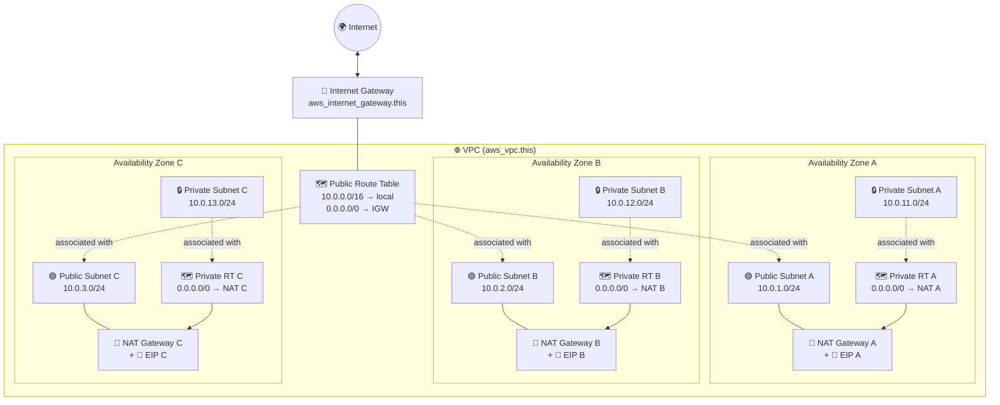
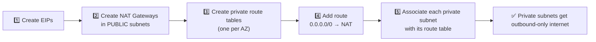
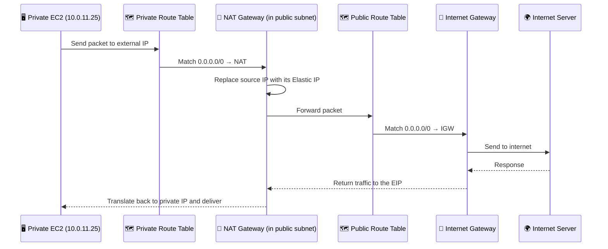
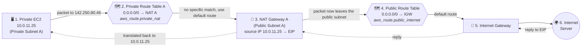
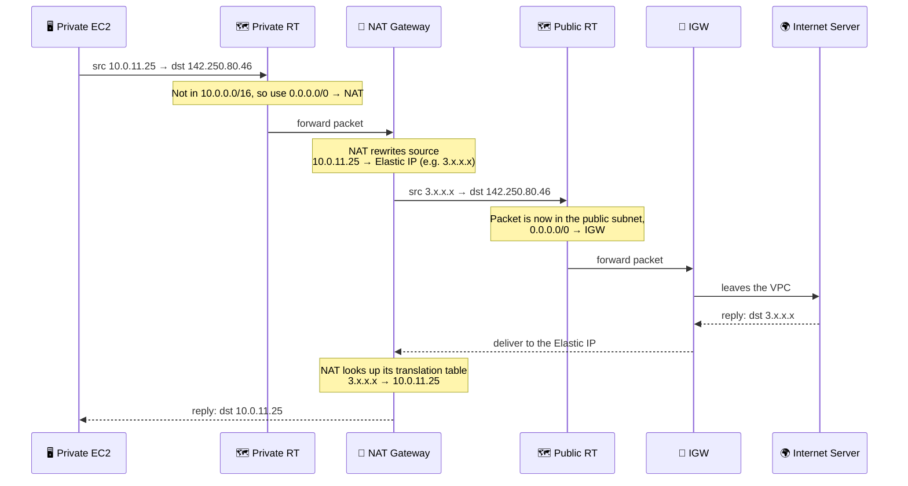

# AWS VPC Networking with Terraform: Code and Routing Logic Explained

This guide walks through a Terraform module that builds a VPC with **public subnets**, **private subnets**, an **Internet Gateway (IGW)**, **NAT Gateways**, and the **route tables** that tie them together.

---

## 1. Big Picture

| Layer | Purpose |
|---|---|
| 🌐 **VPC** | The isolated virtual network that holds everything |
| 🚪 **Internet Gateway (IGW)** | Door between the VPC and the internet |
| 🟢 **Public subnets** | Subnets whose route table sends `0.0.0.0/0` to the IGW |
| 🔒 **Private subnets** | Subnets with no direct internet route; outbound goes through NAT |
| 📍 **Elastic IP (EIP)** | Static public IPv4 address used by each NAT Gateway |
| 🔁 **NAT Gateway** | Lets private instances start outbound connections; blocks unsolicited inbound |
| 🗺️ **Route tables** | Rules that decide where traffic goes |

> **Key idea:** a subnet is "public" or "private" only because of **which route table it is associated with**, not because of its name or tag.

---

## 2. Architecture Diagram (3 AZs, one NAT per AZ)



*(Example CIDRs assume `var.vpc_cidr = "10.0.0.0/16"`.)*

---

## 3. Step-by-Step Code Explanation

### 3.1 VPC

```hcl
resource "aws_vpc" "this" {
  cidr_block           = var.vpc_cidr
  enable_dns_hostnames = true
  enable_dns_support   = true
  tags = { Name = "${local.name}-vpc" }
}
```

| Argument | Meaning |
|---|---|
| `cidr_block` | The VPC's IP range, for example `10.0.0.0/16` |
| `enable_dns_support` | Enables the Amazon DNS resolver inside the VPC |
| `enable_dns_hostnames` | Gives instances with public IPs DNS hostnames |
| `tags` | Readable name, such as `myapp-vpc` |

Every other resource references this VPC through `aws_vpc.this.id`.

---

### 3.2 Internet Gateway

```hcl
resource "aws_internet_gateway" "this" {
  vpc_id = aws_vpc.this.id
  tags   = { Name = "${local.name}-igw" }
}
```

Creating an IGW with `vpc_id` also **attaches** it to the VPC. At this point it does nothing yet, because no route table points to it.

---

### 3.3 Public Subnets

```hcl
resource "aws_subnet" "public" {
  count                   = var.az_count
  vpc_id                  = aws_vpc.this.id
  availability_zone       = local.azs[count.index]
  cidr_block              = cidrsubnet(var.vpc_cidr, 8, count.index + 1)
  map_public_ip_on_launch = true
  tags = {
    Name = "${local.name}-public-${substr(local.azs[count.index], -1, -1)}"
    Tier = "public"
  }
}
```

| Piece | Explanation |
|---|---|
| `count = var.az_count` | One subnet per AZ. With `az_count = 3`, `count.index` is 0, 1, 2 |
| `availability_zone = local.azs[count.index]` | Subnet 0 goes in the first AZ, subnet 1 in the second, and so on |
| `cidrsubnet(var.vpc_cidr, 8, count.index + 1)` | Splits the VPC CIDR by adding 8 bits to the prefix. A `/16` becomes `/24` subnets. The last argument selects which one |
| `map_public_ip_on_launch = true` | Instances launched here automatically receive a public IPv4 address |
| `substr(..., -1, -1)` | Takes the last character of the AZ name, so `us-east-1a` becomes `a` |
| `Tier = "public"` | A label for filtering and organization. It does **not** make the subnet public |

**CIDR result for `10.0.0.0/16`:**

| `count.index` | Calculation | Public subnet CIDR |
|---|---|---|
| 0 | `cidrsubnet(…, 8, 1)` | `10.0.1.0/24` |
| 1 | `cidrsubnet(…, 8, 2)` | `10.0.2.0/24` |
| 2 | `cidrsubnet(…, 8, 3)` | `10.0.3.0/24` |

---

### 3.4 Private Subnets

```hcl
resource "aws_subnet" "private" {
  count                   = var.az_count
  vpc_id                  = aws_vpc.this.id
  availability_zone       = local.azs[count.index]
  cidr_block              = cidrsubnet(var.vpc_cidr, 8, count.index + 11)
  map_public_ip_on_launch = false
  ...
}
```

This is the same pattern as the public subnets, with two differences:

- **Offset of 11** (`count.index + 11`) keeps the private ranges separate from the public ones.
- **`map_public_ip_on_launch = false`**: instances never get a public IP.

| `count.index` | Private subnet CIDR |
|---|---|
| 0 | `10.0.11.0/24` |
| 1 | `10.0.12.0/24` |
| 2 | `10.0.13.0/24` |

---

## 4. The Routing Logic (the important part)

### 4.1 Public routing: IGW → route table → subnets

```hcl
resource "aws_route_table" "public" {
  vpc_id = aws_vpc.this.id
  tags   = { Name = "${local.name}-rtb-public" }
}

resource "aws_route" "public_internet" {
  route_table_id         = aws_route_table.public.id
  destination_cidr_block = "0.0.0.0/0"
  gateway_id             = aws_internet_gateway.this.id
}

resource "aws_route_table_association" "public" {
  count          = var.az_count
  subnet_id      = aws_subnet.public[count.index].id
  route_table_id = aws_route_table.public.id
}
```

Think of it as three steps:

| Step | Resource | What it does |
|---|---|---|
| 1 | 🚪 `aws_internet_gateway.this` | Creates the IGW and attaches it to the VPC |
| 2 | 🗺️ `aws_route_table.public` + `aws_route.public_internet` | Creates **one** shared public route table and adds the rule `0.0.0.0/0 → IGW` |
| 3 | 🔗 `aws_route_table_association.public` | Links **each** public subnet to that route table |


**Why one route table for all public subnets?** They all behave the same way: internet traffic goes to the IGW. There is no per-AZ difference, so one table is enough.

---

### 4.2 Private routing: NAT → route tables → subnets

```hcl
resource "aws_eip" "nat" {
  count      = local.nat_count
  domain     = "vpc"
  depends_on = [aws_internet_gateway.this]
}

resource "aws_nat_gateway" "this" {
  count         = local.nat_count
  allocation_id = aws_eip.nat[count.index].id
  subnet_id     = aws_subnet.public[count.index].id
  depends_on    = [aws_internet_gateway.this]
}

resource "aws_route_table" "private" {
  count  = var.az_count
  vpc_id = aws_vpc.this.id
}

resource "aws_route" "private_nat" {
  count                  = var.enable_nat_gateway ? var.az_count : 0
  route_table_id         = aws_route_table.private[count.index].id
  destination_cidr_block = "0.0.0.0/0"
  nat_gateway_id         = aws_nat_gateway.this[var.single_nat_gateway ? 0 : count.index].id
}

resource "aws_route_table_association" "private" {
  count          = var.az_count
  subnet_id      = aws_subnet.private[count.index].id
  route_table_id = aws_route_table.private[count.index].id
}
```

| Step | Resource | What it does |
|---|---|---|
| 1 | 📍 `aws_eip.nat` | Allocates `nat_count` Elastic IPs |
| 2 | 🔁 `aws_nat_gateway.this` | Creates NAT Gateways **in the public subnets**, each using one EIP |
| 3 | 🗺️ `aws_route_table.private` | Creates **one private route table per AZ** |
| 4 | ➡️ `aws_route.private_nat` | Adds `0.0.0.0/0 → NAT Gateway` to each private route table |
| 5 | 🔗 `aws_route_table_association.private` | Links each private subnet to **its own** AZ's private route table |



> **Why is the NAT Gateway in a *public* subnet?**
> The NAT Gateway itself needs internet access. Its public subnet's route table sends `0.0.0.0/0` to the IGW, so the NAT can reach the internet on behalf of private instances.

---

## 5. How `count` and the NAT Selection Work

### 5.1 `count.index` links resources together

Resources created with `count` are matched by index:

```
aws_subnet.private[0]  ↔  aws_route_table.private[0]  ↔  aws_nat_gateway.this[0]
aws_subnet.private[1]  ↔  aws_route_table.private[1]  ↔  aws_nat_gateway.this[1]
aws_subnet.private[2]  ↔  aws_route_table.private[2]  ↔  aws_nat_gateway.this[2]
```

This only holds when there is one NAT per AZ.

### 5.2 The ternary in `aws_route.private_nat`

```hcl
count          = var.enable_nat_gateway ? var.az_count : 0
nat_gateway_id = aws_nat_gateway.this[var.single_nat_gateway ? 0 : count.index].id
```

**Part 1: should routes exist at all?**

| `enable_nat_gateway` | Routes created |
|---|---|
| `true` | `az_count` routes, one per private route table |
| `false` | `0`, so private subnets have **no** internet access |

**Part 2: which NAT does each route use?**

| `single_nat_gateway` | NAT used by private RT A / B / C | Result |
|---|---|---|
| `true` | NAT `[0]` / NAT `[0]` / NAT `[0]` | All AZs share one NAT (cheaper) |
| `false` | NAT `[0]` / NAT `[1]` / NAT `[2]` | Each AZ uses its own NAT (resilient) |

### 5.3 What `local.nat_count` should be

`local.nat_count` is not shown in your code. It is normally defined in a `locals` block like this:

```hcl
locals {
  nat_count = var.enable_nat_gateway ? (var.single_nat_gateway ? 1 : var.az_count) : 0
}
```

| `enable_nat_gateway` | `single_nat_gateway` | `nat_count` | NATs and EIPs created |
|---|---|---|---|
| `false` | any | 0 | none |
| `true` | `true` | 1 | 1 |
| `true` | `false` | `az_count` | one per AZ |

This is why the index `[0]` is always valid when `single_nat_gateway = true`, and why `[count.index]` is valid otherwise. **Verify that your `locals` block matches this**, or Terraform will fail with an "index out of range" error.

---

## 6. Resulting Route Tables

| Route table | Destination | Target | Meaning |
|---|---|---|---|
| **Public RT** (shared) | `10.0.0.0/16` | `local` | Traffic inside the VPC |
| | `0.0.0.0/0` | IGW | Everything else goes to the internet |
| **Private RT A** | `10.0.0.0/16` | `local` | Traffic inside the VPC |
| | `0.0.0.0/0` | NAT A | Outbound internet via NAT A |
| **Private RT B** | `10.0.0.0/16` | `local` | Traffic inside the VPC |
| | `0.0.0.0/0` | NAT B *(or NAT A if single NAT)* | Outbound internet |
| **Private RT C** | `10.0.0.0/16` | `local` | Traffic inside the VPC |
| | `0.0.0.0/0` | NAT C *(or NAT A if single NAT)* | Outbound internet |

The `local` route is added by AWS automatically. You do not define it in Terraform.

---

## 7. Traffic Flow: Private EC2 Downloads an Update



A NAT Gateway handles **outbound-initiated connections and their replies**. It does not allow unsolicited inbound connections from the internet to private instances. Security groups and NACLs must still allow the traffic.

---

## 8. Why `depends_on = [aws_internet_gateway.this]`?

```hcl
depends_on = [aws_internet_gateway.this]   # on aws_eip.nat and aws_nat_gateway.this
```

- Terraform already knows the NAT must come after the EIP and subnet, because it references them.
- It does **not** know the NAT also needs a working internet path, because nothing references the IGW.
- `depends_on` makes Terraform create and attach the IGW first.
- It controls **creation order only**. It does not create any route.

---

## 9. Single NAT vs. NAT per AZ

| | Single NAT (`single_nat_gateway = true`) | NAT per AZ (`false`) |
|---|---|---|
| NAT Gateways | 1 | One per AZ |
| Hourly cost | Lower | Higher |
| Resilience | If that NAT's AZ fails, all private subnets lose internet | Failure is isolated to one AZ |
| Cross-AZ data charges | Possible for other AZs | Generally avoided |
| Best for | Dev and test | Production |

---

## 10. Quick Summary

```
🚪 IGW  ──route 0.0.0.0/0──►  🗺️ Public RT  ──associated with──►  🟢 Public subnets
                                                                        │
                                                                🔁 NAT Gateways + 📍 EIPs live here
                                                                        ▲
🔒 Private subnets ──associated with──► 🗺️ Private RTs ──route 0.0.0.0/0──┘
```

| Resource | One-line role |
|---|---|
| `aws_vpc` | The network boundary |
| `aws_internet_gateway` | VPC's door to the internet |
| `aws_subnet.public` | Subnets that will route to the IGW |
| `aws_subnet.private` | Subnets that will route to NAT |
| `aws_route_table.public` + `aws_route` | Rule: internet goes to the IGW |
| `aws_route_table_association.public` | Makes the subnets actually public |
| `aws_eip` | Fixed public IP for each NAT |
| `aws_nat_gateway` | Outbound-only internet for private subnets |
| `aws_route_table.private` + `aws_route.private_nat` | Rule: internet goes to NAT |
| `aws_route_table_association.private` | Makes the subnets use NAT |

---

## 11. Common Questions (Q&A)

### Q1. "Adds `0.0.0.0/0 → NAT Gateway` to each private route table": what does this mean?

**A:** It means: *"any traffic from this subnet that isn't headed somewhere inside the VPC should be handed to the NAT Gateway."*

- **`0.0.0.0/0`** is a CIDR block that matches every IPv4 address. It is the **default route**, the catch-all.
- Route tables always pick the **most specific match first**:

| Destination of packet | Matching route | Result |
|---|---|---|
| `10.0.12.7` (another instance in the VPC) | `10.0.0.0/16 → local` (more specific) | Stays inside the VPC |
| `142.250.80.46` (e.g. google.com) | Nothing specific, so falls to `0.0.0.0/0` | Sent to the NAT Gateway |

- **`→ NAT Gateway`** is the target. It says where the fall-through traffic goes: to the NAT Gateway, not directly to the internet.

When a private EC2 instance runs something like `yum update`, the route table says "not a VPC address, send it to the NAT Gateway." The NAT Gateway (in a public subnet) swaps the instance's private IP for its own Elastic IP, then the traffic continues to the Internet Gateway. The reply is translated back and delivered to the instance.

**Why add it to the *private* route tables?** Private subnets have no internet route of their own. Without this line they can only talk to things inside the VPC. With it, they can reach out, but nothing on the internet can start a connection back in.

**Comparison with the public route table:** it has the same catch-all, but the target is the Internet Gateway: `0.0.0.0/0 → IGW`. That difference in target is what makes one subnet public and the other private.

---

### Q2. So from the NAT Gateway, does traffic go to the IGW?

**A:** Yes, but the NAT Gateway doesn't send traffic to the IGW directly. The **route table of the subnet the NAT Gateway lives in** does that.

1. The private instance's packet reaches the NAT Gateway (via the private route table's `0.0.0.0/0 → NAT`).
2. The NAT Gateway swaps the source IP from the instance's private IP to its own Elastic IP.
3. The NAT Gateway sits in a **public subnet**, so the packet is now routed by that subnet's route table, which has `0.0.0.0/0 → IGW`.
4. The IGW passes the packet out to the internet.

That is why the NAT Gateway must be placed in a public subnet (`subnet_id = aws_subnet.public[...]`). In a private subnet, its route table would have no path to the IGW and the traffic would go nowhere.

It is also why the code has `depends_on = [aws_internet_gateway.this]`: the IGW must exist before the NAT can do its job.

The reply takes the reverse path: internet → IGW → NAT Gateway (which maps the Elastic IP back to the instance's private IP) → private instance.

---

### Q3. In `aws_route.private_nat` we haven't added the IGW. Why?

```hcl
resource "aws_route" "private_nat" {
  count                  = var.enable_nat_gateway ? var.az_count : 0
  route_table_id         = aws_route_table.private[count.index].id
  destination_cidr_block = "0.0.0.0/0"
  nat_gateway_id         = aws_nat_gateway.this[var.single_nat_gateway ? 0 : count.index].id
}
```

**A:** That is intentional. This resource answers only one question: *"where should private subnets send internet-bound traffic?"* The answer is the NAT Gateway, and that is all it needs to say.

The IGW is handled by a **different resource in a different route table**:

```hcl
resource "aws_route" "public_internet" {
  route_table_id         = aws_route_table.public.id
  destination_cidr_block = "0.0.0.0/0"
  gateway_id             = aws_internet_gateway.this.id   # <-- IGW is here
}
```

The chain is split across two route tables:

| Hop | Route table that decides | Terraform resource | Rule |
|---|---|---|---|
| Private EC2 → NAT | Private RT | `aws_route.private_nat` | `0.0.0.0/0 → NAT` |
| NAT → IGW | Public RT | `aws_route.public_internet` | `0.0.0.0/0 → IGW` |

Each route table only describes the **next hop** for traffic leaving its own subnets. By the time a packet leaves the NAT Gateway, it is in the public subnet and the public route table takes over.

The pieces that tie it together:

| Resource / argument | Role |
|---|---|
| `aws_route_table_association.public` | Attaches the public route table to the public subnets, so the NAT Gateway inherits the IGW route |
| `subnet_id = aws_subnet.public[...]` on the NAT Gateway | Places the NAT in one of those public subnets |
| `depends_on = [aws_internet_gateway.this]` | Makes sure the IGW exists before the NAT is created |

> If you removed `aws_route.public_internet`, the private route would still point to the NAT, but the NAT would have no way out, and private instances would silently lose internet access.

---

## 12. Visual: How a Request Travels

### 12.1 Hop-by-hop path (which route table decides each hop)



Solid arrows are the outbound request. Dotted arrows are the reply.

### 12.2 What happens to the packet's source address



### 12.3 Terraform resource → traffic hop map

```mermaid
flowchart LR
    subgraph PRIV["🔒 Private subnet<br/><i>aws_subnet.private</i>"]
        EC2["🖥️ EC2<br/>10.0.11.25"]
    end

    PRT{{"🗺️ Private Route Table<br/><i>aws_route_table.private</i><br/>0.0.0.0/0 → NAT"}}

    subgraph PUB["🟢 Public subnet<br/><i>aws_subnet.public</i>"]
        NAT["🔁 NAT Gateway<br/><i>aws_nat_gateway.this</i><br/>+ 📍 EIP <i>(aws_eip.nat)</i>"]
    end

    PUBRT{{"🗺️ Public Route Table<br/><i>aws_route_table.public</i><br/>0.0.0.0/0 → IGW"}}
    IGW["🚪 Internet Gateway<br/><i>aws_internet_gateway.this</i>"]
    NET(("🌍 Internet"))

    EC2 -. "aws_route_table_association.private" .-> PRT
    PRT -- "aws_route.private_nat<br/>(0.0.0.0/0 → NAT)" --> NAT
    NAT -- "NAT lives in public subnet, which uses the<br/>public RT via aws_route_table_association.public" --> PUBRT
    PUBRT -- "aws_route.public_internet<br/>(0.0.0.0/0 → IGW)" --> IGW
    IGW --> NET
```



Dotted line = route table association (which subnet uses which table). Solid lines = the path the packet takes, labelled with the Terraform resource that makes that hop possible.

### 12.4 Summary: who decides what

| Step | Where is the packet? | Who decides the next hop? | Next hop |
|---|---|---|---|
| 1 | Private EC2 | Private route table (via subnet association) | NAT Gateway |
| 2 | NAT Gateway | NAT translates source IP to its Elastic IP | (same device) |
| 3 | Public subnet (where the NAT lives) | Public route table | Internet Gateway |
| 4 | Internet Gateway | IGW | Internet |
| 5 | Reply arrives at IGW | IGW delivers to the Elastic IP | NAT Gateway |
| 6 | NAT Gateway | NAT translation table | Private EC2 |