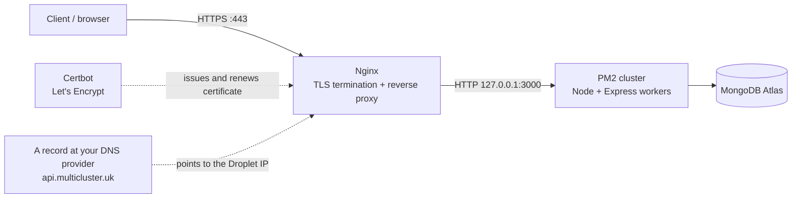
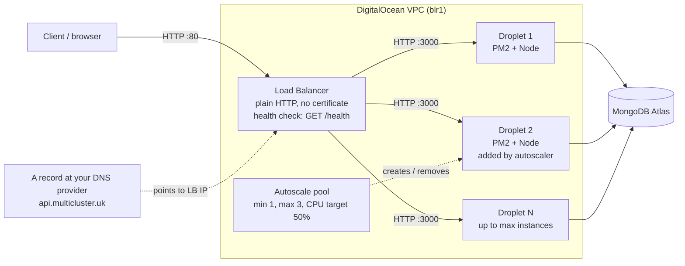
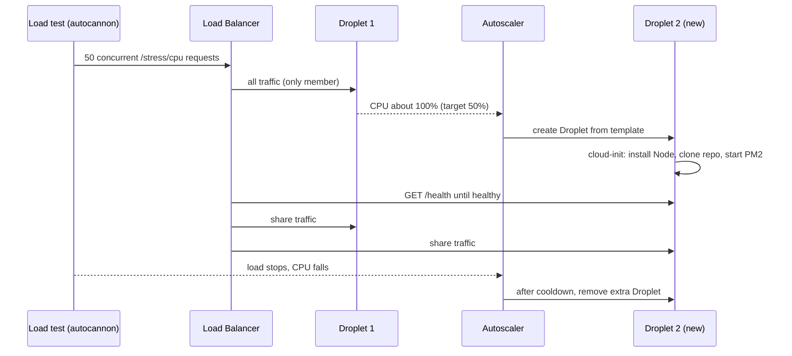
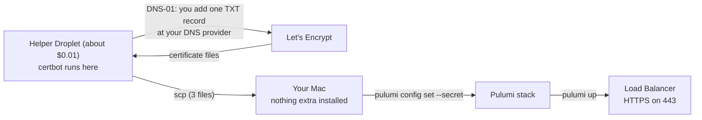

# Express.js Beginner → DevOps: Build, Deploy and Autoscale a Blog API

A hands-on, five-phase guide. You will build a REST API, give it a real database, deploy it by hand, rebuild that deployment as code, and finally put it behind a load balancer with an autoscaling pool, then stress test it until a new server appears.

Everything uses **ESM** (`import` / `export`, `"type": "module"`), including the Pulumi TypeScript code.

| Phase | What you build | Key tools |
|---|---|---|
| 1 | Blog REST API, in-memory data, JWT auth, error-handling middleware | Express 5, jsonwebtoken, bcryptjs |
| 2 | Replace memory with MongoDB Atlas | Atlas, Mongoose |
| 3 | Manual deploy on a DigitalOcean Droplet | PM2, Nginx, Certbot, `api.multicluster.uk` |
| 4 | The same infrastructure as code | Pulumi + TypeScript (ESM) |
| 5 | Load balancer + autoscaling pool + stress test | Pulumi, DO Load Balancer, Droplet Autoscale, autocannon |

## Table of contents

- [Prerequisites](#prerequisites)
- [Final project layout](#final-project-layout)
- [Phase 1: REST API with in-memory DB and JWT](#phase-1-rest-api-with-in-memory-db-and-jwt)
- [Phase 2: MongoDB Atlas and Mongoose](#phase-2-mongodb-atlas-and-mongoose)
- [Phase 3: Manual deployment on a Droplet](#phase-3-manual-deployment-on-a-digitalocean-droplet)
- [Phase 4: Infrastructure as code with Pulumi](#phase-4-infrastructure-as-code-with-pulumi-typescript)
- [Phase 5: Load balancer, autoscaling and stress test](#phase-5-load-balancer-autoscaling-pool-and-stress-test)
- [Troubleshooting](#troubleshooting)
- [Clean-up checklist](#clean-up-checklist)

---

## Prerequisites

| Need | Notes |
|---|---|
| Node.js 22 or newer (24 LTS recommended) | `node -v`. Express 5 needs Node 18+. |
| Git + a GitHub account | Servers will `git clone` your code. **Use a public repo** to keep this guide simple (private repos need deploy keys). |
| DigitalOcean account + API token | Control panel → API → Generate New Token (read + write). |
| Domain `multicluster.uk` | DNS stays with your **current DNS provider** (not DigitalOcean). You only need to add/edit records in its DNS panel. |
| MongoDB Atlas account | Free (M0) tier is enough. |
| Pulumi CLI | Installed in Phase 4. |
| `curl`, `jq`, `openssl` | Command-line tools used in the examples. |
| SSH key pair | You already have `~/.ssh/digital_ocean_key` (private) and `~/.ssh/digital_ocean_key.pub` (public). Private key permissions must be `600`: `chmod 600 ~/.ssh/digital_ocean_key`. |

**Hostname used in this guide:** `api.multicluster.uk` (a subdomain keeps the apex `multicluster.uk` free for a website later). To use the apex instead, replace the hostname everywhere and set `subdomain` to `@` in Phase 4/5.

**DNS:** your DNS stays at your current provider the whole time. In every phase you create or update a single `A` record for `api` there by hand (Pulumi never touches your DNS).

**Servers run as `root`.** To keep the guide shorter we use the `root` account on the servers instead of a separate user. That is simpler but gives an attacker who compromises the app full control of the machine, so treat it as a learning setup.

> **Cost warning.** Droplets and load balancers are billed hourly while they exist. Phases 3-5 cost real money. The [clean-up checklist](#clean-up-checklist) at the end tells you how to tear everything down.

---

## Final project layout

```
blog-api/                      <- the application (Phases 1-3)
├── package.json
├── ecosystem.config.cjs       <- PM2 config (Phase 3)
├── .env                       <- never committed
├── .gitignore
├── scripts/deploy.sh          <- Phase 3
├── src/
│   ├── server.js
│   ├── app.js
│   ├── config/env.js
│   ├── db/connect.js          <- Phase 2
│   ├── models/                <- Phase 2 (Mongoose)
│   │   ├── User.js
│   │   └── Post.js
│   ├── repositories/
│   │   ├── index.js           <- picks memory or mongo backend
│   │   ├── users.memory.js
│   │   ├── posts.memory.js
│   │   ├── users.mongo.js     <- Phase 2
│   │   └── posts.mongo.js     <- Phase 2
│   ├── controllers/
│   │   ├── auth.controller.js
│   │   └── posts.controller.js
│   ├── middleware/
│   │   ├── auth.js
│   │   ├── validate.js
│   │   └── error.js
│   ├── routes/
│   │   ├── auth.routes.js
│   │   ├── posts.routes.js
│   │   └── stress.routes.js   <- Phase 5
│   └── utils/AppError.js
└── infra/                     <- Pulumi project (Phases 4-5), inside the same repo
    ├── Pulumi.yaml
    ├── package.json
    ├── tsconfig.json
    ├── index.ts
    ├── config.ts
    ├── bootstrap.ts
    ├── single.ts              <- Phase 4
    └── autoscale.ts           <- Phase 5
```

---

# Phase 1: REST API with in-memory DB and JWT

**Goal:** a working blog API where users register/login, receive a JWT, and manage their own posts. Data lives in JavaScript `Map`s, so it disappears on restart. That is deliberate: it keeps Phase 1 focused on Express itself.

### Endpoints

| Method | Path | Auth | Purpose |
|---|---|---|---|
| GET | `/health` | no | Liveness check (used later by the load balancer) |
| POST | `/api/auth/register` | no | Create account, returns token |
| POST | `/api/auth/login` | no | Returns token |
| GET | `/api/auth/me` | yes | Current user |
| GET | `/api/posts?page=1&limit=10` | no | List posts (paginated) |
| GET | `/api/posts/:id` | no | One post |
| POST | `/api/posts` | yes | Create post |
| PUT | `/api/posts/:id` | yes (owner) | Update post |
| DELETE | `/api/posts/:id` | yes (owner) | Delete post |

### Concepts you will meet

- **Middleware**: functions `(req, res, next)` that run in order. Auth, validation, logging and error handling are all middleware.
- **Error-handling middleware**: a function with *four* parameters `(err, req, res, next)`. Express recognises it by its arity, so never drop the `next` parameter.
- **Express 5 async support**: if an `async` handler throws or rejects, Express 5 forwards the error to your error middleware automatically. No `try/catch` or `express-async-errors` needed.
- **JWT (JSON Web Token)**: a signed token the client sends as `Authorization: Bearer <token>`. The server verifies the signature; it doesn't store sessions.
- **Repository pattern**: controllers talk to a small interface (`usersRepo`, `postsRepo`). In Phase 2 we swap the implementation without touching controllers.

## 1.1 Create the project

```bash
mkdir blog-api && cd blog-api
git init
npm init -y
npm install express cors helmet morgan jsonwebtoken bcryptjs dotenv
mkdir -p src/{config,controllers,middleware,repositories,routes,utils,db,models} scripts
```

Edit `package.json` so it looks like this (the important parts are `"type": "module"` and the scripts):

```json
{
  "name": "blog-api",
  "version": "1.0.0",
  "private": true,
  "type": "module",
  "main": "src/server.js",
  "engines": { "node": ">=22" },
  "scripts": {
    "dev": "node --watch src/server.js",
    "start": "node src/server.js"
  },
  "dependencies": {
    "bcryptjs": "^3.0.0",
    "cors": "^2.8.5",
    "dotenv": "^17.0.0",
    "express": "^5.1.0",
    "helmet": "^8.0.0",
    "jsonwebtoken": "^9.0.2",
    "morgan": "^1.10.0"
  }
}
```

> Don't worry if `npm install` gave you slightly newer versions. Keep what npm wrote and just add the `type`, `engines` and `scripts` fields.

`.gitignore`:

```gitignore
node_modules
.env
*.log
.DS_Store
```

`.env` (local development only):

```bash
NODE_ENV=development
PORT=3000
JWT_SECRET=replace-me-with-the-output-of-openssl-rand
JWT_EXPIRES_IN=1d
# MONGODB_URI=   <- added in Phase 2. Leave unset to use the in-memory store.
```

Generate a real secret and paste it in:

```bash
openssl rand -hex 48
```

## 1.2 Configuration (`src/config/env.js`)

Fail fast at startup if a required variable is missing, instead of crashing mysteriously on the first request.

```js
import 'dotenv/config';

const required = (name) => {
  const value = process.env[name];
  if (!value) throw new Error(`Missing required environment variable: ${name}`);
  return value;
};

export const env = Object.freeze({
  nodeEnv: process.env.NODE_ENV ?? 'development',
  port: Number(process.env.PORT ?? 3000),
  jwtSecret: required('JWT_SECRET'),
  jwtExpiresIn: process.env.JWT_EXPIRES_IN ?? '1d',
  mongoUri: process.env.MONGODB_URI ?? '',
  enableStress: process.env.ENABLE_STRESS === 'true', // used in Phase 5
});
```

## 1.3 A custom error class (`src/utils/AppError.js`)

Errors you *expect* (bad input, not found, forbidden) are thrown as `AppError` with an HTTP status. Anything else is treated as a bug and returned as a generic 500.

```js
export class AppError extends Error {
  /**
   * @param {string} message  safe to show to the client
   * @param {number} statusCode HTTP status
   * @param {Array<{field?: string, message: string}>} [details]
   */
  constructor(message, statusCode = 500, details) {
    super(message);
    this.name = 'AppError';
    this.statusCode = statusCode;
    this.details = details;
    Error.captureStackTrace?.(this, this.constructor);
  }
}
```

## 1.4 The in-memory "database" (repositories)

`src/repositories/users.memory.js`:

```js
import { randomUUID } from 'node:crypto';

const users = new Map();

export const usersRepo = {
  async create({ name, email, passwordHash }) {
    const user = {
      id: randomUUID(),
      name,
      email,
      passwordHash,
      createdAt: new Date().toISOString(),
    };
    users.set(user.id, user);
    return user;
  },

  async findByEmail(email) {
    return [...users.values()].find((u) => u.email === email) ?? null;
  },

  async findById(id) {
    return users.get(id) ?? null;
  },
};
```

`src/repositories/posts.memory.js`:

```js
import { randomUUID } from 'node:crypto';

const posts = new Map();

export const postsRepo = {
  async create({ title, content, author }) {
    const now = new Date().toISOString();
    const post = { id: randomUUID(), title, content, author, createdAt: now, updatedAt: now };
    posts.set(post.id, post);
    return post;
  },

  async findAll({ page, limit }) {
    const all = [...posts.values()].sort((a, b) => b.createdAt.localeCompare(a.createdAt));
    const start = (page - 1) * limit;
    return { items: all.slice(start, start + limit), total: all.length };
  },

  async findById(id) {
    return posts.get(id) ?? null;
  },

  async update(id, changes) {
    const post = posts.get(id);
    if (!post) return null;
    Object.assign(post, changes, { updatedAt: new Date().toISOString() });
    return post;
  },

  async remove(id) {
    return posts.delete(id);
  },
};
```

`src/repositories/index.js` (the single place controllers import from):

```js
export { usersRepo } from './users.memory.js';
export { postsRepo } from './posts.memory.js';
```

Every method is `async` on purpose. The real database in Phase 2 is asynchronous, so the controllers are already written the right way.

## 1.5 Middleware

### Validation helper (`src/middleware/validate.js`)

```js
import { AppError } from '../utils/AppError.js';

/** Ensures each named field in req.body is a non-empty string. */
export const requireFields =
  (...fields) =>
  (req, _res, next) => {
    const body = req.body ?? {};
    const problems = fields
      .filter((f) => typeof body[f] !== 'string' || body[f].trim() === '')
      .map((f) => ({ field: f, message: `${f} is required and must be a non-empty string` }));

    if (problems.length) throw new AppError('Validation failed', 400, problems);
    next();
  };
```

### Authentication (`src/middleware/auth.js`)

```js
import jwt from 'jsonwebtoken';
import { env } from '../config/env.js';
import { AppError } from '../utils/AppError.js';
import { usersRepo } from '../repositories/index.js';

export const authenticate = async (req, _res, next) => {
  const header = req.headers.authorization ?? '';
  const [scheme, token] = header.split(' ');

  if (scheme !== 'Bearer' || !token) {
    throw new AppError('Missing or malformed Authorization header (expected "Bearer <token>")', 401);
  }

  // Throws JsonWebTokenError / TokenExpiredError, handled in error middleware.
  const payload = jwt.verify(token, env.jwtSecret);

  const user = await usersRepo.findById(payload.sub);
  if (!user) throw new AppError('User no longer exists', 401);

  req.user = { id: String(user.id), name: user.name, email: user.email };
  next();
};
```

### Error handling (`src/middleware/error.js`)

This is the heart of Phase 1's "error handling": one place that turns every failure into a consistent JSON shape.

```js
import { env } from '../config/env.js';
import { AppError } from '../utils/AppError.js';

/** Catch-all for unknown routes. Must be registered AFTER all real routes. */
export const notFound = (req, _res, next) => {
  next(new AppError(`Route not found: ${req.method} ${req.originalUrl}`, 404));
};

/** Translate any thrown thing into { status, message, details }. */
const normalizeError = (err) => {
  if (err instanceof AppError) {
    return { status: err.statusCode, message: err.message, details: err.details };
  }
  // express.json() failures
  if (err.type === 'entity.parse.failed') {
    return { status: 400, message: 'Request body contains invalid JSON' };
  }
  if (err.type === 'entity.too.large') {
    return { status: 413, message: 'Request body is too large' };
  }
  // jsonwebtoken failures
  if (err.name === 'TokenExpiredError') {
    return { status: 401, message: 'Token has expired' };
  }
  if (err.name === 'JsonWebTokenError' || err.name === 'NotBeforeError') {
    return { status: 401, message: 'Invalid token' };
  }
  // Anything else is a bug: don't leak internals.
  return { status: 500, message: 'Internal server error' };
};

// Express identifies error middleware by its 4 parameters. Keep all four.
export const errorHandler = (err, req, res, next) => {
  const { status, message, details } = normalizeError(err);

  if (status >= 500) {
    console.error(`[error] ${req.method} ${req.originalUrl}`, err);
  }

  if (res.headersSent) return next(err);

  res.status(status).json({
    error: {
      message,
      ...(details && { details }),
      // Stack traces only outside production
      ...(status >= 500 && env.nodeEnv !== 'production' && { stack: err.stack }),
    },
  });
};
```

## 1.6 Controllers

`src/controllers/auth.controller.js`:

```js
import bcrypt from 'bcryptjs';
import jwt from 'jsonwebtoken';
import { env } from '../config/env.js';
import { AppError } from '../utils/AppError.js';
import { usersRepo } from '../repositories/index.js';

const EMAIL_RE = /^[^\s@]+@[^\s@]+\.[^\s@]+$/;

const signToken = (user) =>
  jwt.sign({ sub: String(user.id) }, env.jwtSecret, { expiresIn: env.jwtExpiresIn });

const publicUser = (u) => ({ id: String(u.id), name: u.name, email: u.email, createdAt: u.createdAt });

export const register = async (req, res) => {
  const { name, email, password } = req.body;

  const problems = [];
  if (!EMAIL_RE.test(email)) problems.push({ field: 'email', message: 'must be a valid email address' });
  if (password.length < 8) problems.push({ field: 'password', message: 'must be at least 8 characters' });
  if (problems.length) throw new AppError('Validation failed', 400, problems);

  const normalizedEmail = email.trim().toLowerCase();
  if (await usersRepo.findByEmail(normalizedEmail)) {
    throw new AppError('Email is already registered', 409);
  }

  const passwordHash = await bcrypt.hash(password, 10);
  const user = await usersRepo.create({ name: name.trim(), email: normalizedEmail, passwordHash });

  res.status(201).json({ user: publicUser(user), token: signToken(user) });
};

export const login = async (req, res) => {
  const { email, password } = req.body;
  const user = await usersRepo.findByEmail(email.trim().toLowerCase());

  // Same message for "no such user" and "wrong password" so attackers can't enumerate emails.
  const ok = user && (await bcrypt.compare(password, user.passwordHash));
  if (!ok) throw new AppError('Invalid email or password', 401);

  res.json({ user: publicUser(user), token: signToken(user) });
};

export const me = async (req, res) => {
  res.json({ user: req.user });
};
```

`src/controllers/posts.controller.js`:

```js
import { AppError } from '../utils/AppError.js';
import { postsRepo } from '../repositories/index.js';

const clampInt = (value, fallback, max) => {
  const n = Number.parseInt(value, 10);
  if (!Number.isFinite(n) || n < 1) return fallback;
  return Math.min(n, max);
};

/** Loads a post and verifies that the logged-in user owns it. */
const loadOwnedPost = async (req) => {
  const post = await postsRepo.findById(req.params.id);
  if (!post) throw new AppError('Post not found', 404);
  if (String(post.author) !== req.user.id) {
    throw new AppError('You can only modify your own posts', 403);
  }
  return post;
};

export const listPosts = async (req, res) => {
  const page = clampInt(req.query.page, 1, 10_000);
  const limit = clampInt(req.query.limit, 10, 50);
  const { items, total } = await postsRepo.findAll({ page, limit });

  res.json({
    data: items,
    meta: { page, limit, total, totalPages: Math.ceil(total / limit) },
  });
};

export const getPost = async (req, res) => {
  const post = await postsRepo.findById(req.params.id);
  if (!post) throw new AppError('Post not found', 404);
  res.json({ data: post });
};

export const createPost = async (req, res) => {
  const { title, content } = req.body;
  const post = await postsRepo.create({
    title: title.trim(),
    content: content.trim(),
    author: req.user.id,
  });
  res.status(201).json({ data: post });
};

export const updatePost = async (req, res) => {
  await loadOwnedPost(req);

  const changes = {};
  for (const key of ['title', 'content']) {
    const value = req.body?.[key];
    if (typeof value === 'string' && value.trim() !== '') changes[key] = value.trim();
  }
  if (Object.keys(changes).length === 0) {
    throw new AppError('Provide at least one of: title, content', 400);
  }

  const post = await postsRepo.update(req.params.id, changes);
  res.json({ data: post });
};

export const deletePost = async (req, res) => {
  await loadOwnedPost(req);
  await postsRepo.remove(req.params.id);
  res.status(204).end();
};
```

## 1.7 Routes

`src/routes/auth.routes.js`:

```js
import { Router } from 'express';
import { login, me, register } from '../controllers/auth.controller.js';
import { authenticate } from '../middleware/auth.js';
import { requireFields } from '../middleware/validate.js';

const router = Router();

router.post('/register', requireFields('name', 'email', 'password'), register);
router.post('/login', requireFields('email', 'password'), login);
router.get('/me', authenticate, me);

export default router;
```

`src/routes/posts.routes.js`:

```js
import { Router } from 'express';
import {
  createPost,
  deletePost,
  getPost,
  listPosts,
  updatePost,
} from '../controllers/posts.controller.js';
import { authenticate } from '../middleware/auth.js';
import { requireFields } from '../middleware/validate.js';

const router = Router();

router.get('/', listPosts);
router.get('/:id', getPost);
router.post('/', authenticate, requireFields('title', 'content'), createPost);
router.put('/:id', authenticate, updatePost);
router.delete('/:id', authenticate, deletePost);

export default router;
```

## 1.8 The app and the server

Separating `app.js` (the Express app) from `server.js` (the process that listens) makes the app testable and keeps shutdown logic in one place.

`src/app.js`:

```js
import os from 'node:os';
import cors from 'cors';
import express from 'express';
import helmet from 'helmet';
import morgan from 'morgan';
import { env } from './config/env.js';
import { errorHandler, notFound } from './middleware/error.js';
import authRoutes from './routes/auth.routes.js';
import postsRoutes from './routes/posts.routes.js';

export const app = express();

// Behind Nginx (Phase 3) or a load balancer (Phase 5) there is exactly one proxy hop.
// This makes req.ip and req.protocol reflect the real client.
if (env.nodeEnv === 'production') app.set('trust proxy', 1);

app.use(helmet());
app.use(cors());
app.use(morgan(env.nodeEnv === 'production' ? 'combined' : 'dev'));
app.use(express.json({ limit: '100kb' }));

// Deliberately does NOT touch the database: if it did, an Atlas hiccup would make the
// load balancer pull every server out of rotation at once.
app.get('/health', (_req, res) => {
  res.json({ status: 'ok', host: os.hostname(), uptime: Math.round(process.uptime()) });
});

app.use('/api/auth', authRoutes);
app.use('/api/posts', postsRoutes);

// Order matters: 404 handler, then the error handler, both LAST.
app.use(notFound);
app.use(errorHandler);
```

`src/server.js`:

```js
import { app } from './app.js';
import { env } from './config/env.js';

const server = app.listen(env.port, () => {
  console.log(`[server] ${env.nodeEnv} listening on port ${env.port} (pid ${process.pid})`);
});

// Graceful shutdown: stop accepting connections, let in-flight requests finish.
// PM2 sends SIGINT, systemd/Docker send SIGTERM.
const shutdown = (signal) => {
  console.log(`[server] ${signal} received, shutting down`);
  server.close(() => process.exit(0));
  setTimeout(() => process.exit(1), 10_000).unref(); // force-quit if something hangs
};
process.on('SIGINT', () => shutdown('SIGINT'));
process.on('SIGTERM', () => shutdown('SIGTERM'));

process.on('unhandledRejection', (reason) => {
  console.error('[server] unhandledRejection', reason);
});
```

## 1.9 Run it and test it

```bash
npm run dev
```

In another terminal:

```bash
# 1. Health
curl -s localhost:3000/health | jq

# 2. Register
curl -s -X POST localhost:3000/api/auth/register \
  -H 'Content-Type: application/json' \
  -d '{"name":"Ada","email":"ada@example.com","password":"supersecret1"}' | jq

# 3. Login and save the token
TOKEN=$(curl -s -X POST localhost:3000/api/auth/login \
  -H 'Content-Type: application/json' \
  -d '{"email":"ada@example.com","password":"supersecret1"}' | jq -r .token)
echo "$TOKEN"

# 4. Create a post
curl -s -X POST localhost:3000/api/posts \
  -H "Authorization: Bearer $TOKEN" -H 'Content-Type: application/json' \
  -d '{"title":"Hello world","content":"My first post"}' | jq

# 5. List posts
curl -s "localhost:3000/api/posts?page=1&limit=5" | jq
```

Now exercise the **error handling**. Each of these should return a clean JSON error, never an HTML stack trace:

```bash
# 401 - no token
curl -s -X POST localhost:3000/api/posts -H 'Content-Type: application/json' -d '{"title":"x","content":"y"}' | jq

# 401 - garbage token
curl -s -X POST localhost:3000/api/posts -H 'Authorization: Bearer nonsense' \
  -H 'Content-Type: application/json' -d '{"title":"x","content":"y"}' | jq

# 400 - broken JSON
curl -s -X POST localhost:3000/api/auth/login -H 'Content-Type: application/json' -d '{bad json' | jq

# 400 - validation (missing password)
curl -s -X POST localhost:3000/api/auth/login -H 'Content-Type: application/json' -d '{"email":"a@b.co"}' | jq

# 404 - unknown route
curl -s localhost:3000/nope | jq

# 409 - duplicate registration (run the register command twice)
```

Restart the server (`Ctrl+C`, `npm run dev`) and notice every user and post is gone. That is the problem Phase 2 solves.

Commit it:

```bash
git add -A && git commit -m "Phase 1: blog API with in-memory store and JWT"
```

---

# Phase 2: MongoDB Atlas and Mongoose

**Goal:** persist data in a managed cloud database. Because of the repository pattern from Phase 1, **the controllers, routes and middleware do not change at all.** We add Mongoose models, two new repository files, and flip a switch.

## 2.1 Set up MongoDB Atlas

1. Sign up at <https://www.mongodb.com/cloud/atlas/register> and log in.
2. **Create a project** (e.g. `blog-api`). Projects group clusters and access rules.
3. **Create a cluster**: choose **Free (M0)**, pick a cloud provider (DigitalOcean isn't offered; AWS is fine) and a region close to your future Droplets. For a Bangalore Droplet (`blr1`) choose **AWS ap-south-1 (Mumbai)**, the closest AWS region. Name it e.g. `blog-cluster`.
4. **Create a database user**: *Security → Database Access → Add New Database User*.
   - Authentication: Password.
   - Username `blogapp`, click **Autogenerate Secure Password** and copy it somewhere safe.
   - Built-in role: **Read and write to any database** (or, tighter, a custom role limited to the `blogdb` database).
5. **Allow network access**: *Security → Network Access → Add IP Address*.
   - For now click **Add Current IP Address**.
   - Atlas blocks everything not on this list. In Phase 3 you will add your Droplet's IP; in Phase 5 the pool's servers come and go, so you'll need a different approach (explained there).
6. **Get the connection string**: *Database → your cluster → Connect → Drivers → Node.js*. It looks like:

   ```
   mongodb+srv://blogapp:<password>@blog-cluster.abc12.mongodb.net/?retryWrites=true&w=majority&appName=blog-cluster
   ```

7. Insert the database name `blogdb` before the `?` and substitute the password:

   ```
   mongodb+srv://<db-user>:<db-password>@<cluster-host>/blogdb?retryWrites=true&w=majority&appName=blog-cluster
   ```

> **Special characters in the password** (`@ : / ? # %`) must be URL-encoded (`@` → `%40`). Autogenerated passwords are alphanumeric, which avoids this.

Add it to your local `.env`:

```bash
MONGODB_URI=mongodb+srv://<db-user>:<db-password>@<cluster-host>/blogdb?retryWrites=true&w=majority&appName=blog-cluster
```

## 2.2 Install Mongoose

```bash
npm install mongoose
```

## 2.3 Connect to the database (`src/db/connect.js`)

```js
import mongoose from 'mongoose';

export async function connectDB(uri) {
  mongoose.connection.on('connected', () => console.log('[db] connected to MongoDB'));
  mongoose.connection.on('disconnected', () => console.warn('[db] disconnected'));
  mongoose.connection.on('error', (err) => console.error('[db] error', err.message));

  await mongoose.connect(uri, {
    serverSelectionTimeoutMS: 10_000, // fail fast if Atlas is unreachable (usually the IP allow-list)
    maxPoolSize: 10,                  // per Node process; be polite to the free tier
  });
}

export async function disconnectDB() {
  await mongoose.disconnect();
}
```

## 2.4 Models

`src/models/User.js`:

```js
import mongoose from 'mongoose';

const userSchema = new mongoose.Schema(
  {
    name: { type: String, required: true, trim: true, maxlength: 80 },
    email: { type: String, required: true, unique: true, lowercase: true, trim: true },
    passwordHash: { type: String, required: true },
  },
  {
    timestamps: true, // adds createdAt / updatedAt
    toJSON: {
      transform(_doc, ret) {
        ret.id = ret._id.toString();
        delete ret._id;
        delete ret.__v;
        delete ret.passwordHash; // never serialise the hash
        return ret;
      },
    },
  },
);

export const User = mongoose.model('User', userSchema);
```

`src/models/Post.js`:

```js
import mongoose from 'mongoose';

const postSchema = new mongoose.Schema(
  {
    title: { type: String, required: true, trim: true, maxlength: 200 },
    content: { type: String, required: true, trim: true, maxlength: 20_000 },
    author: { type: mongoose.Schema.Types.ObjectId, ref: 'User', required: true, index: true },
  },
  {
    timestamps: true,
    toJSON: {
      transform(_doc, ret) {
        ret.id = ret._id.toString();
        delete ret._id;
        delete ret.__v;
        return ret;
      },
    },
  },
);

postSchema.index({ createdAt: -1 }); // fast "latest first" listing

export const Post = mongoose.model('Post', postSchema);
```

## 2.5 Mongo repositories (same interface as the memory ones)

`src/repositories/users.mongo.js`:

```js
import { User } from '../models/User.js';

export const usersRepo = {
  create: (data) => User.create(data),
  findByEmail: (email) => User.findOne({ email }),
  findById: (id) => User.findById(id),
};
```

`src/repositories/posts.mongo.js`:

```js
import { Post } from '../models/Post.js';

export const postsRepo = {
  create: (data) => Post.create(data),

  async findAll({ page, limit }) {
    const [items, total] = await Promise.all([
      Post.find()
        .sort({ createdAt: -1 })
        .skip((page - 1) * limit)
        .limit(limit),
      Post.countDocuments(),
    ]);
    return { items, total };
  },

  findById: (id) => Post.findById(id),

  update: (id, changes) =>
    Post.findByIdAndUpdate(id, changes, { new: true, runValidators: true }),

  async remove(id) {
    const deleted = await Post.findByIdAndDelete(id);
    return Boolean(deleted);
  },
};
```

## 2.6 Choose the backend at startup

Replace `src/repositories/index.js`. This uses **top-level `await`** and dynamic `import()`, both ESM features. If `MONGODB_URI` is set we use Mongo; otherwise the in-memory store (handy for quick tests with no database).

```js
import { env } from '../config/env.js';

const backend = env.mongoUri ? 'mongo' : 'memory';
console.log(`[repositories] using ${backend} backend`);

const { usersRepo } = await import(`./users.${backend}.js`);
const { postsRepo } = await import(`./posts.${backend}.js`);

export { usersRepo, postsRepo };
```

## 2.7 Connect on startup, disconnect on shutdown

Replace `src/server.js`:

```js
import { app } from './app.js';
import { env } from './config/env.js';
import { connectDB, disconnectDB } from './db/connect.js';

if (env.mongoUri) {
  await connectDB(env.mongoUri); // crash early if the DB is unreachable
} else {
  console.warn('[server] MONGODB_URI not set, using the in-memory store');
}

const server = app.listen(env.port, () => {
  console.log(`[server] ${env.nodeEnv} listening on port ${env.port} (pid ${process.pid})`);
});

const shutdown = (signal) => {
  console.log(`[server] ${signal} received, shutting down`);
  server.close(async () => {
    await disconnectDB();
    process.exit(0);
  });
  setTimeout(() => process.exit(1), 10_000).unref();
};
process.on('SIGINT', () => shutdown('SIGINT'));
process.on('SIGTERM', () => shutdown('SIGTERM'));

process.on('unhandledRejection', (reason) => {
  console.error('[server] unhandledRejection', reason);
});
```

## 2.8 Teach the error middleware about Mongoose

Database errors have their own shapes. In `src/middleware/error.js`, add these branches to `normalizeError`, **before** the final `return { status: 500 ... }`:

```js
  // --- Mongoose / MongoDB ---
  if (err.name === 'ValidationError' && err.errors) {
    return {
      status: 400,
      message: 'Validation failed',
      details: Object.values(err.errors).map((e) => ({ field: e.path, message: e.message })),
    };
  }
  if (err.name === 'CastError') {
    // e.g. GET /api/posts/not-a-valid-object-id
    return { status: 400, message: `Invalid value for ${err.path}` };
  }
  if (err.code === 11000) {
    return { status: 409, message: 'A record with that value already exists' };
  }
  if (err.name === 'MongooseServerSelectionError') {
    return { status: 503, message: 'Database temporarily unavailable' };
  }
```

(We match on `err.name`/`err.code` instead of importing Mongoose, so the error middleware still works in memory mode.)

## 2.9 Test

```bash
npm run dev
```

You should see `[repositories] using mongo backend` and `[db] connected to MongoDB`. Repeat the Phase 1 curl tests, then:

1. Restart the server: your user and posts **are still there** (login works with the old credentials).
2. In Atlas, *Database → Browse Collections* shows `blogdb.users` and `blogdb.posts`.
3. Test the new error branches:

```bash
# 400 - malformed ObjectId (CastError)
curl -s localhost:3000/api/posts/not-an-id | jq

# 404 - well-formed but nonexistent id
curl -s localhost:3000/api/posts/64b7f0f0f0f0f0f0f0f0f0f0 | jq
```

**Troubleshooting Atlas:** `MongooseServerSelectionError` almost always means your current IP isn't in Network Access, the password is wrong or not URL-encoded, or the cluster is still provisioning.

```bash
git add -A && git commit -m "Phase 2: MongoDB Atlas via Mongoose"
```

---

# Phase 3: Manual deployment on a DigitalOcean Droplet

**Goal:** run the API on a real server at `https://api.multicluster.uk` using the classic production stack:



| Piece | Why it exists |
|---|---|
| **PM2** | Keeps Node running, restarts it on crash, starts it on boot, runs one worker per CPU core, reloads with zero downtime. |
| **Nginx** | Terminates HTTPS, speaks to the internet so Node doesn't have to, and is battle-tested at handling slow clients. |
| **Certbot** | Gets a free Let's Encrypt certificate and renews it automatically. |
| **UFW / DO firewall** | Only ports 22, 80 and 443 are reachable. Node on port 3000 is never exposed directly. |

## 3.1 Prepare the repository

Add the PM2 config and a deploy script, then push to GitHub.

`ecosystem.config.cjs` (the `.cjs` extension is required because PM2 loads this file with `require()`, and our package is `"type": "module"`):

```js
module.exports = {
  apps: [
    {
      name: 'blog-api',
      script: 'src/server.js',
      exec_mode: 'cluster',      // one worker per core, sharing port 3000
      instances: 'max',
      max_memory_restart: '250M',
      kill_timeout: 10000,       // matches the 10 s graceful shutdown in server.js
      env_production: {
        NODE_ENV: 'production',
        PORT: 3000,
      },
    },
  ],
};
```

> **Why cluster mode now?** In Phase 1 the data lived in each process's memory, so multiple workers would each have a different "database". With MongoDB Atlas all workers share the same data, so scaling across cores is safe. If your PM2 version ever has trouble with ESM in cluster mode, switch to `exec_mode: 'fork'` and `instances: 1`.

`scripts/deploy.sh`:

```bash
#!/usr/bin/env bash
# Run on the server as root: bash scripts/deploy.sh
set -euo pipefail

APP_DIR=/opt/blog-api
cd "$APP_DIR"

git fetch --all --prune
git reset --hard origin/main
npm ci --omit=dev
pm2 startOrReload ecosystem.config.cjs --env production --update-env
pm2 save
pm2 status
```

```bash
chmod +x scripts/deploy.sh
git add -A && git commit -m "Add PM2 config and deploy script"
# create an empty PUBLIC repo on GitHub named blog-api, then:
git branch -M main
git remote add origin https://github.com/<your-username>/blog-api.git
git push -u origin main
```

## 3.2 Upload your SSH key and create the Droplet

1. DigitalOcean control panel → **Settings → Security → Add SSH Key**. Paste the output of `cat ~/.ssh/digital_ocean_key.pub`. Name it exactly `digital_ocean_key` (Phase 4 looks it up by that name).
2. **Create → Droplets**:
   - Region: **Bangalore (BLR1)** (closest DigitalOcean region to you, and close to Atlas Mumbai).
   - Image: **Ubuntu 24.04 (LTS) x64**.
   - Size: Basic, Regular, the smallest plan: **$4/mo, 512 MB RAM, 1 vCPU, 10 GB disk** (slug `s-1vcpu-512mb-10gb`). 512 MB is tight for `npm ci`, so we add a swap file in step 3.5. If the $4 plan isn't offered in BLR1 when you create the Droplet, pick the next one up (`s-1vcpu-1gb`, $6/mo).
   - Authentication: **SSH Key** → select `digital_ocean_key`.
   - Enable **Monitoring**.
   - Hostname: `blog-api-1`.
3. Note the Droplet's public IPv4 address, e.g. `203.0.113.10`.

## 3.3 Point the domain at the Droplet (DNS stays with your current provider)

You do **not** move DNS to DigitalOcean. Your nameservers stay as they are; you add one record in your existing provider's DNS panel:

| Field | Value |
|---|---|
| Type | `A` |
| Host / Name | `api` (some panels want the full `api.multicluster.uk`) |
| Value / Points to | the Droplet's IPv4, e.g. `203.0.113.10` |
| TTL | `300` seconds (or the lowest your provider allows) |

> If your provider has a "proxy" / "CDN" toggle on the record (for example Cloudflare's orange cloud), set it to **DNS only** for this guide so Let's Encrypt can reach your server directly.

Check it (propagation can take a few minutes):

```bash
dig A api.multicluster.uk +short     # should print the Droplet IP
```

Don't continue to the Certbot step until that returns your Droplet's IP.

## 3.4 First login and basic hardening (as root)

```bash
ssh -i ~/.ssh/digital_ocean_key root@203.0.113.10
```

> **Tip:** to avoid typing `-i ...` every time, add this to `~/.ssh/config` on your laptop:
>
> ```
> Host *.multicluster.uk
>     User root
>     IdentityFile ~/.ssh/digital_ocean_key
>     IdentitiesOnly yes
> ```
>
> Then `ssh api.multicluster.uk` works. (For raw IP addresses keep using `-i`, or run `ssh-add ~/.ssh/digital_ocean_key` once per session.)

We run everything as `root`, so there is no separate user to create. Two sensible hardening steps still apply: key-only SSH and a firewall.

```bash
# Key-only SSH (no passwords); root may still log in with your key
sed -i 's/^#\?PasswordAuthentication.*/PasswordAuthentication no/' /etc/ssh/sshd_config
sed -i 's/^#\?PermitRootLogin.*/PermitRootLogin prohibit-password/' /etc/ssh/sshd_config
systemctl restart ssh
```

(Keep your current session open and confirm a *new* `ssh -i ~/.ssh/digital_ocean_key root@203.0.113.10` works before closing it.)

Update packages and set up the firewall:

```bash
apt update && apt upgrade -y
apt install -y ufw
ufw allow OpenSSH
ufw allow 80/tcp
ufw allow 443/tcp
ufw --force enable
ufw status
```

## 3.5 Add swap, then install Node.js and PM2

With 512 MB of RAM, `npm ci` can get killed by the kernel. A 1 GB swap file (disk used as emergency memory) prevents that:

```bash
fallocate -l 1G /swapfile
chmod 600 /swapfile
mkswap /swapfile
swapon /swapfile
echo '/swapfile none swap sw 0 0' >> /etc/fstab
free -h        # Swap should show 1.0Gi
```

Now Node and PM2:

```bash
curl -fsSL https://deb.nodesource.com/setup_24.x | bash -
apt install -y nodejs git
node -v && npm -v

npm install -g pm2
pm2 -v
```

## 3.6 Deploy the application

```bash
git clone https://github.com/<your-username>/blog-api.git /opt/blog-api
cd /opt/blog-api
```

Create the production environment file. **It is not in git, so it must be created on the server:**

```bash
nano .env
```

```bash
NODE_ENV=production
PORT=3000
JWT_SECRET=<run: openssl rand -hex 48   (use a DIFFERENT secret from local dev)>
JWT_EXPIRES_IN=1d
MONGODB_URI=mongodb+srv://<db-user>:<db-password>@<cluster-host>/blogdb?retryWrites=true&w=majority&appName=blog-cluster
```

```bash
chmod 600 .env
```

**Allow the Droplet in Atlas:** Atlas → Network Access → Add IP Address → your Droplet's IPv4 (`203.0.113.10`).

Start it:

```bash
npm ci --omit=dev
pm2 start ecosystem.config.cjs --env production
pm2 status
curl -s localhost:3000/health | jq
```

(`jq` isn't installed by default: `apt install -y jq`.)

## 3.7 Make PM2 survive reboots

```bash
pm2 startup systemd -u root --hp /root
pm2 save
```

Useful PM2 commands:

```bash
pm2 status                 # what's running
pm2 logs blog-api          # live logs (Ctrl+C to leave)
pm2 monit                  # CPU/memory dashboard
pm2 reload blog-api        # zero-downtime restart (cluster mode)
pm2 restart blog-api       # hard restart
pm2 install pm2-logrotate  # stop logs from filling the disk
```

Test persistence: `reboot`, wait a minute, SSH back in, and run `pm2 status`. The app should already be running.

## 3.8 Nginx as a reverse proxy

```bash
apt install -y nginx
rm -f /etc/nginx/sites-enabled/default
nano /etc/nginx/sites-available/blog-api
```

```nginx
server {
    listen 80;
    listen [::]:80;
    server_name api.multicluster.uk;

    client_max_body_size 1m;

    location / {
        proxy_pass http://127.0.0.1:3000;
        proxy_http_version 1.1;
        proxy_set_header Host              $host;
        proxy_set_header X-Real-IP         $remote_addr;
        proxy_set_header X-Forwarded-For   $proxy_add_x_forwarded_for;
        proxy_set_header X-Forwarded-Proto $scheme;
        proxy_set_header Connection        "";
        proxy_read_timeout 60s;
    }
}
```

```bash
ln -s /etc/nginx/sites-available/blog-api /etc/nginx/sites-enabled/blog-api
nginx -t                 # must say "syntax is ok"
systemctl reload nginx
curl -s http://api.multicluster.uk/health | jq
```

## 3.9 HTTPS with Certbot

Let's Encrypt's recommended installation method is snap:

```bash
snap install --classic certbot
ln -sf /snap/bin/certbot /usr/bin/certbot

certbot --nginx -d api.multicluster.uk \
  -m you@example.com --agree-tos --no-eff-email --redirect
```

Certbot proves you control the domain over HTTP on port 80 (this is why the A record at your DNS provider must already point to the Droplet), downloads the certificate, **edits your Nginx file** to add the `listen 443 ssl` block and certificates, and (with `--redirect`) sends all HTTP traffic to HTTPS.

Verify and test renewal (a systemd timer renews automatically when needed):

```bash
curl -s https://api.multicluster.uk/health | jq
curl -sI http://api.multicluster.uk | head -n 3     # 301 redirect to https
certbot renew --dry-run
systemctl list-timers | grep certbot
```

🎉 **You now have a production deployment.** Run the Phase 1 curl tests against `https://api.multicluster.uk` instead of `localhost:3000`.

## 3.10 Deploying updates

From your laptop: `git push`. Then:

```bash
ssh -i ~/.ssh/digital_ocean_key root@api.multicluster.uk "bash /opt/blog-api/scripts/deploy.sh"
```

Because PM2 `reload` restarts workers one at a time, the site stays up during a deploy.

## 3.11 What you just did by hand (and why Phase 4 exists)

Count the manual steps: create Droplet, upload key, add DNS record, harden SSH, firewall, install Node, PM2, clone, `.env`, Nginx, Certbot. Do that for 5 servers and you will make a mistake. Phase 4 turns it all into code you can run again and again.

---

# Phase 4: Infrastructure as code with Pulumi (TypeScript)

**Goal:** a single command, `pulumi up`, creates the Phase 3 infrastructure: Droplet, firewall, Node, PM2, Nginx and HTTPS. (DNS stays with your provider, so you add one A record by hand.) Another command, `pulumi destroy`, removes it.

### How the pieces map

| Phase 3 (GUI/manual) | Phase 4 (Pulumi) |
|---|---|
| Create Droplet in the panel | `digitalocean.Droplet` |
| Firewall rules in UFW | `digitalocean.Firewall` (cloud firewall, applied by tag) |
| A record at your DNS provider | **Still manual**: one record, added after `pulumi up` (Pulumi prints the IP) |
| SSH in and run commands (as root) | `userData`: a bash script cloud-init runs on first boot |
| Secrets typed into `.env` | `pulumi config set --secret` |

## 4.1 Clean up Phase 3 first

1. Destroy the Phase 3 Droplet (control panel → Droplet → *Destroy*). Otherwise you pay for two servers.
2. Leave your DNS record alone for now. After `pulumi up` you will edit the `api` A record to point at the new Droplet's IP (step 4.6).
3. **Keep** the SSH key named `digital_ocean_key` (Pulumi looks it up by name) and the Atlas cluster.

## 4.2 Install Pulumi and authenticate

```bash
curl -fsSL https://get.pulumi.com | sh        # or: brew install pulumi/tap/pulumi
pulumi version

pulumi login            # Pulumi Cloud (free for individuals), stores state + encrypts secrets
# or keep state on your laptop:  pulumi login --local

export DIGITALOCEAN_TOKEN=dop_v1_xxxxxxxx     # the token from the prerequisites
```

## 4.3 Create the project

Inside the `blog-api` repo:

```bash
mkdir infra && cd infra
```

`infra/Pulumi.yaml`:

```yaml
name: multicluster-infra
description: Blog API on DigitalOcean (single droplet or autoscaled pool)
runtime:
  name: nodejs
  options:
    packagemanager: npm
```

`infra/package.json` (`"type": "module"` makes the Pulumi program native ESM; this requires `@pulumi/pulumi` 3.183 or newer):

```json
{
  "name": "multicluster-infra",
  "private": true,
  "type": "module",
  "main": "index.ts",
  "dependencies": {
    "@pulumi/digitalocean": "^4.56.0",
    "@pulumi/pulumi": "^3.183.0"
  },
  "devDependencies": {
    "@types/node": "^22.0.0",
    "typescript": "^5.6.0"
  }
}
```

`infra/tsconfig.json` (`nodenext` makes TypeScript emit/accept ESM):

```json
{
  "compilerOptions": {
    "target": "es2022",
    "module": "nodenext",
    "moduleResolution": "nodenext",
    "strict": true,
    "esModuleInterop": true,
    "skipLibCheck": true,
    "types": ["node"]
  },
  "include": ["*.ts"]
}
```

```bash
npm install
pulumi stack init phase4
```

> **ESM gotcha:** with `nodenext`, relative imports **must include the `.js` extension** even though the file is `.ts` (e.g. `import { cfg } from './config.js'`). This is how Node's ESM resolution works.

## 4.4 Configuration

> **Check the cheapest size exists in BLR1** before you deploy. The $4 plan isn't offered in every region:
>
> ```bash
> doctl compute size list --format Slug,Memory,VCPUs,PriceMonthly,Regions | grep s-1vcpu-512mb-10gb
> ```
>
> The `Regions` column must contain `blr1`. If it doesn't, use `s-1vcpu-1gb`.

Non-secret and secret values live in the stack config (`Pulumi.phase4.yaml`; secrets are stored encrypted):

```bash
pulumi config set topology single
pulumi config set domain multicluster.uk
pulumi config set subdomain api
pulumi config set region blr1
pulumi config set dropletSize s-1vcpu-512mb-10gb
pulumi config set sshKeyName digital_ocean_key
pulumi config set repoUrl https://github.com/<your-username>/blog-api.git
pulumi config set letsencryptEmail you@example.com
pulumi config set --secret jwtSecret "$(openssl rand -hex 48)"
pulumi config set --secret mongodbUri 'mongodb+srv://<db-user>:<db-password>@<cluster-host>/blogdb?retryWrites=true&w=majority&appName=blog-cluster'
```

## 4.5 The code

`infra/config.ts`, one typed place for all configuration:

```ts
import * as pulumi from '@pulumi/pulumi';

const c = new pulumi.Config();

export const cfg = {
  topology: (c.get('topology') ?? 'single') as 'single' | 'autoscale',
  domain: c.require('domain'),
  subdomain: c.get('subdomain') ?? 'api',
  region: c.get('region') ?? 'blr1',
  dropletSize: c.get('dropletSize') ?? 's-1vcpu-512mb-10gb',
  sshKeyName: c.require('sshKeyName'),
  repoUrl: c.require('repoUrl'),
  repoBranch: c.get('repoBranch') ?? 'main',
  letsencryptEmail: c.require('letsencryptEmail'),
  jwtSecret: c.requireSecret('jwtSecret'),
  mongodbUri: c.requireSecret('mongodbUri'),

  // Phase 5
  minInstances: c.getNumber('minInstances') ?? 1,
  maxInstances: c.getNumber('maxInstances') ?? 3,
  targetCpu: c.getNumber('targetCpu') ?? 0.5,
  enableStress: c.getBoolean('enableStress') ?? false,
};

export const stack = pulumi.getStack();
export const fqdn = cfg.subdomain === '@' ? cfg.domain : `${cfg.subdomain}.${cfg.domain}`;
```

`infra/bootstrap.ts` builds the first-boot script (this is "everything you typed over SSH in Phase 3", as code). Everything runs as root:

```ts
import * as pulumi from '@pulumi/pulumi';

export interface BootstrapArgs {
  repoUrl: string;
  branch: string;
  jwtSecret: pulumi.Input<string>;
  mongodbUri: pulumi.Input<string>;
  enableStress: boolean;
  /** When set, installs Nginx + Certbot and serves HTTPS on the Droplet itself (Phase 4).
   *  When omitted, the app listens on :3000 and a load balancer terminates TLS (Phase 5). */
  nginx?: { domain: string; email: string };
}

const nginxSection = (domain: string, email: string) => `
# ---- Nginx reverse proxy ----
cat > /etc/nginx/sites-available/blog-api <<'NGINXEOF'
server {
    listen 80;
    listen [::]:80;
    server_name ${domain};
    client_max_body_size 1m;
    location / {
        proxy_pass http://127.0.0.1:3000;
        proxy_http_version 1.1;
        proxy_set_header Host $host;
        proxy_set_header X-Real-IP $remote_addr;
        proxy_set_header X-Forwarded-For $proxy_add_x_forwarded_for;
        proxy_set_header X-Forwarded-Proto $scheme;
        proxy_set_header Connection "";
        proxy_read_timeout 60s;
    }
}
NGINXEOF
ln -sf /etc/nginx/sites-available/blog-api /etc/nginx/sites-enabled/blog-api
rm -f /etc/nginx/sites-enabled/default
nginx -t
systemctl reload nginx

# ---- Your DNS is managed by hand, so WAIT (up to 30 min) until the A record for this
# hostname points at this machine, THEN ask Let's Encrypt. (Let's Encrypt rate-limits
# repeated failed validations, so we don't hammer it.)
PUBLIC_IP=$(curl -s http://169.254.169.254/metadata/v1/interfaces/public/0/ipv4/address)
for i in $(seq 1 120); do
  RESOLVED=$(getent ahostsv4 ${domain} | awk 'NR==1{print $1}' || true)
  if [ "$RESOLVED" = "$PUBLIC_IP" ]; then break; fi
  echo "waiting for DNS: ${domain} -> '$RESOLVED' (want $PUBLIC_IP). Create the A record at your DNS provider."
  sleep 15
done
certbot --nginx -d ${domain} --non-interactive --agree-tos --no-eff-email -m ${email} --redirect
`;

export function buildBootstrapScript(args: BootstrapArgs): pulumi.Output<string> {
  return pulumi.all([args.jwtSecret, args.mongodbUri]).apply(([jwtSecret, mongodbUri]) => {
    const extraPackages = args.nginx ? 'nginx certbot python3-certbot-nginx' : '';
    const nginx = args.nginx ? nginxSection(args.nginx.domain, args.nginx.email) : '';

    return `#!/bin/bash
set -euxo pipefail
exec > >(tee -a /var/log/blog-bootstrap.log) 2>&1
export HOME=/root
export DEBIAN_FRONTEND=noninteractive

APP_DIR=/opt/blog-api

# ---- 1 GB swap (the $4 Droplet only has 512 MB RAM) ----
if [ ! -f /swapfile ]; then
  fallocate -l 1G /swapfile
  chmod 600 /swapfile
  mkswap /swapfile
  swapon /swapfile
  echo '/swapfile none swap sw 0 0' >> /etc/fstab
fi

# ---- System packages + Node.js 24 + PM2 ----
apt-get update -y
apt-get install -y curl git jq ca-certificates gnupg ${extraPackages}
curl -fsSL https://deb.nodesource.com/setup_24.x | bash -
apt-get install -y nodejs
npm install -g pm2

# ---- Application ----
git clone --depth 1 --branch ${args.branch} ${args.repoUrl} $APP_DIR

cat > $APP_DIR/.env <<'ENVEOF'
NODE_ENV=production
PORT=3000
JWT_EXPIRES_IN=1d
JWT_SECRET=${jwtSecret}
MONGODB_URI=${mongodbUri}
ENABLE_STRESS=${args.enableStress}
ENVEOF
chmod 600 $APP_DIR/.env

cd $APP_DIR
npm ci --omit=dev
pm2 start ecosystem.config.cjs --env production
pm2 startup systemd -u root --hp /root
pm2 save
${nginx}
echo "bootstrap complete"
`;
  });
}
```

`infra/single.ts` is the Phase 4 stack. Note there is **no DNS resource**: your DNS lives elsewhere.

```ts
import * as digitalocean from '@pulumi/digitalocean';
import * as pulumi from '@pulumi/pulumi';
import { buildBootstrapScript } from './bootstrap.js';
import { cfg, fqdn, stack } from './config.js';

const anywhere = ['0.0.0.0/0', '::/0'];

export function createSingleDroplet() {
  // The SSH key already exists in your DO account (uploaded in Phase 3). Look it up by name.
  const sshKey = digitalocean.getSshKeyOutput({ name: cfg.sshKeyName });

  // Firewalls attach to Droplets by tag.
  const tag = new digitalocean.Tag('api-tag', { name: `blog-api-${stack}` });

  new digitalocean.Firewall('api-fw', {
    name: `blog-api-${stack}`,
    tags: [tag.name],
    inboundRules: [
      { protocol: 'tcp', portRange: '22', sourceAddresses: anywhere },
      { protocol: 'tcp', portRange: '80', sourceAddresses: anywhere },
      { protocol: 'tcp', portRange: '443', sourceAddresses: anywhere },
    ],
    outboundRules: [
      { protocol: 'tcp', portRange: '1-65535', destinationAddresses: anywhere },
      { protocol: 'udp', portRange: '1-65535', destinationAddresses: anywhere },
      { protocol: 'icmp', destinationAddresses: anywhere },
    ],
  });

  const droplet = new digitalocean.Droplet('api', {
    name: `blog-api-${stack}`,
    image: 'ubuntu-24-04-x64',
    region: cfg.region,
    size: cfg.dropletSize,
    sshKeys: [sshKey.fingerprint],
    tags: [tag.name],
    monitoring: true,
    // NOTE: changing userData forces Droplet replacement. That is the point of immutable infra.
    userData: buildBootstrapScript({
      repoUrl: cfg.repoUrl,
      branch: cfg.repoBranch,
      jwtSecret: cfg.jwtSecret,
      mongodbUri: cfg.mongodbUri,
      enableStress: cfg.enableStress,
      nginx: { domain: fqdn, email: cfg.letsencryptEmail },
    }),
  });

  return {
    dropletIp: droplet.ipv4Address,
    // What you must create at your DNS provider:
    dnsRecordToCreate: pulumi.interpolate`A  ${cfg.subdomain}  ->  ${droplet.ipv4Address}  (TTL 300)`,
    ssh: pulumi.interpolate`ssh -i ~/.ssh/digital_ocean_key root@${droplet.ipv4Address}`,
    bootstrapLog: pulumi.interpolate`ssh -i ~/.ssh/digital_ocean_key root@${droplet.ipv4Address} 'tail -f /var/log/blog-bootstrap.log'`,
  };
}
```

`infra/index.ts` is the entry point (its exports become **stack outputs**):

```ts
import { cfg, fqdn } from './config.js';
import { createAutoscale } from './autoscale.js';
import { createSingleDroplet } from './single.js';

const details = cfg.topology === 'autoscale' ? createAutoscale() : createSingleDroplet();

export const url = `https://${fqdn}`;
export const resources = details;
```

Phase 5 adds `autoscale.ts`. For now create a stub so the import compiles:

```ts
// infra/autoscale.ts (temporary stub, replaced in Phase 5)
export function createAutoscale(): Record<string, string> {
  throw new Error('autoscale topology is introduced in Phase 5');
}
```

## 4.6 Preview and deploy

```bash
cd infra
pulumi preview      # shows exactly what will be created; creates nothing
pulumi up           # review the plan, select "yes"
```

Pulumi creates the Tag, Firewall and Droplet. Then the Droplet's bootstrap script runs by itself, which takes **roughly 3-6 minutes** (apt, Node, npm, then the certificate).

### Do these three things right after `pulumi up` finishes

1. **Create/update the DNS record at your provider.** Print the details:

   ```bash
   pulumi stack output resources
   ```

   At your DNS provider set `A` record `api` → the `dropletIp` (TTL 300). If you still have the Phase 3 record, **edit it** to the new IP rather than adding a second one.

2. **Allow the new Droplet in Atlas** (Network Access → Add IP Address → `dropletIp`).

3. **Watch the bootstrap:**

   ```bash
   ssh -i ~/.ssh/digital_ocean_key root@<dropletIp> 'tail -f /var/log/blog-bootstrap.log'
   # "waiting for DNS ..." lines mean it's waiting for your A record (it waits up to 30 minutes).
   # "bootstrap complete" means everything, including HTTPS, is done.
   ```

Then verify:

```bash
dig A api.multicluster.uk +short
curl -s https://api.multicluster.uk/health | jq
```

> **Why the wait loop?** Certbot can only get a certificate once `api.multicluster.uk` points to this server. Since Pulumi doesn't control your DNS, the script polls until your record resolves to the Droplet's own IP and only then runs Certbot. If you were slower than 30 minutes, SSH in and run:
> `certbot --nginx -d api.multicluster.uk -m you@example.com --agree-tos --no-eff-email --redirect`

## 4.7 Why this is better

- **Repeatable**: `pulumi destroy` then `pulumi up` gives you an identical server.
- **Reviewable**: infrastructure changes are code reviewed in git. `pulumi preview` is the "diff".
- **Documented**: the code *is* the documentation of what exists.
- **Secrets**: `jwtSecret` and `mongodbUri` are encrypted in the stack file and in state, and the `userData` output that contains them is also marked secret.

> **Security note.** Droplet user-data is stored by DigitalOcean's metadata service and is readable from inside the Droplet by any process (`curl http://169.254.169.254/metadata/v1/user-data`). Fine for a tutorial and many small apps; for stricter needs fetch secrets at boot from a secrets manager (e.g. Pulumi ESC, HashiCorp Vault, or a cloud secrets service) instead.

## 4.8 Tear down

```bash
pulumi destroy
```

Then remove or repoint the `api` A record at your DNS provider so it doesn't point to an IP you no longer own. Destroy this stack **before** deploying Phase 5 to avoid paying for both.

---

# Phase 5: Load balancer, autoscaling pool and stress test

**Goal:** replace the single server with a managed **Load Balancer** in front of an **Autoscale Pool**. You will then generate heavy traffic and watch DigitalOcean add another Droplet automatically.



How a scale-up unfolds:



### What changes compared to Phase 4

| Topic | Phase 4 | Phase 5 |
|---|---|---|
| TLS | Certbot on the Droplet | **None.** Phase 5 serves plain HTTP (see 5.2) |
| Nginx | on every server | **not needed**: the LB talks to Node on port 3000 |
| Servers | 1 fixed Droplet | 1..N Droplets created/destroyed by the autoscaler |
| DNS record points to | Droplet IP | Load balancer IP (still set by hand at your DNS provider) |
| Firewall | 22, 80, 443 open | 22 open; **3000 only from the load balancer** |
| Server state | n/a | Servers are disposable. All state is in Atlas. (This is why Phase 2 mattered: in-memory data would differ per server.) |

### How DigitalOcean's autoscaler decides

An autoscale pool has a **min** and **max** instance count and a **target utilization** (CPU and/or memory). Every minute or so it compares the average utilization across pool members to the target. If the average is above target it adds Droplets; if well below, it removes them. A **cooldown** (minimum 5 minutes) stops it from flapping. Scale-up is therefore *not instant*: expect several minutes after load begins.

Droplets in the pool are created from a template (size, image, tags, `userData`) and the load balancer finds them through a **tag**, so new members join automatically once they pass the health check.

## 5.1 Application changes

### A CPU-heavy endpoint for stress testing

The blog API is mostly waiting on the database, so even heavy traffic barely raises CPU. We add an endpoint that deliberately burns CPU. It is **disabled unless `ENABLE_STRESS=true`**.

`src/routes/stress.routes.js`:

```js
import os from 'node:os';
import { Router } from 'express';

const router = Router();

// GET /stress/cpu?ms=100  -> busy-loops for `ms` milliseconds (1..1000)
router.get('/cpu', (req, res) => {
  const ms = Math.min(Math.max(Number.parseInt(req.query.ms, 10) || 100, 1), 1000);
  const end = performance.now() + ms;
  let acc = 0;
  while (performance.now() < end) acc += Math.sqrt(Math.random());
  res.json({ burnedMs: ms, host: os.hostname(), pid: process.pid, acc: Math.round(acc) });
});

export default router;
```

In `src/app.js`, add the import at the top and mount it after the posts routes (before `notFound`):

```js
import stressRoutes from './routes/stress.routes.js';
// ...
app.use('/api/posts', postsRoutes);
if (env.enableStress) app.use('/stress', stressRoutes);
```

Commit and push. New Droplets clone `main` from GitHub, so **this must be pushed before `pulumi up`**:

```bash
git add -A && git commit -m "Add gated CPU stress endpoint" && git push
```

> **Security:** the stress endpoint lets anyone on the internet burn your CPU. Set `enableStress` back to `false` (and redeploy) when the experiment is over.

### Atlas network access for a fleet

Pool members come and go with unpredictable public IPs, so a per-IP allow-list can't keep up. For this tutorial, in Atlas → Network Access add **`0.0.0.0/0` (Allow access from anywhere)**. This is acceptable only because the cluster is protected by a long random password, TLS, and a database user limited to one database. For production, use a fixed egress IP (e.g. DigitalOcean's VPC NAT gateway) or private networking/peering instead.

## 5.2 HTTPS in Phase 5: skipped

In this phase the load balancer serves plain **HTTP on port 80** and forwards to port 3000 on the Droplets. There is **no certificate**, so there is nothing to install on your Mac (no Certbot).

What this means:

- Use `http://api.multicluster.uk`, not `https://`. Browsers will show "Not secure", and a web page served over HTTPS cannot call an HTTP API (the browser blocks it as mixed content). That's fine for `curl`, autocannon and the stress test.
- Everything sent to the API travels unencrypted. Don't send anything sensitive, and destroy the stack when you're done experimenting.
- Phases 3 and 4 still get HTTPS, because there Certbot runs **on the Droplet itself**, not on your Mac.

If you want HTTPS on the load balancer later, [section 5.9](#59-optional-add-https-to-the-load-balancer-later-no-certbot-on-your-mac) shows how to get a certificate using a throwaway Droplet, so there is still nothing to install on your Mac.

## 5.3 Create the Phase 5 stack

Destroy Phase 4 first (so you aren't paying for two setups, and so the `api` A record isn't pointing at a dead server), then create a new stack:

```bash
cd infra
pulumi destroy -s phase4         # confirm
pulumi stack init phase5

pulumi config set topology autoscale
pulumi config set enableStress true
pulumi config set minInstances 1
pulumi config set maxInstances 3
pulumi config set targetCpu 0.5
pulumi config set domain multicluster.uk
pulumi config set subdomain api
pulumi config set region blr1
pulumi config set dropletSize s-1vcpu-512mb-10gb
pulumi config set sshKeyName digital_ocean_key
pulumi config set repoUrl https://github.com/<your-username>/blog-api.git
pulumi config set letsencryptEmail you@example.com
pulumi config set --secret jwtSecret "$(openssl rand -hex 48)"
pulumi config set --secret mongodbUri 'mongodb+srv://<db-user>:<db-password>@<cluster-host>/blogdb?retryWrites=true&w=majority&appName=blog-cluster'
```

## 5.4 The Phase 5 code

Replace the stub `infra/autoscale.ts`:

```ts
import * as digitalocean from '@pulumi/digitalocean';
import * as pulumi from '@pulumi/pulumi';
import { buildBootstrapScript } from './bootstrap.js';
import { cfg, stack } from './config.js';

const anywhere = ['0.0.0.0/0', '::/0'];

export function createAutoscale() {
  const sshKey = digitalocean.getSshKeyOutput({ name: cfg.sshKeyName });

  // 1. Private network for the load balancer and pool members to talk over.
  const vpc = new digitalocean.Vpc('vpc', {
    name: `blog-api-${stack}`,
    region: cfg.region,
    ipRange: '10.20.0.0/20',
  });

  // 2. Tag: the glue. Pool members get it; the LB and firewall select by it.
  const tag = new digitalocean.Tag('api-tag', { name: `blog-api-${stack}` });

  // 3. Load balancer.
  const lb = new digitalocean.LoadBalancer('lb', {
    name: `blog-api-${stack}`,
    region: cfg.region,
    sizeUnit: 1,
    vpcUuid: vpc.id,
    dropletTag: tag.name, // members are discovered by tag
    // Plain HTTP only: port 80 on the load balancer -> port 3000 on the Droplets (see 5.2).
    forwardingRules: [
      { entryProtocol: 'http', entryPort: 80, targetProtocol: 'http', targetPort: 3000 },
    ],
    healthcheck: {
      protocol: 'http',
      port: 3000,
      path: '/health',
      checkIntervalSeconds: 10,
      responseTimeoutSeconds: 5,
      unhealthyThreshold: 3,
      healthyThreshold: 2,
    },
  });

  // 4. Firewall: SSH from anywhere (tighten to your IP in real life); port 3000 ONLY from the LB.
  new digitalocean.Firewall('api-fw', {
    name: `blog-api-${stack}`,
    tags: [tag.name],
    inboundRules: [
      { protocol: 'tcp', portRange: '22', sourceAddresses: anywhere },
      { protocol: 'tcp', portRange: '3000', sourceLoadBalancerUids: [lb.id] },
    ],
    outboundRules: [
      { protocol: 'tcp', portRange: '1-65535', destinationAddresses: anywhere },
      { protocol: 'udp', portRange: '1-65535', destinationAddresses: anywhere },
      { protocol: 'icmp', destinationAddresses: anywhere },
    ],
  });

  // 5. Autoscale pool. No `nginx` option: the app listens on :3000 and the LB forwards plain HTTP to it.
  const pool = new digitalocean.DropletAutoscale('pool', {
    name: `blog-api-${stack}`,
    config: {
      minInstances: cfg.minInstances,
      maxInstances: cfg.maxInstances,
      targetCpuUtilization: cfg.targetCpu, // 0.5 = scale up when average CPU passes 50%
      cooldownMinutes: 5,
    },
    dropletTemplate: {
      size: cfg.dropletSize,
      region: cfg.region,
      image: 'ubuntu-24-04-x64',
      sshKeys: [sshKey.fingerprint],
      tags: [tag.id],
      vpcUuid: vpc.id,
      ipv6: false,
      withDropletAgent: true, // metrics agent: the autoscaler needs CPU readings
      userData: buildBootstrapScript({
        repoUrl: cfg.repoUrl,
        branch: cfg.repoBranch,
        jwtSecret: cfg.jwtSecret,
        mongodbUri: cfg.mongodbUri,
        enableStress: cfg.enableStress,
      }),
    },
  });

  // No DNS resource: you point your A record at the LB IP by hand (see 5.5).
  return {
    loadBalancerIp: lb.ip,
    dnsRecordToCreate: pulumi.interpolate`A  ${cfg.subdomain}  ->  ${lb.ip}  (TTL 300)`,
    poolId: pool.id,
    watchMembers: pulumi.interpolate`doctl compute droplet-autoscale list-members ${pool.id}`,
  };
}
```

## 5.5 Deploy

```bash
pulumi preview
pulumi up
```

Timeline to expect:

| Time | Event |
|---|---|
| 0-2 min | VPC, tag, load balancer and firewall created |
| ~1-2 min after pool creation | First Droplet is created and runs the bootstrap script (~3-5 min total) |
| after health checks pass | LB marks the member healthy and starts sending traffic |

### 1. Test through the load balancer *before* touching DNS

The load balancer answers on its own IP address, so you can test it before changing any DNS:

```bash
LB_IP=$(pulumi stack output resources -j | jq -r .loadBalancerIp)
curl -s http://$LB_IP/health | jq
# { "status": "ok", "host": "...", "uptime": 123 ... }
```

A 503 for the first several minutes is normal: no member is healthy until its bootstrap finishes.

### 2. Point DNS at the load balancer

At your DNS provider, **edit the `api` A record** so its value is the load balancer IP (`pulumi stack output resources` prints it as `dnsRecordToCreate`). Use TTL 300.

```bash
dig A api.multicluster.uk +short     # should print the LB IP
curl -s http://api.multicluster.uk/health | jq
```

Run your Phase 1 curl tests against the new URL: registration and login should work, and thanks to Atlas the data survives any individual server dying.

## 5.6 Watch load balancing (before stressing)

Each response includes the Droplet's hostname. With one member you'll see one name. To see load balancing manually later:

```bash
for i in $(seq 1 40); do curl -s http://api.multicluster.uk/health | jq -r .host; done | sort | uniq -c
```

## 5.7 The stress test

### Install the load generator (on your laptop)

[autocannon](https://github.com/mcollina/autocannon) is a fast Node.js HTTP benchmarking tool. No install needed:

```bash
npx autocannon --version
```

### Set up three terminals

> **Tip:** instead of juggling windows, run these as panes in one tmux session (plus a fourth pane for Pulumi). See the companion `tmux-guide.md`, which includes a ready-made `lab.sh` script for exactly this layout.

**Terminal A: watch the pool** (install `doctl` and run `doctl auth init` once, or use the DO dashboard under *Droplets → Autoscale*):

```bash
POOL_ID=$(cd infra && pulumi stack output resources -j | jq -r .poolId)
watch -n 15 "doctl compute droplet-autoscale get $POOL_ID; doctl compute droplet-autoscale list-members $POOL_ID"
```

**Terminal B: watch who answers** (hostnames appear as new servers join):

```bash
watch -n 5 'for i in $(seq 1 30); do curl -s http://api.multicluster.uk/health | jq -r .host; done | sort | uniq -c'
```

**Terminal C: generate load.** Each request burns 200 ms of CPU, and we keep 50 requests in flight for 12 minutes:

```bash
npx autocannon -c 50 -d 720 -t 60 "http://api.multicluster.uk/stress/cpu?ms=200"
```

Flags: `-c` concurrent connections, `-d` duration in seconds, `-t` per-request timeout in seconds.

### What you should see

1. **Minute 0-2**: latency climbs, because the single 1-vCPU server is saturated (each request needs 200 ms of the only CPU). Some timeouts/errors in autocannon's summary are expected; that is the overload you're simulating.
2. **Minute 2-7**: the Droplet's CPU graph (Droplet → Graphs) sits near 100%, above the 50% target. When the autoscaler's next evaluation runs, the pool's status changes and **a second Droplet is created**.
3. **A few minutes later**: the new Droplet finishes its bootstrap, passes `/health`, and the LB starts using it. In Terminal B a **second hostname** appears. Throughput and latency improve.
4. If load stays high, the pool may continue to `maxInstances` (3), one step per cooldown period.

### Scale-down

Stop the test (`Ctrl+C`) or let it finish. After CPU falls below target and the cooldown elapses, the pool removes extra Droplets until it is back at `minInstances`. This takes several minutes, and it's deliberately conservative.

### Experiments to try

- Lower `targetCpu` to `0.3` with `pulumi config set targetCpu 0.3 && pulumi up` and see it scale sooner.
- Raise `minInstances` to 2 and confirm the LB splits traffic evenly (Terminal B).
- SSH into one member and run `pm2 stop blog-api`. Watch the load balancer's health check eject it (`/health` fails) while users keep getting answers from the other members.
- Replace autocannon with [k6](https://k6.io) for staged ramp-up scenarios.

## 5.8 Production hardening checklist

- [ ] `pulumi config set enableStress false && pulumi up` (this replaces pool members with ones that don't expose `/stress`).
- [ ] Stop running as root: create an unprivileged user for the app (PM2 `-u appuser`) and restrict SSH.
- [ ] Restrict SSH in the firewall to your own IP or use a bastion.
- [ ] Replace the Atlas `0.0.0.0/0` rule with a fixed egress IP or private networking.
- [ ] **Add HTTPS before real users arrive.** Phase 5 serves plain HTTP. See [5.9](#59-optional-add-https-to-the-load-balancer-later-no-certbot-on-your-mac) (helper Droplet, nothing installed on your Mac), or move your DNS to DigitalOcean for an automatically renewed certificate.
- [ ] Add rate limiting (`express-rate-limit`) in front of `/api/auth/login`.
- [ ] Move secrets from `userData` to a secrets manager.
- [ ] Use a pre-baked snapshot image (Packer) so new members boot in seconds instead of minutes. Scale-up latency is dominated by the bootstrap script.
- [ ] Add CI/CD (GitHub Actions) that runs tests, then `pulumi up`.
- [ ] Add structured logging and uptime alerts (DO Monitoring alert policies).

## 5.9 Optional: add HTTPS to the load balancer later (no Certbot on your Mac)

Phase 5 works fine on plain HTTP. When you want HTTPS, the load balancer needs a certificate that **you** issue, because DigitalOcean's automatic Let's Encrypt only works for domains that use DigitalOcean's nameservers (yours doesn't).

You still don't need Certbot on your Mac. Instead you borrow a throwaway Droplet:



It takes about 10 minutes and costs a few cents. Phases 3 and 4 are unaffected: there Certbot already runs on the Droplet itself.

### 1. Create the helper Droplet

In the DigitalOcean panel: **Create → Droplets**, region **Bangalore (BLR1)**, image **Ubuntu 24.04**, size **Basic $4/mo** (`s-1vcpu-512mb-10gb`; if it isn't offered, use `s-1vcpu-1gb`), authentication **SSH Key `digital_ocean_key`**, hostname `cert-helper`. Note its IP address; the commands below call it `<helper-ip>`.

It doesn't need a firewall, a DNS record or any open port, because the DNS challenge proves ownership with a TXT record, not by connecting to the machine.

### 2. Issue the certificate on the helper

```bash
ssh -i ~/.ssh/digital_ocean_key root@<helper-ip>

apt update && apt install -y certbot

certbot certonly --manual --preferred-challenges dns \
  -d api.multicluster.uk \
  -m you@example.com --agree-tos --no-eff-email
```

Certbot pauses and prints a record to create, for example:

```
_acme-challenge.api.multicluster.uk   TXT   "x8Jf...random...value"
```

1. At your DNS provider add a `TXT` record with host `_acme-challenge.api` (some panels want the full name `_acme-challenge.api.multicluster.uk`) and that value.
2. From your Mac, wait until it is visible:

   ```bash
   dig TXT _acme-challenge.api.multicluster.uk +short
   ```

3. Press Enter in the helper session. Certbot saves the certificate in `/etc/letsencrypt/live/api.multicluster.uk/`. Then type `exit`.

### 3. Copy the three files to your Mac

`scp` is already on your Mac, so nothing needs installing:

```bash
mkdir -p ~/certs/api.multicluster.uk
chmod 700 ~/certs

scp -i ~/.ssh/digital_ocean_key \
  root@<helper-ip>:/etc/letsencrypt/live/api.multicluster.uk/{privkey,cert,chain}.pem \
  ~/certs/api.multicluster.uk/

ls -l ~/certs/api.multicluster.uk/                                     # privkey.pem  cert.pem  chain.pem
openssl x509 -in ~/certs/api.multicluster.uk/cert.pem -noout -subject -dates   # name and expiry (90 days)
```

| File | Use it as |
|---|---|
| `privkey.pem` | private key |
| `cert.pem` | leaf certificate |
| `chain.pem` | certificate chain (intermediates) |
| `fullchain.pem` | **don't use**: it's leaf + chain combined |

### 4. Destroy the helper and clean up DNS

- Panel → Droplets → `cert-helper` → **Destroy**. (The certificate stays valid; it doesn't depend on the Droplet.)
- At your DNS provider, delete the `_acme-challenge.api` TXT record.

The private key now exists only on your Mac and, in the next step, inside Pulumi's encrypted config.

### 5. Give the certificate to Pulumi

```bash
cd infra
pulumi config set enableHttps true
pulumi config set --secret certPrivateKey < ~/certs/api.multicluster.uk/privkey.pem
pulumi config set --secret certLeaf       < ~/certs/api.multicluster.uk/cert.pem
pulumi config set --secret certChain      < ~/certs/api.multicluster.uk/chain.pem
pulumi config set certVersion 1
```

(`pulumi config set` reads the value from stdin when you redirect a file into it.)

### 6. Update the Pulumi code

**`infra/config.ts`**: add one line under `// Phase 5`:

```ts
  enableHttps: c.getBoolean('enableHttps') ?? false,
```

**`infra/autoscale.ts`**: add this as the **first line** inside `createAutoscale()`:

```ts
  const c = new pulumi.Config();
```

Then replace the whole `// 3. Load balancer.` section (everything from that comment down to, but not including, `// 4. Firewall`) with:

```ts
  // 3a. The certificate you issued on the helper Droplet (only created when enableHttps is true).
  //     The version suffix lets a renewal create the new certificate BEFORE the old one is
  //     deleted (names must be unique, and the LB keeps using the old one until it is updated).
  const cert = cfg.enableHttps
    ? new digitalocean.Certificate('cert', {
        name: `blog-api-${stack}-cert-${c.get('certVersion') ?? '1'}`,
        type: 'custom',
        privateKey: c.requireSecret('certPrivateKey'),
        leafCertificate: c.requireSecret('certLeaf'),
        certificateChain: c.requireSecret('certChain'),
      })
    : undefined;

  // 3b. Load balancer.
  const lb = new digitalocean.LoadBalancer('lb', {
    name: `blog-api-${stack}`,
    region: cfg.region,
    sizeUnit: 1,
    vpcUuid: vpc.id,
    dropletTag: tag.name, // members are discovered by tag
    redirectHttpToHttps: cfg.enableHttps, // port 80 redirects to HTTPS once a certificate exists
    forwardingRules: [
      // HTTPS on 443 is added only when there is a certificate. TLS ends at the LB.
      ...(cert
        ? [
            {
              entryProtocol: 'https',
              entryPort: 443,
              targetProtocol: 'http',
              targetPort: 3000,
              certificateName: cert.name,
            },
          ]
        : []),
      { entryProtocol: 'http', entryPort: 80, targetProtocol: 'http', targetPort: 3000 },
    ],
    healthcheck: {
      protocol: 'http',
      port: 3000,
      path: '/health',
      checkIntervalSeconds: 10,
      responseTimeoutSeconds: 5,
      unhealthyThreshold: 3,
      healthyThreshold: 2,
    },
  });
```

With `enableHttps` unset or `false` this produces exactly the plain-HTTP load balancer from 5.4, so it is safe to keep permanently. When it is `true` Pulumi also creates the certificate, adds an HTTPS rule on port 443, and redirects port 80 to HTTPS.

### 7. Apply and test

```bash
pulumi preview      # expect: + certificate, ~ load balancer (updated in place)
pulumi up
```

```bash
curl -s https://api.multicluster.uk/health | jq
curl -sI http://api.multicluster.uk/health | head -n 3      # 301 redirect to https
```

Your DNS record already points at the load balancer, so nothing changes there. From now on use `https://api.multicluster.uk` in the stress test too (and `HOST=https://...` in the tmux `lab.sh`).

### 8. Renewal (every 60-90 days)

This certificate does not renew itself. Before it expires:

1. Repeat steps 1-4 (a new helper Droplet, a new TXT value, copy the files, destroy the helper).
2. Re-run the three `pulumi config set --secret ...` commands from step 5 and **bump the version**: `pulumi config set certVersion 2` (then 3, 4, ...).
3. `pulumi up`. Pulumi creates the new certificate, points the load balancer at it, then deletes the old one, with no downtime.

Put a calendar reminder about 60 days out. When you no longer need it, delete the local copies: `rm -rf ~/certs`.

### Other ways to get HTTPS

- **Move your DNS zone to DigitalOcean.** Then DigitalOcean issues and renews the load balancer's certificate for you (in Pulumi: a `digitalocean.Certificate` with `type: 'lets_encrypt'` and `domains: ['api.multicluster.uk']`). The cost is that DigitalOcean hosts your DNS.
- **Cloudflare in front** (only if your DNS is on Cloudflare): proxy the record (orange cloud) and use SSL/TLS mode **Flexible**, so visitors get HTTPS and Cloudflare talks plain HTTP to the load balancer. I haven't tested this setup. If you use it, set `app.set('trust proxy', 2)` in the app (two proxies now sit in front: Cloudflare and the load balancer), or every visitor will share one rate-limit bucket.

---

## Troubleshooting

| Symptom | Likely cause | Fix |
|---|---|---|
| `ERR_REQUIRE_ESM`, or `Cannot use import statement` | Missing `"type": "module"` or old `@pulumi/pulumi` | Check `package.json`; need `@pulumi/pulumi` ≥ 3.183 |
| `Cannot find module './config'` in `infra/` | Missing `.js` extension in a relative import | Use `'./config.js'` (ESM rule) |
| `ReferenceError: require is not defined` | CommonJS syntax in an ESM file | Use `import`; PM2 config must stay `.cjs` |
| `MongooseServerSelectionError` | IP not allowed in Atlas, bad password, or unencoded special characters | Atlas → Network Access; check URI |
| Certbot: "DNS problem: NXDOMAIN" | DNS not propagated yet | Wait; `dig A api.multicluster.uk +short` must return the IP |
| Certbot: "too many failed authorizations" | Repeated failures (rate limit) | Wait an hour; fix DNS first |
| Nginx 502 Bad Gateway | Node not running | `pm2 status`, `pm2 logs blog-api` |
| Pulumi: "SSH key ... not found" | `sshKeyName` doesn't match the DO key's name | It must be `digital_ocean_key`; check *Settings → Security* |
| LB returns 503 | No healthy members yet (bootstrap running, or `.env` wrong) | `ssh -i ~/.ssh/digital_ocean_key root@<member-ip> 'tail -n 100 /var/log/blog-bootstrap.log'` and `pm2 logs` |
| Phase 4 bootstrap log keeps printing "waiting for DNS" | The A record at your DNS provider is missing or has the wrong IP | Set `A api -> dropletIp`; check with `dig A api.multicluster.uk +short` |
| Pool never scales | Load not CPU-bound, or `targetCpu` too high | Use `/stress/cpu`; lower `targetCpu`; check Droplet graphs; wait out the cooldown |
| A front-end served over HTTPS can't call the API in Phase 5 (browser blocks it as mixed content) | Phase 5 serves plain HTTP | Test with `curl` or from an `http://` page, or add HTTPS with 5.9 |
| After 5.9: Pulumi certificate upload fails ("invalid chain/key") | Wrong PEM file used | `privkey.pem` = key, `cert.pem` = leaf, `chain.pem` = chain. Not `fullchain.pem` |
| After 5.9: browser says the certificate expired | The 90-day certificate wasn't renewed | Repeat steps 1-5 of 5.9 and bump `certVersion` |
| After 5.9: `pulumi preview` asks for `certPrivateKey` | `enableHttps` is `true` but the certificate secrets aren't set | Run the three `pulumi config set --secret cert...` commands from step 5 |
| `Invalid token` after redeploy | Each stack has its own `jwtSecret` | Log in again; use the same secret across pool members (they do: it comes from config) |

Debugging a pool member:

```bash
ssh -i ~/.ssh/digital_ocean_key root@<member-ip>
tail -n 200 /var/log/blog-bootstrap.log     # first-boot script output
cat /var/log/cloud-init-output.log | tail   # cloud-init's own log
pm2 status && pm2 logs --lines 100
curl -s localhost:3000/health
```

---

## Clean-up checklist

Billing continues until resources are deleted.

```bash
cd infra
pulumi destroy -s phase5        # LB, pool Droplets, firewall, VPC
pulumi destroy -s phase4        # only if you haven't already
pulumi stack rm phase5          # optional: remove stack records
```

Then:

- [ ] DO control panel: confirm *Droplets* and *Load Balancers* are empty.
- [ ] DNS provider: delete the `api` A record (or repoint it).
- [ ] Atlas: remove the `0.0.0.0/0` access rule; delete the cluster if you're done.
- [ ] Rotate any secret that was pasted into a terminal or chat.
- [ ] Revoke the DigitalOcean API token if it's no longer needed.

---

## Recap

| Phase | You learned |
|---|---|
| 1 | Express 5 routing, middleware chain, JWT auth, error-handling middleware, repository pattern |
| 2 | MongoDB Atlas setup, Mongoose models, swapping persistence without touching business logic |
| 3 | Linux server basics, PM2, Nginx reverse proxy, Let's Encrypt, DNS, firewalls |
| 4 | Infrastructure as code: declarative resources, config/secrets, cloud-init bootstrapping, ESM TypeScript with Pulumi |
| 5 | Load balancing, health checks, stateless servers, autoscaling policy, load testing |

**Next steps:** write tests (`node --test` + `supertest`), add GitHub Actions CI/CD, bake a Packer image for faster scale-up, add Pulumi ESC for secrets, and add observability (Prometheus/Grafana or DO Monitoring alerts).