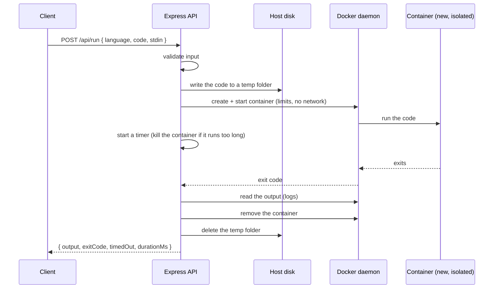

# Code Runner API, Part 1: The API Code

**Express + dockerode.** In this part you build an online "code runner" API (think Programiz or an online IDE backend): the client sends source code, the server runs it inside a throw-away **Docker container** using the `dockerode` package, and returns the output. The API is deliberately small: **three source files** and no database, no login, no queues. Then you lock it down against abuse, and create the supporting files the deployment parts need: the PM2 config, a deploy script and the Nginx config.

Everything uses **ESM** (`import` / `export`, `"type": "module"`).

## The three parts

| Part | Covers | What it is |
|---|---|---|
| **Part 1 (you are here)** | Phases 1-2 | The API code: Express + dockerode runner, sandbox hardening, plus the supporting files (PM2 config, deploy script, Nginx config, attack tests) |
| [Part 2](express-to-devops-code-runner-part2-manual-deploy.md) | Phase 3 | Manual deployment on a DigitalOcean Droplet: Docker, PM2, Nginx, Certbot |
| [Part 3](express-to-devops-code-runner-part3-pulumi.md) | Phases 4-5 | Infrastructure as code with Pulumi (TypeScript, ESM): single Droplet, then load balancer + autoscaling + stress test |

> ## ⚠️ Read this first: this API runs untrusted code on purpose
>
> A public code runner with **no authentication** is one of the most abused kinds of service on the internet (crypto miners, fork bombs, attempts to escape the sandbox). This guide builds real defences (Phase 2) but **no sandbox is perfect**.
>
> - The API process talks to the Docker daemon. **Access to the Docker socket is equivalent to root on that machine.** A bug in the API code is therefore serious, which is why the API is small and validates everything.
> - The Droplets hold **no secrets** (no database credentials, no JWT keys) and the containers have **no network**. That limits the blast radius if something goes wrong.
> - Only run this on dedicated, disposable servers. Don't share them with anything you care about.
> - Read the [production hardening checklist](express-to-devops-code-runner-part3-pulumi.md#58-production-hardening-checklist) before putting this in front of real users.

## What is different from the Blog API guide

| Topic | Blog API guide | Code Runner guide (this one) |
|---|---|---|
| What the API does | CRUD blog posts | `POST` code → run in Docker → return output |
| Authentication | JWT | **None** (public). Abuse protection instead |
| Database | In-memory, then MongoDB Atlas | **None.** Fully stateless |
| Phase 2 | MongoDB Atlas + Mongoose | **Sandbox hardening + abuse protection** |
| Secrets | JWT secret, Mongo URI | **None at all** |
| Server software | Node, PM2, Nginx, Certbot | The same **plus Docker Engine** and pre-pulled language images |
| Droplet size | `s-1vcpu-512mb-10gb` | **`s-1vcpu-2gb`** (containers need RAM; 512 MB is not enough) |
| Hostname | `api.multicluster.uk` | `runner.multicluster.uk` (so both projects can coexist) |
| Atlas IP allow-list | Needed | **Not needed** |
| Stress test | A special `/stress/cpu` endpoint | The **real** `/api/run` endpoint running CPU-burning code |
| Health check | Doesn't touch the DB | Pings the **local Docker daemon** (a server that can't run code shouldn't receive traffic) |

| Phase | What you build | Key tools |
|---|---|---|
| 1 | Code runner REST API that executes code in Docker | Express 5, dockerode |
| 2 | Harden the sandbox and protect against abuse | Docker security options, rate limiting, concurrency cap |
| 3 | Manual deploy on a DigitalOcean Droplet | Docker Engine, PM2, Nginx, Certbot, `runner.multicluster.uk` |
| 4 | The same infrastructure as code | Pulumi + TypeScript (ESM) |
| 5 | Load balancer + autoscaling pool + stress test | Pulumi, DO Load Balancer, Droplet Autoscale, autocannon |

## Table of contents

- [Prerequisites](#prerequisites)
- [How a run works](#how-a-run-works)
- [Final project layout](#final-project-layout)
- [Phase 1: The code runner API](#phase-1-the-code-runner-api)
- [Phase 2: Sandbox hardening and abuse protection](#phase-2-sandbox-hardening-and-abuse-protection)
- [2.6 Supporting files for deployment](#26-supporting-files-for-deployment)
- [2.7 Push to GitHub](#27-push-to-github)
- [Troubleshooting (Part 1)](#troubleshooting-part-1)
- [What's next](#whats-next)

---

## Prerequisites

| Need | Notes |
|---|---|
| Node.js 22 or newer (24 LTS recommended) | `node -v` |
| **Docker** on your laptop | Docker Desktop (macOS/Windows) or Docker Engine (Linux). `docker run --rm hello-world` must work. |
| Git + a GitHub account | The servers in Parts 2 and 3 will `git clone` your code. **Use a public repo.** |
| `curl`, `jq`, `openssl` | Command-line tools used in the examples. |

You do **not** need a DigitalOcean account, a domain or Pulumi until Parts 2 and 3. No MongoDB Atlas account is needed anywhere in these guides.

### Docker on your laptop

**Linux:** your user must be allowed to use the Docker socket, or the Node process will get `EACCES`:

```bash
sudo usermod -aG docker $USER      # then log out and back in
docker run --rm hello-world
```

**macOS / Windows:** start Docker Desktop. On Windows, work inside WSL 2 (Ubuntu) with Docker Desktop's WSL integration enabled, so `/var/run/docker.sock` exists.

Pull the language images used in Phase 1. **The app does not download images by itself**, so this step is required:

```bash
docker pull node:22-alpine
docker pull python:3.13-alpine
```

---

---

## How a run works

Each request creates a **new container from a clean image**, runs the code, reads the output, and destroys the container. Nothing a user does can persist or affect the next request.



Note that the HTTP status describes the **API call**, not the user's program. If the user's Python crashes, you still return `200` with `exitCode: 1` and the traceback in `output`.

---

## Final project layout

```
code-runner-api/               <- the application (everything in this part)
├── package.json
├── ecosystem.config.cjs       <- PM2 config           (2.6, used in Part 2 and 3)
├── .env                       <- never committed
├── .gitignore
├── deploy/
│   └── nginx/
│       └── code-runner.conf   <- Nginx config         (2.6, used in Part 2)
├── scripts/
│   ├── deploy.sh              <- update script        (2.6, used in Part 2)
│   └── test-sandbox.sh        <- attack tests         (2.3)
└── src/
    ├── server.js              <- Express app: routes, validation, limits
    ├── runner.js              <- runs code in a Docker container
    └── languages.js           <- supported languages
```

(The `infra/` Pulumi folder is added to this same repo in [Part 3](express-to-devops-code-runner-part3-pulumi.md).)

---

# Phase 1: The code runner API

**Goal:** a working API that accepts code, runs it in a Docker container, and returns the result. Three small files, about 150 lines in total.

### Endpoints

| Method | Path | Purpose |
|---|---|---|
| GET | `/health` | Is the server alive, and can it talk to Docker? (used later by the load balancer) |
| GET | `/api/languages` | List supported languages |
| POST | `/api/run` | Run code. Body: `{ "language": "python", "code": "print(1)", "stdin": "" }` |

### Concepts you will meet

- **dockerode**: a Node.js client for the Docker Engine. It talks to the Docker daemon over a Unix socket (`/var/run/docker.sock`) and lets you create, start and remove containers from code.
- **Ephemeral containers**: one container per request, destroyed afterwards.
- **Resource limits**: Docker can cap a container's memory and CPU.
- **Timeouts**: we kill containers that run too long.

## 1.1 Create the project

```bash
mkdir code-runner-api && cd code-runner-api
git init
npm init -y
npm install express cors dotenv dockerode express-rate-limit
mkdir src scripts
```

(`express-rate-limit` is used in Phase 2; installing it now keeps `package.json` complete.)

Edit `package.json` so it looks like this (the important parts are `"type": "module"` and the scripts):

```json
{
  "name": "code-runner-api",
  "version": "1.0.0",
  "private": true,
  "type": "module",
  "main": "src/server.js",
  "engines": { "node": ">=22" },
  "scripts": {
    "dev": "node --watch src/server.js",
    "start": "node src/server.js"
  },
  "dependencies": {
    "cors": "^2.8.5",
    "dockerode": "^4.0.0",
    "dotenv": "^17.0.0",
    "express": "^5.1.0",
    "express-rate-limit": "^8.0.0"
  }
}
```

> Keep whatever versions npm actually installed and just add the `type`, `engines` and `scripts` fields.

`.gitignore`:

```gitignore
node_modules
.env
*.log
.DS_Store
```

`.env` (local development only; everything is optional because the code has defaults):

```bash
NODE_ENV=development
PORT=3000
```

## 1.2 Supported languages (`src/languages.js`)

A language is just: which Docker image to use, what to name the source file, and the shell command that runs it. Adding one later is one more entry (see [Adding more languages](#adding-more-languages)).

```js
// `cmd` runs inside the container via `sh -c`. The user's code is mounted read-only at /code,
// and their stdin text is in /code/input.txt.
export const LANGUAGES = {
  javascript: {
    image: 'node:22-alpine',
    file: 'main.js',
    cmd: 'node /code/main.js < /code/input.txt',
  },
  python: {
    image: 'python:3.13-alpine',
    file: 'main.py',
    cmd: 'python3 -u /code/main.py < /code/input.txt',
  },
};
```

## 1.3 Running code in a container (`src/runner.js`)

This is the core of the application. Read it top to bottom: it is short.

```js
import fs from 'node:fs/promises';
import os from 'node:os';
import path from 'node:path';
import Docker from 'dockerode';
import { LANGUAGES } from './languages.js';

// With no arguments dockerode uses /var/run/docker.sock.
export const docker = new Docker();

// Where each run's temp folder is created. The Docker daemon must be able to see this path
// because it mounts it into the container, so on a server we set RUN_DIR to a fixed folder.
const RUN_DIR = process.env.RUN_DIR ?? path.join(os.tmpdir(), 'code-runner');

const TIMEOUT_MS = 5000;        // kill any run that takes longer than this
const MAX_OUTPUT = 64 * 1024;   // return at most this many characters of output

// How the container is created. (Phase 2 makes this stricter.)
function containerOptions({ lang, dir }) {
  const memory = 128 * 1024 * 1024;       // 128 MB
  return {
    Image: lang.image,
    Cmd: ['sh', '-c', lang.cmd],
    User: '65534:65534',                  // "nobody": never run user code as root
    Tty: true,                            // stdout + stderr come back as one plain text stream
    NetworkDisabled: true,                // no network at all
    Labels: { app: 'code-runner' },       // lets us find our containers: docker ps --filter label=app=code-runner
    HostConfig: {
      Binds: [`${dir}:/code:ro`],         // the user's code, mounted READ-ONLY
      NetworkMode: 'none',
      Memory: memory,                     // hard RAM limit
      MemorySwap: memory,                 // same value = no swap
      NanoCpus: 0.5e9,                    // half of one CPU core (1e9 = one full core)
      // Keep Docker's stored copy of the output small, so an endless print() can't fill the disk:
      LogConfig: { Type: 'json-file', Config: { 'max-size': '256k', 'max-file': '1' } },
    },
  };
}

export async function runCode({ language, code, stdin }) {
  const lang = LANGUAGES[language];
  const started = Date.now();

  // 1. Put the user's code and stdin in a fresh temp folder the container can read.
  await fs.mkdir(RUN_DIR, { recursive: true, mode: 0o755 });
  const dir = await fs.mkdtemp(path.join(RUN_DIR, 'run-'));
  let container;

  try {
    // The container runs as "nobody", so the folder and files must be world-readable.
    await fs.chmod(dir, 0o755);
    await fs.writeFile(path.join(dir, lang.file), code, { mode: 0o644 });
    await fs.writeFile(path.join(dir, 'input.txt'), stdin, { mode: 0o644 });

    // 2. Create and start the container.
    container = await docker.createContainer(containerOptions({ lang, dir }));
    await container.start();

    // 3. Wait for it to finish, but kill it if it takes too long.
    let timedOut = false;
    const timer = setTimeout(() => {
      timedOut = true;
      container.kill().catch(() => {});
    }, TIMEOUT_MS);
    const { StatusCode: exitCode } = await container.wait();
    clearTimeout(timer);

    // 4. Read what the program printed, and check whether it ran out of memory.
    const logs = await container.logs({ stdout: true, stderr: true });
    const info = await container.inspect();

    return {
      output: logs.toString('utf8').replaceAll('\r\n', '\n').slice(0, MAX_OUTPUT),
      exitCode,
      timedOut,
      oomKilled: info.State.OOMKilled,
      durationMs: Date.now() - started,
    };
  } finally {
    // 5. ALWAYS clean up, even if something above threw.
    if (container) container.remove({ force: true }).catch(() => {});
    fs.rm(dir, { recursive: true, force: true }).catch(() => {});
  }
}
```

Things worth noticing:

- The code never touches the host's own shell. It is written to a **file**, and a container that has no network and a read-only view of that file runs it.
- `Tty: true` is what makes the output simple: the container's stdout and stderr arrive as one ordinary text stream, so we read it with a single `container.logs()` call (no stream handling).
- `finally` guarantees the container and temp folder are removed whatever happens.

## 1.4 The server (`src/server.js`)

```js
import 'dotenv/config';
import os from 'node:os';
import cors from 'cors';
import express from 'express';
import { LANGUAGES } from './languages.js';
import { docker, runCode } from './runner.js';

const PORT = Number(process.env.PORT ?? 3000);
const MAX_CODE = 64 * 1024;    // characters
const MAX_STDIN = 16 * 1024;

const app = express();

// Behind Nginx (Part 2) or a load balancer (Part 3) there is exactly one proxy hop.
// This makes req.ip the real client address (used by the rate limiter in Phase 2).
if (process.env.NODE_ENV === 'production') app.set('trust proxy', 1);

app.use(cors({ origin: process.env.CORS_ORIGIN ?? '*' }));
app.use(express.json({ limit: '128kb' }));

// "Healthy" means "this machine can actually run code", so we ping the Docker daemon.
// A server that fails this is taken out of the load balancer.
app.get('/health', async (_req, res) => {
  const host = os.hostname();
  try {
    await docker.ping();
    res.json({ status: 'ok', docker: 'up', host });
  } catch {
    res.status(503).json({ status: 'degraded', docker: 'down', host });
  }
});

app.get('/api/languages', (_req, res) => {
  res.json({ languages: Object.keys(LANGUAGES) });
});

app.post('/api/run', async (req, res) => {
  const { language, code, stdin = '' } = req.body ?? {};

  // This endpoint is public, so check everything.
  if (!Object.hasOwn(LANGUAGES, language)) {
    return res.status(400).json({ error: `language must be one of: ${Object.keys(LANGUAGES).join(', ')}` });
  }
  if (typeof code !== 'string' || code.trim() === '' || code.length > MAX_CODE) {
    return res.status(400).json({ error: `code must be a non-empty string of at most ${MAX_CODE} characters` });
  }
  if (typeof stdin !== 'string' || stdin.length > MAX_STDIN) {
    return res.status(400).json({ error: `stdin must be a string of at most ${MAX_STDIN} characters` });
  }

  const result = await runCode({ language, code, stdin });
  res.json({ language, ...result, host: os.hostname() });
});

// Anything that didn't match a route.
app.use((_req, res) => res.status(404).json({ error: 'Not found' }));

// Error handler: Express recognises it by its 4 parameters. (Express 5 sends errors thrown
// inside async route handlers here automatically.)
app.use((err, _req, res, _next) => {
  if (err.type === 'entity.parse.failed') return res.status(400).json({ error: 'Invalid JSON' });
  if (err.type === 'entity.too.large') return res.status(413).json({ error: 'Request body too large' });
  console.error(err); // the real cause goes to the log, never to the client
  res.status(500).json({ error: 'Internal server error' });
});

const server = app.listen(PORT, () => console.log(`listening on port ${PORT}`));

// Stop cleanly when PM2 / systemd asks us to.
for (const signal of ['SIGINT', 'SIGTERM']) {
  process.on(signal, () => server.close(() => process.exit(0)));
}
```

## 1.5 Run it and test it

```bash
npm run dev
```

In another terminal:

```bash
# Health (also proves Node can reach Docker)
curl -s localhost:3000/health | jq

# Supported languages
curl -s localhost:3000/api/languages | jq

# Run Python
curl -s -X POST localhost:3000/api/run \
  -H 'Content-Type: application/json' \
  -d '{"language":"python","code":"print(sum(range(101)))"}' | jq

# Run JavaScript, reading from stdin
curl -s -X POST localhost:3000/api/run \
  -H 'Content-Type: application/json' \
  -d '{"language":"javascript","code":"const s=require(\"fs\").readFileSync(0,\"utf8\").trim(); console.log(s.toUpperCase())","stdin":"hello runner"}' | jq
```

You should get something like:

```json
{
  "language": "python",
  "output": "5050\n",
  "exitCode": 0,
  "timedOut": false,
  "oomKilled": false,
  "durationMs": 412,
  "host": "your-laptop"
}
```

Now try the failure modes. Each one is a **successful API call** (HTTP 200) describing a failed program, except validation:

```bash
# A crashing program: exitCode 1 and a traceback in output
curl -s -X POST localhost:3000/api/run -H 'Content-Type: application/json' \
  -d '{"language":"python","code":"print(1/0)"}' | jq '{exitCode, output}'

# An infinite loop: killed after 5 seconds, timedOut=true
curl -s -X POST localhost:3000/api/run -H 'Content-Type: application/json' \
  -d '{"language":"python","code":"while True: pass"}' | jq '{exitCode, timedOut, durationMs}'

# Validation error: HTTP 400
curl -s -X POST localhost:3000/api/run -H 'Content-Type: application/json' \
  -d '{"language":"cobol","code":""}' | jq
```

And prove the container is **really** isolated from the network and cleaned up afterwards:

```bash
curl -s -X POST localhost:3000/api/run -H 'Content-Type: application/json' \
  -d '{"language":"python","code":"import urllib.request\nprint(urllib.request.urlopen(\"http://example.com\", timeout=3).status)"}' | jq '{exitCode, output}'
# expect a network error: there is no network inside the container

docker ps -a --filter label=app=code-runner      # should list nothing: every container was removed
ls /tmp/code-runner 2>/dev/null                   # should be empty: temp folders were removed
```

A tiny browser-side example (what your front-end would do):

```js
const res = await fetch('https://runner.multicluster.uk/api/run', {
  method: 'POST',
  headers: { 'Content-Type': 'application/json' },
  body: JSON.stringify({ language: 'python', code: 'print("hi")', stdin: '' }),
});
const { output, exitCode, timedOut } = await res.json();
```

### Adding more languages

Each language is one entry in `src/languages.js`. Pull the image on every server (the deploy script and the Pulumi bootstrap script both have an image list). Compiled languages write their program to `/tmp`, which Phase 2 makes writable.

| Language | `image` | `file` | `cmd` |
|---|---|---|---|
| C | `gcc:14` | `main.c` | `gcc /code/main.c -o /tmp/a.out && /tmp/a.out < /code/input.txt` |
| C++ | `gcc:14` | `main.cpp` | `g++ /code/main.cpp -o /tmp/a.out && /tmp/a.out < /code/input.txt` |
| Go | `golang:1.24-alpine` | `main.go` | `cd /tmp && GOCACHE=/tmp/.cache go run /code/main.go < /code/input.txt` |
| Ruby | `ruby:3.4-alpine` | `main.rb` | `ruby /code/main.rb < /code/input.txt` |
| Bash | `alpine:3.21` | `main.sh` | `sh /code/main.sh < /code/input.txt` |

Compiled languages may need more than the 5-second limit and 128 MB of memory: change `TIMEOUT_MS` and `memory` in `runner.js`. The `gcc` image is over 1 GB, so every new autoscale server takes noticeably longer to boot if you include it.

Commit it:

```bash
git add -A && git commit -m "Phase 1: code runner API using dockerode"
```

---

# Phase 2: Sandbox hardening and abuse protection

**Goal:** make it reasonable to expose this to the internet with no login. There are only **two edits**: a stricter container, and two protections in `server.js`.

### Threats and defences

| Threat | Example | Defence |
|---|---|---|
| Infinite loop / CPU hog | `while True: pass` | 5-second timeout + CPU limit (Phase 1) |
| Memory bomb | Allocate gigabytes | Memory limit, no swap (Phase 1) |
| **Fork bomb** | `while True: os.fork()` | **`PidsLimit`** (new) |
| Output flood | `print` in an endless loop | Output size cap + small Docker log (Phase 1) |
| Network abuse | Scanning, DDoS | No network at all (Phase 1) |
| Privilege escalation | Gain root, new privileges | **`CapDrop: ALL`**, **`no-new-privileges`** (new), runs as `nobody` |
| Tampering with the filesystem | Write to `/` | **Read-only root filesystem** + small RAM-backed `/tmp` (new) |
| **Request flooding** | A script hammering `/api/run` | **Rate limit per IP** (new) |
| Overloading the server | 500 simultaneous runs | **Concurrency cap**: extra requests get HTTP 429 (new) |

## 2.1 A stricter container (edit `src/runner.js`)

Replace the `containerOptions` function with this version. Everything new is marked.

```js
function containerOptions({ lang, dir }) {
  const memory = 128 * 1024 * 1024;
  return {
    Image: lang.image,
    Cmd: ['sh', '-c', lang.cmd],
    User: '65534:65534',
    WorkingDir: '/tmp',                                        // NEW
    Env: ['HOME=/tmp', 'PYTHONDONTWRITEBYTECODE=1'],           // NEW
    Tty: true,
    NetworkDisabled: true,
    Labels: { app: 'code-runner' },
    HostConfig: {
      Binds: [`${dir}:/code:ro`],
      NetworkMode: 'none',
      Memory: memory,
      MemorySwap: memory,
      NanoCpus: 0.5e9,
      LogConfig: { Type: 'json-file', Config: { 'max-size': '256k', 'max-file': '1' } },

      PidsLimit: 64,                                           // NEW: max processes (stops fork bombs)
      ReadonlyRootfs: true,                                    // NEW: the image can't be modified...
      Tmpfs: { '/tmp': 'rw,exec,nosuid,nodev,size=64m' },      // NEW: ...except a 64 MB scratch folder in RAM
      CapDrop: ['ALL'],                                        // NEW: drop every special Linux privilege
      SecurityOpt: ['no-new-privileges'],                      // NEW: setuid programs can't gain privileges
    },
  };
}
```

In plain language:

- `ReadonlyRootfs` + `Tmpfs`: the whole filesystem is read-only except `/tmp`, which lives in RAM and is capped at 64 MB. Programs that must write (compilers, caches) use `/tmp`.
- `CapDrop: ['ALL']`: Linux splits root's powers into about 40 "capabilities" (change file owners, bind low ports, load modules...). Dropping all of them leaves a process that can do almost nothing special, even if it somehow became root.
- `no-new-privileges`: even a setuid-root program inside the image can't gain privileges.
- `PidsLimit`: a fork bomb stops at 64 processes instead of exhausting the host.
- Docker's default **seccomp** and (on Ubuntu) **AppArmor** profiles stay active automatically. Never set `Privileged: true` or mount `/var/run/docker.sock` into a container.

## 2.2 Rate limit and concurrency cap (replace `src/server.js`)

Two protections:

- **Rate limit**: each client IP may call `/api/run` only so many times per minute (default 30). This uses the `express-rate-limit` package.
- **Concurrency cap**: only a few runs happen at once on a server (default 2). A request arriving while the server is full gets an immediate `429 Server is busy` instead of making everything slower. Rejecting fast is much cheaper than letting the machine collapse.

The final `src/server.js` (new lines are marked):

```js
import 'dotenv/config';
import os from 'node:os';
import cors from 'cors';
import express from 'express';
import rateLimit from 'express-rate-limit';                    // NEW
import { LANGUAGES } from './languages.js';
import { docker, runCode } from './runner.js';

const PORT = Number(process.env.PORT ?? 3000);
const MAX_CODE = 64 * 1024;
const MAX_STDIN = 16 * 1024;
const MAX_CONCURRENT_RUNS = Number(process.env.MAX_CONCURRENT_RUNS ?? 2);   // NEW
const RATE_LIMIT_PER_MIN = Number(process.env.RATE_LIMIT_PER_MIN ?? 30);    // NEW

const app = express();
if (process.env.NODE_ENV === 'production') app.set('trust proxy', 1);

app.use(cors({ origin: process.env.CORS_ORIGIN ?? '*' }));
app.use(express.json({ limit: '128kb' }));

// NEW: per client IP. The counter lives in this process's memory, so each server counts
// separately. That's fine as a safety net.
const runLimiter = rateLimit({
  windowMs: 60_000,
  limit: RATE_LIMIT_PER_MIN,
  standardHeaders: 'draft-7',                // sends RateLimit-* headers so clients can back off
  legacyHeaders: false,
  message: { error: 'Too many requests, slow down' },
});

let activeRuns = 0;                                            // NEW

app.get('/health', async (_req, res) => {
  const host = os.hostname();
  try {
    await docker.ping();
    res.json({ status: 'ok', docker: 'up', host, active: activeRuns });
  } catch {
    res.status(503).json({ status: 'degraded', docker: 'down', host });
  }
});

app.get('/api/languages', (_req, res) => {
  res.json({ languages: Object.keys(LANGUAGES) });
});

app.post('/api/run', runLimiter, async (req, res) => {         // runLimiter added
  const { language, code, stdin = '' } = req.body ?? {};

  if (!Object.hasOwn(LANGUAGES, language)) {
    return res.status(400).json({ error: `language must be one of: ${Object.keys(LANGUAGES).join(', ')}` });
  }
  if (typeof code !== 'string' || code.trim() === '' || code.length > MAX_CODE) {
    return res.status(400).json({ error: `code must be a non-empty string of at most ${MAX_CODE} characters` });
  }
  if (typeof stdin !== 'string' || stdin.length > MAX_STDIN) {
    return res.status(400).json({ error: `stdin must be a string of at most ${MAX_STDIN} characters` });
  }

  // NEW: concurrency cap
  if (activeRuns >= MAX_CONCURRENT_RUNS) {
    return res.status(429).json({ error: 'Server is busy, please retry in a moment' });
  }
  activeRuns++;
  try {
    const result = await runCode({ language, code, stdin });
    res.json({ language, ...result, host: os.hostname() });
  } finally {
    activeRuns--;                                              // always, even if the run threw
  }
});

app.use((_req, res) => res.status(404).json({ error: 'Not found' }));

app.use((err, _req, res, _next) => {
  if (err.type === 'entity.parse.failed') return res.status(400).json({ error: 'Invalid JSON' });
  if (err.type === 'entity.too.large') return res.status(413).json({ error: 'Request body too large' });
  console.error(err);
  res.status(500).json({ error: 'Internal server error' });
});

const server = app.listen(PORT, () => console.log(`listening on port ${PORT}`));

for (const signal of ['SIGINT', 'SIGTERM']) {
  process.on(signal, () => server.close(() => process.exit(0)));
}
```

> `activeRuns++` runs right after the check with no `await` in between, so two requests can never both slip past the limit (Node handles one piece of JavaScript at a time).

## 2.3 Attack tests (`scripts/test-sandbox.sh`)

These simulate hostile programs. **Every one of them must be contained**: the API responds, the server stays healthy, and nothing is left behind. Some take up to 5 seconds because they run until the timeout.

```bash
#!/usr/bin/env bash
# Usage: scripts/test-sandbox.sh [base-url]   (default http://localhost:3000)
set -uo pipefail
URL="${1:-http://localhost:3000}"

# run <language> <code>  -> prints a compact verdict
run() {
  local body
  body=$(jq -n --arg l "$1" --arg c "$2" '{language:$l, code:$c}')
  curl -s -X POST "$URL/api/run" -H 'Content-Type: application/json' -d "$body" \
    | jq -c '{exitCode, timedOut, oomKilled, ms: .durationMs, chars: (.output // "" | length), output: (.output // "" | .[0:100]), error}'
}

echo "1. infinite loop           (expect timedOut=true)"
run python $'while True:\n    pass'

echo "2. memory bomb             (expect oomKilled=true or exitCode 137)"
run python $'a = []\nwhile True:\n    a.append(bytearray(10_000_000))'

echo "3. fork bomb               (expect it to stop: PidsLimit, then timeout)"
run python $'import os\nwhile True:\n    os.fork()'

echo "4. output flood            (expect it to finish, chars <= 65536)"
run python $'while True:\n    print("x" * 1000)'

echo "5. network access          (expect a network error)"
run python $'import urllib.request\nprint(urllib.request.urlopen("http://1.1.1.1", timeout=3).status)'

echo "6. write to read-only root (expect Read-only file system)"
run python $'open("/evil.txt", "w").write("x")'

echo "7. write into /code        (expect Read-only file system)"
run python $'open("/code/evil.py", "w").write("x")'

echo "8. fill /tmp               (expect No space left on device)"
run python $'f = open("/tmp/big", "wb")\nwhile True:\n    f.write(b"0" * 1000000)'

echo "9. am I root?              (expect uid=65534)"
run python $'import os\nprint("uid=" + str(os.getuid()))'

echo "10. is the Docker socket reachable? (expect False)"
run python $'import os\nprint(os.path.exists("/var/run/docker.sock"))'

echo "11. oversized code         (expect an error about code size)"
big=$(head -c 70000 /dev/zero | tr '\0' 'a')
run python "print('$big')"

echo "12. server still healthy afterwards"
curl -s "$URL/health" | jq -c .

echo "13. leftovers (expect no containers listed)"
docker ps -a --filter label=app=code-runner --format '{{.ID}} {{.Status}}' || true
```

```bash
chmod +x scripts/test-sandbox.sh
npm run dev                      # terminal 1
./scripts/test-sandbox.sh        # terminal 2
```

## 2.4 Test the abuse protection

```bash
# Rate limit: the default is 30 requests per minute per IP, so some of these should return 429
for i in $(seq 1 40); do
  curl -s -o /dev/null -w "%{http_code} " -X POST localhost:3000/api/run \
    -H 'Content-Type: application/json' -d '{"language":"python","code":"print(1)"}'
done; echo

# Concurrency cap: restart the server allowing only ONE run at a time...
MAX_CONCURRENT_RUNS=1 npm run dev
# ...then, from another terminal, start three slow runs at once.
# Expect one 200 and two 429 (the server was busy).
for i in 1 2 3; do
  curl -s -o /dev/null -w "%{http_code}\n" -X POST localhost:3000/api/run \
    -H 'Content-Type: application/json' \
    -d '{"language":"python","code":"import time; time.sleep(2)"}' &
done; wait
```

Things to try breaking on purpose: set `PidsLimit` to `100000` and run test 3 (and then stop it!), or remove `CapDrop` and see what changes. Understanding *which* defence stops *which* attack is the point of this phase.

```bash
git add -A && git commit -m "Phase 2: sandbox hardening, rate limit, concurrency cap"
```

---

## 2.6 Supporting files for deployment

The next two parts deploy this app. They need three small files in the repository. Create them now so Parts 2 and 3 can simply `git clone` the repo and use them.

### 2.6.1 PM2 process config (`ecosystem.config.cjs`, in the project root)

PM2 keeps Node running, restarts it on crash, and runs one worker per CPU core. The `.cjs` extension is required because PM2 loads this file with `require()`, and our package is `"type": "module"`.

```js
module.exports = {
  apps: [
    {
      name: 'code-runner',
      script: 'src/server.js',
      exec_mode: 'cluster',      // one worker per core, sharing port 3000
      instances: 'max',
      max_memory_restart: '300M',
      kill_timeout: 8000,        // lets a run (max 5 s) finish before PM2 force-kills
      env_production: {
        NODE_ENV: 'production',
        PORT: 3000,
      },
    },
  ],
};
```

> **How many runs happen at once?** Each PM2 worker has its own concurrency cap: total concurrent runs = `instances × MAX_CONCURRENT_RUNS`. Each run is limited to 0.5 CPU by default. On a 1-vCPU server that is 1 worker × 2 runs × 0.5 CPU = the whole CPU, which is what you want. On a 2-vCPU server you get 2 workers × 2 runs = 4 runs, again filling both cores. Memory: 4 runs × 128 MB = 512 MB, which is why the deployment guides use a 2 GB Droplet.
>
> If your PM2 version ever has trouble with ESM in cluster mode, switch to `exec_mode: 'fork'` and `instances: 1`.

### 2.6.2 Update script (`scripts/deploy.sh`)

Run on the server (as root) to pull the latest code, refresh the language images and reload the app without downtime:

```bash
#!/usr/bin/env bash
# Run on the server as root: bash scripts/deploy.sh
set -euo pipefail

APP_DIR=/opt/code-runner
IMAGES="node:22-alpine python:3.13-alpine"   # keep in sync with src/languages.js

cd "$APP_DIR"
git fetch --all --prune
git reset --hard origin/main
npm ci --omit=dev

for img in $IMAGES; do docker pull "$img"; done   # refresh language runtimes
docker image prune -f                              # remove old, unused layers

pm2 startOrReload ecosystem.config.cjs --env production --update-env
pm2 save
pm2 status
```

```bash
chmod +x scripts/deploy.sh
```

### 2.6.3 Nginx config (`deploy/nginx/code-runner.conf`)

Nginx sits in front of Node on a manually deployed server (Part 2). It terminates HTTPS, rejects floods before they reach Node, and refuses oversized bodies early. This file is copied to `/etc/nginx/sites-available/code-runner` on the server.

```nginx
# deploy/nginx/code-runner.conf
#
# Installed on the server as /etc/nginx/sites-available/code-runner (see Part 2, step 3.9).
# Certbot edits the INSTALLED copy to add HTTPS; this file in the repo stays the plain-HTTP original.
# If you use a different hostname, change server_name below.

# Defence in depth: Nginx rejects floods before they reach Node.
# (The zone must be declared outside the server block; this file is included inside http { }.)
limit_req_zone $binary_remote_addr zone=runner_zone:10m rate=5r/s;

server {
    listen 80;
    listen [::]:80;
    server_name runner.multicluster.uk;

    client_max_body_size 200k;          # code is capped at 64 KB, so refuse big bodies early

    location / {
        limit_req zone=runner_zone burst=20 nodelay;
        limit_req_status 429;

        proxy_pass http://127.0.0.1:3000;
        proxy_http_version 1.1;
        proxy_set_header Host              $host;
        proxy_set_header X-Real-IP         $remote_addr;
        proxy_set_header X-Forwarded-For   $proxy_add_x_forwarded_for;
        proxy_set_header X-Forwarded-Proto $scheme;
        proxy_set_header Connection        "";
        proxy_read_timeout 30s;         # a run takes at most ~5 s
    }
}
```

What the important lines do:

| Line | Why |
|---|---|
| `limit_req_zone ... rate=5r/s` + `limit_req ... burst=20` | Each client IP may make ~5 requests per second (with short bursts of 20) before Nginx answers `429`. |
| `client_max_body_size 200k` | The API caps code at 64 KB, so anything much bigger is refused before it reaches Node. |
| `X-Forwarded-For` | Lets the Express rate limiter see each visitor's real IP. This works because `app.set('trust proxy', 1)` is on in production. |
| `proxy_read_timeout 30s` | A run takes at most about 5 seconds. |

## 2.7 Push to GitHub

The servers in Parts 2 and 3 `git clone` your code, so it must be on GitHub. Use a **public** repository to keep these guides simple (private repos need deploy keys).

```bash
git add -A && git commit -m "Add PM2 config, deploy script and Nginx config"
# create an empty PUBLIC repo on GitHub named code-runner-api, then:
git branch -M main
git remote add origin https://github.com/<your-username>/code-runner-api.git
git push -u origin main
```

Check that the repo contains the deployment files:

```bash
git ls-files | grep -E 'ecosystem.config.cjs|scripts/deploy.sh|scripts/test-sandbox.sh|deploy/nginx/code-runner.conf'
# all four paths must be listed
```

---
---

## Troubleshooting (Part 1)

| Symptom | Likely cause | Fix |
|---|---|---|
| `Cannot use import statement outside a module` | Missing `"type": "module"` in `package.json` | Add it (see 1.1) |
| `EACCES` / `permission denied` on `/var/run/docker.sock` | Your user isn't in the `docker` group | `sudo usermod -aG docker $USER`, then log out and back in |
| `/health` returns `docker: down` | Docker isn't running | Start Docker Desktop / `sudo systemctl start docker`; check `docker ps` |
| `500 Internal server error` on `/api/run`, log says `No such image` | The language image isn't pulled | `docker pull node:22-alpine` and `docker pull python:3.13-alpine` |
| Program fails with "No such file" for `/code/main.py` | The Docker daemon can't see the temp folder (macOS/Windows file sharing, or a private `/tmp`) | Set `RUN_DIR` in `.env` to a folder that Docker Desktop shares (e.g. under your home folder) |
| "Permission denied" reading `/code/...` | Temp folder not readable by user 65534 | The code `chmod`s it 755/644; make sure the parent folders of `RUN_DIR` are traversable |
| `exitCode: 137` / `oomKilled: true` | Program exceeded 128 MB | Expected for memory hogs; raise `memory` in `runner.js` for legitimate heavy programs |
| Compiled language: "Permission denied" running `/tmp/a.out` | `/tmp` mounted `noexec` | Phase 2 uses `rw,exec` on purpose; don't add `noexec` if you compile |
| Leftover containers or folders | The server was killed mid-run | `docker rm -f $(docker ps -aq --filter label=app=code-runner)`; delete old folders in `RUN_DIR` |
| Rate-limit test never returns 429 | Limit raised, or each request came from a different IP | Check `RATE_LIMIT_PER_MIN`; test from one terminal |

---

## What's next

- **[Part 2: Manual deployment](express-to-devops-code-runner-part2-manual-deploy.md)** puts this exact code on a DigitalOcean Droplet by hand: Docker, PM2, Nginx and HTTPS. You will use the files from section 2.6.
- **[Part 3: Pulumi](express-to-devops-code-runner-part3-pulumi.md)** does the same with code, then adds a load balancer and an autoscaling pool and stress tests it.

You can do Part 3 without doing Part 2, but doing Part 2 first makes it much clearer what the Pulumi bootstrap script automates.