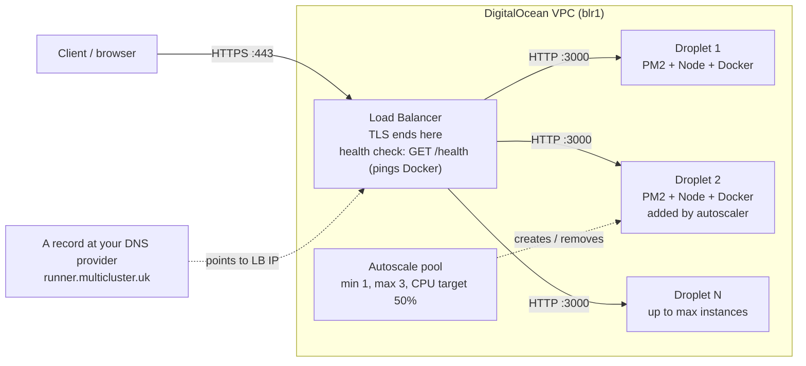
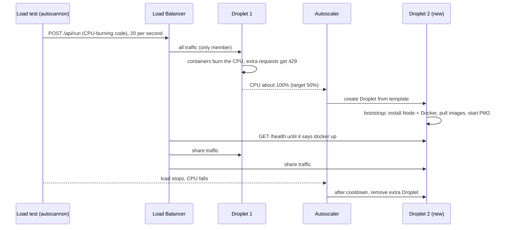

# Code Runner API, Part 3: Infrastructure as Code with Pulumi

In this part you rebuild the deployment from [Part 2](express-to-devops-code-runner-part2-manual-deploy.md) as **code** using Pulumi (TypeScript, ESM): first a single Droplet with `pulumi up` (Phase 4), then a **load balancer plus an autoscaling pool**, which you stress test until DigitalOcean adds another server (Phase 5).

## The three parts

| Part | Covers | What it is |
|---|---|---|
| [Part 1](express-to-devops-code-runner-part1-api.md) | Phases 1-2 | The API code: Express + dockerode runner, sandbox hardening, plus the supporting files (PM2 config, deploy script, Nginx config, attack tests) |
| [Part 2](express-to-devops-code-runner-part2-manual-deploy.md) | Phase 3 | Manual deployment on a DigitalOcean Droplet: Docker, PM2, Nginx, Certbot |
| **Part 3 (you are here)** | Phases 4-5 | Infrastructure as code with Pulumi (TypeScript, ESM): single Droplet, then load balancer + autoscaling + stress test |

> **⚠️ This service runs untrusted code on purpose.** Access to the Docker socket is equivalent to root on the server, and no sandbox is perfect. Use dedicated, disposable servers and read the security notes in [Part 1](express-to-devops-code-runner-part1-api.md) and the [hardening checklist](express-to-devops-code-runner-part3-pulumi.md#58-production-hardening-checklist) before exposing it to real users.

| Phase | What you build | Key tools |
|---|---|---|
| 4 | The Part 2 infrastructure as code | Pulumi + TypeScript (ESM), cloud-init bootstrap script |
| 5 | Load balancer + autoscaling pool + stress test | Pulumi, DO Load Balancer, Droplet Autoscale, autocannon |

## Table of contents

- [Prerequisites](#prerequisites)
- [The infra folder you will create](#the-infra-folder-you-will-create)
- [Phase 4: Infrastructure as code with Pulumi](#phase-4-infrastructure-as-code-with-pulumi-typescript)
- [Phase 5: Load balancer, autoscaling and stress test](#phase-5-load-balancer-autoscaling-pool-and-stress-test)
- [Troubleshooting (Part 3)](#troubleshooting-part-3)
- [Clean-up checklist](#clean-up-checklist)
- [Recap](#recap)

---

## Prerequisites

The full checklist is in step 4.0. In short: Part 1 pushed to GitHub (public repo), a DigitalOcean account and API token, your SSH key uploaded to DigitalOcean as `digital_ocean_key`, and access to your DNS provider.

**Hostname used:** `runner.multicluster.uk`. To use another name (for example `api.multicluster.uk`), replace it everywhere and set the Pulumi `subdomain` config to match.

**DNS:** your DNS stays at your current provider the whole time. You create or update a single `A` record for `runner` there by hand (Pulumi never touches your DNS).

**Servers run as `root`.** As in Part 2, to keep things short. For this app that matters more than usual (root plus the Docker socket), so treat it as a learning setup.

> **Cost warning.** Droplets and load balancers are billed hourly while they exist. Phases 4-5 cost real money. The [clean-up checklist](#clean-up-checklist) tells you how to tear everything down.

---

## The `infra/` folder you will create

```
code-runner-api/               <- the repo from Part 1
├── ...                        <- app, ecosystem.config.cjs, scripts/, deploy/ (Part 1)
└── infra/                     <- Pulumi project (this part)
    ├── Pulumi.yaml
    ├── package.json
    ├── tsconfig.json
    ├── index.ts               <- entry point; picks single or autoscale
    ├── config.ts              <- typed configuration
    ├── bootstrap.ts           <- first-boot script run on every new server
    ├── single.ts              <- Phase 4: one Droplet
    └── autoscale.ts           <- Phase 5: load balancer + autoscale pool
```

> The Nginx server block inside `bootstrap.ts` mirrors `deploy/nginx/code-runner.conf` from Part 1. It is written out in the script (instead of copied from the repo) so the hostname can be filled in by Pulumi.

---

# Phase 4: Infrastructure as code with Pulumi (TypeScript)

**Goal:** a single command, `pulumi up`, creates the infrastructure you built by hand in [Part 2](express-to-devops-code-runner-part2-manual-deploy.md) (Phase 3): Droplet, firewall, Docker, Node, PM2, Nginx and HTTPS. (DNS stays with your provider, so you add one A record by hand.) `pulumi destroy` removes it.

### How the pieces map

| Part 2 / Phase 3 (manual) | Part 3 / Phase 4 (Pulumi) |
|---|---|
| Create Droplet in the panel | `digitalocean.Droplet` |
| Firewall rules in UFW | `digitalocean.Firewall` (cloud firewall, applied by tag) |
| A record at your DNS provider | **Still manual**: one record, added after `pulumi up` (Pulumi prints the IP) |
| SSH in, install Docker/Node/PM2, pull images, clone, start | `userData`: a bash script run on first boot |
| Secrets typed into `.env` | **No secrets exist in this app** |

> **A nice simplification:** because this app has no secrets, `userData` is a plain string. The Blog API guide needed `pulumi.all([...]).apply(...)` to unwrap secret `Output` values into the script. Here that isn't necessary.

## 4.0 Before you start

| Need | Notes |
|---|---|
| **Part 1 finished and pushed to GitHub** | A **public** repo named `code-runner-api` (see [Part 1, sections 2.6 and 2.7](express-to-devops-code-runner-part1-api.md#26-supporting-files-for-deployment)). |
| DigitalOcean account + API token | Control panel → API → Generate New Token (read + write). |
| SSH key uploaded to DigitalOcean as **`digital_ocean_key`** | See below. |
| Access to your DNS provider's panel | You'll create A and TXT records by hand. |
| Node.js 22+ on your laptop | The Pulumi program is TypeScript running on Node. |
| `curl`, `jq`, `openssl`, `dig` | Used in the examples. |

**Upload your SSH key** (skip this if you already did it in Part 2): control panel → **Settings → Security → Add SSH Key**. Paste the output of `cat ~/.ssh/digital_ocean_key.pub` and name it exactly `digital_ocean_key`. Pulumi looks the key up by that name.

## 4.1 Clean up Part 2 first (only if you did it)

1. Destroy the Part 2 Droplet (control panel → Droplet → *Destroy*). Otherwise you pay for two servers.
2. Leave your DNS record alone for now. After `pulumi up` you will edit the `runner` A record to point at the new Droplet's IP (step 4.6).

## 4.2 Install Pulumi and authenticate

```bash
curl -fsSL https://get.pulumi.com | sh        # or: brew install pulumi/tap/pulumi
pulumi version

pulumi login            # Pulumi Cloud (free for individuals), or: pulumi login --local

export DIGITALOCEAN_TOKEN=dop_v1_xxxxxxxx     # the token from the prerequisites
```

## 4.3 Create the project

Inside the `code-runner-api` repo (the same one from Part 1; the Pulumi program lives in an `infra/` folder next to the app):

```bash
mkdir infra && cd infra
```

`infra/Pulumi.yaml`:

```yaml
name: multicluster-runner-infra
description: Code runner API on DigitalOcean (single droplet or autoscaled pool)
runtime:
  name: nodejs
  options:
    packagemanager: npm
```

`infra/package.json` (`"type": "module"` makes the Pulumi program native ESM; this requires `@pulumi/pulumi` 3.183 or newer):

```json
{
  "name": "multicluster-runner-infra",
  "private": true,
  "type": "module",
  "main": "index.ts",
  "dependencies": {
    "@pulumi/digitalocean": "^4.56.0",
    "@pulumi/pulumi": "^3.183.0"
  },
  "devDependencies": {
    "@types/node": "^22.0.0",
    "typescript": "^5.6.0"
  }
}
```

`infra/tsconfig.json`:

```json
{
  "compilerOptions": {
    "target": "es2022",
    "module": "nodenext",
    "moduleResolution": "nodenext",
    "strict": true,
    "esModuleInterop": true,
    "skipLibCheck": true,
    "types": ["node"]
  },
  "include": ["*.ts"]
}
```

```bash
npm install
pulumi stack init phase4
```

> **ESM gotcha:** with `nodenext`, relative imports **must include the `.js` extension** even though the file is `.ts` (e.g. `import { cfg } from './config.js'`).

## 4.4 Configuration

```bash
pulumi config set topology single
pulumi config set domain multicluster.uk
pulumi config set subdomain runner
pulumi config set region blr1
pulumi config set dropletSize s-1vcpu-2gb
pulumi config set sshKeyName digital_ocean_key
pulumi config set repoUrl https://github.com/<your-username>/code-runner-api.git
pulumi config set letsencryptEmail you@example.com
pulumi config set images "node:22-alpine,python:3.13-alpine"
pulumi config set maxConcurrentRuns 2
pulumi config set rateLimitPerMin 30
```

Note there are no `--secret` values. `images` must match the images in `src/languages.js`; it is the list pre-pulled on every new server.

## 4.5 The code

`infra/config.ts`, one typed place for all configuration:

```ts
import * as pulumi from '@pulumi/pulumi';

const c = new pulumi.Config();

export const cfg = {
  topology: (c.get('topology') ?? 'single') as 'single' | 'autoscale',
  domain: c.require('domain'),
  subdomain: c.get('subdomain') ?? 'runner',
  region: c.get('region') ?? 'blr1',
  dropletSize: c.get('dropletSize') ?? 's-1vcpu-2gb',
  sshKeyName: c.require('sshKeyName'),
  repoUrl: c.require('repoUrl'),
  repoBranch: c.get('repoBranch') ?? 'main',
  letsencryptEmail: c.require('letsencryptEmail'),

  // Runtime images pre-pulled on every server (comma separated)
  images: (c.get('images') ?? 'node:22-alpine,python:3.13-alpine')
    .split(',')
    .map((s) => s.trim())
    .filter(Boolean),

  // App tuning, written into the server's .env
  maxConcurrentRuns: c.getNumber('maxConcurrentRuns') ?? 2,
  rateLimitPerMin: c.getNumber('rateLimitPerMin') ?? 30,

  // Phase 5
  minInstances: c.getNumber('minInstances') ?? 1,
  maxInstances: c.getNumber('maxInstances') ?? 3,
  targetCpu: c.getNumber('targetCpu') ?? 0.5,
};

export const stack = pulumi.getStack();
export const fqdn = cfg.subdomain === '@' ? cfg.domain : `${cfg.subdomain}.${cfg.domain}`;
```

`infra/bootstrap.ts` builds the first-boot script ("everything you typed over SSH in Phase 3", as code). Everything runs as root:

```ts
export interface BootstrapArgs {
  repoUrl: string;
  branch: string;
  images: string[];
  maxConcurrentRuns: number;
  rateLimitPerMin: number;
  /** When set, installs Nginx + Certbot and serves HTTPS on the Droplet itself (Phase 4).
   *  When omitted, the app listens on :3000 and a load balancer terminates TLS (Phase 5). */
  nginx?: { domain: string; email: string };
}

const nginxSection = (domain: string, email: string) => `
# ---- Nginx reverse proxy ----
cat > /etc/nginx/sites-available/code-runner <<'NGINXEOF'
limit_req_zone $binary_remote_addr zone=runner_zone:10m rate=5r/s;

server {
    listen 80;
    listen [::]:80;
    server_name ${domain};
    client_max_body_size 200k;
    location / {
        limit_req zone=runner_zone burst=20 nodelay;
        limit_req_status 429;
        proxy_pass http://127.0.0.1:3000;
        proxy_http_version 1.1;
        proxy_set_header Host $host;
        proxy_set_header X-Real-IP $remote_addr;
        proxy_set_header X-Forwarded-For $proxy_add_x_forwarded_for;
        proxy_set_header X-Forwarded-Proto $scheme;
        proxy_set_header Connection "";
        proxy_read_timeout 30s;
    }
}
NGINXEOF
ln -sf /etc/nginx/sites-available/code-runner /etc/nginx/sites-enabled/code-runner
rm -f /etc/nginx/sites-enabled/default
nginx -t
systemctl reload nginx

# ---- Your DNS is managed by hand, so WAIT (up to 30 min) until the A record for this
# hostname points at this machine, THEN ask Let's Encrypt. (Let's Encrypt rate-limits
# repeated failed validations, so we don't hammer it.)
PUBLIC_IP=$(curl -s http://169.254.169.254/metadata/v1/interfaces/public/0/ipv4/address)
for i in $(seq 1 120); do
  RESOLVED=$(getent ahostsv4 ${domain} | awk 'NR==1{print $1}' || true)
  if [ "$RESOLVED" = "$PUBLIC_IP" ]; then break; fi
  echo "waiting for DNS: ${domain} -> '$RESOLVED' (want $PUBLIC_IP). Create the A record at your DNS provider."
  sleep 15
done
certbot --nginx -d ${domain} --non-interactive --agree-tos --no-eff-email -m ${email} --redirect
`;

// No secrets in this app, so the script is a plain string (no pulumi.Output needed).
export function buildBootstrapScript(args: BootstrapArgs): string {
  const extraPackages = args.nginx ? 'nginx certbot python3-certbot-nginx' : '';
  const nginx = args.nginx ? nginxSection(args.nginx.domain, args.nginx.email) : '';
  const pulls = args.images.map((img) => `docker pull ${img}`).join('\n');

  return `#!/bin/bash
set -euxo pipefail
exec > >(tee -a /var/log/runner-bootstrap.log) 2>&1
export HOME=/root
export DEBIAN_FRONTEND=noninteractive

APP_DIR=/opt/code-runner

# ---- 1 GB swap (for npm ci and spikes; user containers have swap disabled) ----
if [ ! -f /swapfile ]; then
  fallocate -l 1G /swapfile
  chmod 600 /swapfile
  mkswap /swapfile
  swapon /swapfile
  echo '/swapfile none swap sw 0 0' >> /etc/fstab
fi

# ---- System packages + Node.js 24 + PM2 ----
apt-get update -y
apt-get install -y curl git jq ca-certificates gnupg ${extraPackages}
curl -fsSL https://deb.nodesource.com/setup_24.x | bash -
apt-get install -y nodejs
npm install -g pm2

# ---- Docker Engine + language images ----
curl -fsSL https://get.docker.com | sh
systemctl enable --now docker
${pulls}

# Folder the Docker daemon bind-mounts into containers (must be a real host path)
mkdir -p /var/lib/code-runner
chmod 755 /var/lib/code-runner

# ---- Application (NO secrets: nothing sensitive lives on this server) ----
git clone --depth 1 --branch ${args.branch} ${args.repoUrl} $APP_DIR

cat > $APP_DIR/.env <<'ENVEOF'
NODE_ENV=production
PORT=3000
RUN_DIR=/var/lib/code-runner
MAX_CONCURRENT_RUNS=${args.maxConcurrentRuns}
RATE_LIMIT_PER_MIN=${args.rateLimitPerMin}
ENVEOF
chmod 600 $APP_DIR/.env

cd $APP_DIR
npm ci --omit=dev
pm2 start ecosystem.config.cjs --env production
pm2 startup systemd -u root --hp /root
pm2 save
${nginx}
echo "bootstrap complete"
`;
}
```

> The order matters: Docker is installed and the images are pulled **before** PM2 starts the app. That way, a new Droplet only starts passing the health check (and receiving load balancer traffic in Phase 5) once it can really run code.

`infra/single.ts` is the Phase 4 stack. Note there is **no DNS resource**: your DNS lives elsewhere.

```ts
import * as digitalocean from '@pulumi/digitalocean';
import * as pulumi from '@pulumi/pulumi';
import { buildBootstrapScript } from './bootstrap.js';
import { cfg, fqdn, stack } from './config.js';

const anywhere = ['0.0.0.0/0', '::/0'];

export function createSingleDroplet() {
  // The SSH key already exists in your DO account. Look it up by name.
  const sshKey = digitalocean.getSshKeyOutput({ name: cfg.sshKeyName });

  // Firewalls attach to Droplets by tag.
  const tag = new digitalocean.Tag('runner-tag', { name: `code-runner-${stack}` });

  new digitalocean.Firewall('runner-fw', {
    name: `code-runner-${stack}`,
    tags: [tag.name],
    inboundRules: [
      { protocol: 'tcp', portRange: '22', sourceAddresses: anywhere },
      { protocol: 'tcp', portRange: '80', sourceAddresses: anywhere },
      { protocol: 'tcp', portRange: '443', sourceAddresses: anywhere },
    ],
    outboundRules: [
      { protocol: 'tcp', portRange: '1-65535', destinationAddresses: anywhere },
      { protocol: 'udp', portRange: '1-65535', destinationAddresses: anywhere },
      { protocol: 'icmp', destinationAddresses: anywhere },
    ],
  });

  const droplet = new digitalocean.Droplet('runner', {
    name: `code-runner-${stack}`,
    image: 'ubuntu-24-04-x64',
    region: cfg.region,
    size: cfg.dropletSize,
    sshKeys: [sshKey.id],
    tags: [tag.name],
    monitoring: true,
    // NOTE: changing userData forces Droplet replacement. That is the point of immutable infra.
    userData: buildBootstrapScript({
      repoUrl: cfg.repoUrl,
      branch: cfg.repoBranch,
      images: cfg.images,
      maxConcurrentRuns: cfg.maxConcurrentRuns,
      rateLimitPerMin: cfg.rateLimitPerMin,
      nginx: { domain: fqdn, email: cfg.letsencryptEmail },
    }),
  });

  return {
    dropletIp: droplet.ipv4Address,
    // What you must create at your DNS provider:
    dnsRecordToCreate: pulumi.interpolate`A  ${cfg.subdomain}  ->  ${droplet.ipv4Address}  (TTL 300)`,
    ssh: pulumi.interpolate`ssh -i ~/.ssh/digital_ocean_key root@${droplet.ipv4Address}`,
    bootstrapLog: pulumi.interpolate`ssh -i ~/.ssh/digital_ocean_key root@${droplet.ipv4Address} 'tail -f /var/log/runner-bootstrap.log'`,
  };
}
```

`infra/index.ts` is the entry point (its exports become **stack outputs**):

```ts
import { cfg, fqdn } from './config.js';
import { createAutoscale } from './autoscale.js';
import { createSingleDroplet } from './single.js';

const details = cfg.topology === 'autoscale' ? createAutoscale() : createSingleDroplet();

export const url = `https://${fqdn}`;
export const resources = details;
```

Phase 5 adds `autoscale.ts`. For now create a stub so the import compiles:

```ts
// infra/autoscale.ts (temporary stub, replaced in Phase 5)
export function createAutoscale(): Record<string, string> {
  throw new Error('autoscale topology is introduced in Phase 5');
}
```

## 4.6 Preview and deploy

```bash
cd infra
pulumi preview      # shows exactly what will be created; creates nothing
pulumi up           # review the plan, select "yes"
```

Pulumi creates the Tag, Firewall and Droplet. Then the bootstrap script runs by itself, which takes **roughly 5-8 minutes** (apt, Node, Docker, image pulls, npm, then the certificate).

### Do these two things right after `pulumi up` finishes

1. **Create/update the DNS record at your provider.** Print the details:

   ```bash
   pulumi stack output resources
   ```

   At your DNS provider set `A` record `runner` → the `dropletIp` (TTL 300). If a record already exists, **edit it** rather than adding a second one.

2. **Watch the bootstrap:**

   ```bash
   ssh -i ~/.ssh/digital_ocean_key root@<dropletIp> 'tail -f /var/log/runner-bootstrap.log'
   # "waiting for DNS ..." lines mean it's waiting for your A record (it waits up to 30 minutes).
   # "bootstrap complete" means everything, including HTTPS, is done.
   ```

(There is no Atlas allow-list step this time.)

Then verify:

```bash
dig A runner.multicluster.uk +short
curl -s https://runner.multicluster.uk/health | jq
curl -s -X POST https://runner.multicluster.uk/api/run -H 'Content-Type: application/json' \
  -d '{"language":"python","code":"print(\"provisioned by Pulumi\")"}' | jq
```

> **Why the wait loop?** Certbot can only get a certificate once `runner.multicluster.uk` points to this server. Since Pulumi doesn't control your DNS, the script polls until your record resolves to the Droplet's own IP and only then runs Certbot. If you were slower than 30 minutes, SSH in and run:
> `certbot --nginx -d runner.multicluster.uk -m you@example.com --agree-tos --no-eff-email --redirect`

## 4.7 Why this is better

- **Repeatable**: `pulumi destroy` then `pulumi up` gives you an identical server, Docker and all.
- **Reviewable**: infrastructure changes are code reviewed in git. `pulumi preview` is the "diff".
- **Documented**: the code *is* the documentation of what exists.
- **No secrets to leak**: unlike the Blog API, nothing in `userData` is sensitive, so the Droplet metadata exposure concern doesn't apply.

## 4.8 Tear down

```bash
pulumi destroy
```

Then remove or repoint the `runner` A record at your DNS provider. Destroy this stack **before** deploying Phase 5 to avoid paying for both.

---

# Phase 5: Load balancer, autoscaling pool and stress test

**Goal:** replace the single server with a managed **Load Balancer** in front of an **Autoscale Pool**. You will then hammer the API with CPU-hungry code and watch DigitalOcean add another Droplet automatically.



There is no database box in this diagram: every Droplet is completely independent and stateless, which is exactly what makes autoscaling this app easy.

How a scale-up unfolds:



### What changes compared to Phase 4

| Topic | Phase 4 | Phase 5 |
|---|---|---|
| TLS | Certbot on the Droplet | **Load balancer** terminates TLS using a Let's Encrypt certificate **you issue with DNS-01 and upload** (see 5.2) |
| Nginx | on the server | **not needed**: the LB talks to Node on port 3000 |
| Servers | 1 fixed Droplet | 1..N Droplets created/destroyed by the autoscaler |
| DNS record points to | Droplet IP | Load balancer IP (still set by hand at your DNS provider) |
| Firewall | 22, 80, 443 open | 22 open; **3000 only from the load balancer** |
| Rate limiting | Nginx + Express | **Express only** (no Nginx here). Counters are per server |
| State | none | none. Servers are disposable |

### How DigitalOcean's autoscaler decides

An autoscale pool has a **min** and **max** instance count and a **target utilization** (CPU and/or memory). Every minute or so it compares the average utilization across pool members to the target. If the average is above target it adds Droplets; if well below, it removes them. A **cooldown** (minimum 5 minutes) stops it from flapping. Scale-up is therefore *not instant*: expect several minutes after load begins, plus the time for the new Droplet to bootstrap (longer here than in the Blog API guide because of Docker and the image pulls).

Droplets in the pool are created from a template (size, image, tags, `userData`) and the load balancer finds them through a **tag**, so new members join automatically once they pass the health check. Our health check only passes when the Docker daemon answers, so a half-built member never receives traffic.

> **`maxInstances` is also your cost ceiling.** A public, unauthenticated, CPU-hungry service is exactly what an attacker can use to inflate your bill. The pool can never grow past `maxInstances` Droplets.

## 5.1 Application changes

**None.** The stress test uses the real `/api/run` endpoint with code that burns CPU, so there is no special route to add and nothing extra to expose. One setting does need attention:

- The per-IP rate limit (`rateLimitPerMin`, default 30 per minute) would reject your load test, because all test traffic comes from one IP. For the experiment we raise it in the Pulumi config (step 5.3). **Restore it afterwards.**
- Behind the load balancer, the real client IP arrives in `X-Forwarded-For`. `app.set('trust proxy', 1)` (already in `app.js` for production) tells Express to trust exactly one proxy hop, so `req.ip` is the client and not the load balancer.

## 5.2 Issue a TLS certificate (DNS-01)

**Why not let DigitalOcean do it?** DigitalOcean's fully managed Let's Encrypt certificates for load balancers only work when the domain's nameservers are DigitalOcean's. Delegating just a subdomain isn't enough. Since your DNS stays at your current provider, you obtain the certificate yourself and upload it to the load balancer.

Let's Encrypt's **DNS-01** challenge proves domain ownership with a TXT record, so it works before any server or load balancer exists. Run this **on your laptop**:

```bash
# Install certbot: brew install certbot  |  sudo apt install certbot  |  pipx install certbot
mkdir -p ~/certbot/{config,work,logs}

certbot certonly --manual --preferred-challenges dns \
  -d runner.multicluster.uk \
  --config-dir ~/certbot/config --work-dir ~/certbot/work --logs-dir ~/certbot/logs \
  -m you@example.com --agree-tos --no-eff-email
```

Certbot pauses and tells you to create a TXT record, e.g.:

```
_acme-challenge.runner.multicluster.uk   TXT   "x8Jf...random...value"
```

1. At your DNS provider add a `TXT` record with host `_acme-challenge.runner` (or the full name, depending on the panel) and that value.
2. Wait until it is visible, then press Enter:

   ```bash
   dig TXT _acme-challenge.runner.multicluster.uk +short
   ```

3. Certbot writes the files to `~/certbot/config/live/runner.multicluster.uk/`:

   | File | Use it as |
   |---|---|
   | `privkey.pem` | private key |
   | `cert.pem` | leaf certificate |
   | `chain.pem` | certificate chain (intermediates) |
   | `fullchain.pem` | **don't use**: it's leaf + chain combined |

You can delete the TXT record afterwards.

> **Renewal is on you.** Let's Encrypt certificates last 90 days and this manual process doesn't renew itself. Set a calendar reminder for ~60 days and repeat 5.2 and the "Renewing the certificate" steps in 5.5. To automate later, use a certbot DNS plugin or `acme.sh` with your DNS provider's API, or move your whole DNS zone to DigitalOcean (the only setup where DO renews certificates for you).

## 5.3 Create the Phase 5 stack

Destroy Phase 4 first (so you aren't paying for two setups, and so the `runner` A record isn't pointing at a dead server), then create a new stack:

```bash
cd infra
pulumi destroy -s phase4         # confirm
pulumi stack init phase5

pulumi config set topology autoscale
pulumi config set minInstances 1
pulumi config set maxInstances 3
pulumi config set targetCpu 0.5
pulumi config set domain multicluster.uk
pulumi config set subdomain runner
pulumi config set region blr1
pulumi config set dropletSize s-1vcpu-2gb
pulumi config set sshKeyName digital_ocean_key
pulumi config set repoUrl https://github.com/<your-username>/code-runner-api.git
pulumi config set letsencryptEmail you@example.com
pulumi config set images "node:22-alpine,python:3.13-alpine"
pulumi config set maxConcurrentRuns 2

# TEMPORARY, for the load test only: a single IP would otherwise hit the per-IP limit.
# Put this back to 30 afterwards (see 5.8).
pulumi config set rateLimitPerMin 100000

# The certificate from 5.2 (each command reads the file from stdin and stores it encrypted)
L=~/certbot/config/live/runner.multicluster.uk
pulumi config set --secret certPrivateKey < $L/privkey.pem
pulumi config set --secret certLeaf       < $L/cert.pem
pulumi config set --secret certChain      < $L/chain.pem
pulumi config set certVersion 1
```

(The certificate files are the only secrets in this whole guide. The app itself has none.)

## 5.4 The Phase 5 code

Replace the stub `infra/autoscale.ts`:

```ts
import * as digitalocean from '@pulumi/digitalocean';
import * as pulumi from '@pulumi/pulumi';
import { buildBootstrapScript } from './bootstrap.js';
import { cfg, stack } from './config.js';

const anywhere = ['0.0.0.0/0', '::/0'];

export function createAutoscale() {
  const c = new pulumi.Config();
  const sshKey = digitalocean.getSshKeyOutput({ name: cfg.sshKeyName });

  // 1. Private network for the load balancer and pool members to talk over.
  const vpc = new digitalocean.Vpc('vpc', {
    name: `code-runner-${stack}`,
    region: cfg.region,
    ipRange: '10.30.0.0/20',
  });

  // 2. Tag: the glue. Pool members get it; the LB and firewall select by it.
  const tag = new digitalocean.Tag('runner-tag', { name: `code-runner-${stack}` });

  // 3. Certificate you issued yourself with DNS-01 (step 5.2) and uploaded as a "custom" cert.
  //    The version suffix lets renewals create the new cert BEFORE the old one is deleted
  //    (names must be unique, and the LB is still using the old one until it is updated).
  const cert = new digitalocean.Certificate('cert', {
    name: `code-runner-${stack}-cert-${c.get('certVersion') ?? '1'}`,
    type: 'custom',
    privateKey: c.requireSecret('certPrivateKey'),
    leafCertificate: c.requireSecret('certLeaf'),
    certificateChain: c.requireSecret('certChain'),
  });

  // 4. Load balancer.
  const lb = new digitalocean.LoadBalancer('lb', {
    name: `code-runner-${stack}`,
    region: cfg.region,
    sizeUnit: 1,
    vpcUuid: vpc.id,
    dropletTag: tag.name, // members are discovered by tag
    redirectHttpToHttps: true,
    forwardingRules: [
      {
        entryProtocol: 'https',
        entryPort: 443,
        targetProtocol: 'http', // TLS ends at the LB; traffic inside the VPC is plain HTTP
        targetPort: 3000,
        certificateName: cert.name,
      },
      { entryProtocol: 'http', entryPort: 80, targetProtocol: 'http', targetPort: 3000 },
    ],
    // /health returns 503 when the local Docker daemon is down, so a member that can't
    // run code is automatically taken out of rotation.
    healthcheck: {
      protocol: 'http',
      port: 3000,
      path: '/health',
      checkIntervalSeconds: 10,
      responseTimeoutSeconds: 5,
      unhealthyThreshold: 3,
      healthyThreshold: 2,
    },
  });

  // 5. Firewall: SSH from anywhere (tighten to your IP in real life); port 3000 ONLY from the LB.
  new digitalocean.Firewall('runner-fw', {
    name: `code-runner-${stack}`,
    tags: [tag.name],
    inboundRules: [
      { protocol: 'tcp', portRange: '22', sourceAddresses: anywhere },
      { protocol: 'tcp', portRange: '3000', sourceLoadBalancerUids: [lb.id] },
    ],
    outboundRules: [
      { protocol: 'tcp', portRange: '1-65535', destinationAddresses: anywhere },
      { protocol: 'udp', portRange: '1-65535', destinationAddresses: anywhere },
      { protocol: 'icmp', destinationAddresses: anywhere },
    ],
  });

  // 6. Autoscale pool. No `nginx` option: the app listens on :3000 and the LB handles TLS.
  const pool = new digitalocean.DropletAutoscale('pool', {
    name: `code-runner-${stack}`,
    config: {
      minInstances: cfg.minInstances,
      maxInstances: cfg.maxInstances,       // also your cost ceiling
      targetCpuUtilization: cfg.targetCpu,  // 0.5 = scale up when average CPU passes 50%
      cooldownMinutes: 5,
    },
    dropletTemplate: {
      size: cfg.dropletSize,
      region: cfg.region,
      image: 'ubuntu-24-04-x64',
      sshKeys: [sshKey.id],
      tags: [tag.id],
      vpcUuid: vpc.id,
      ipv6: false,
      withDropletAgent: true, // metrics agent: the autoscaler needs CPU readings
      userData: buildBootstrapScript({
        repoUrl: cfg.repoUrl,
        branch: cfg.repoBranch,
        images: cfg.images,
        maxConcurrentRuns: cfg.maxConcurrentRuns,
        rateLimitPerMin: cfg.rateLimitPerMin,
      }),
    },
  });

  // No DNS resource: you point your A record at the LB IP by hand (see 5.5).
  return {
    loadBalancerIp: lb.ip,
    dnsRecordToCreate: pulumi.interpolate`A  ${cfg.subdomain}  ->  ${lb.ip}  (TTL 300)`,
    poolId: pool.id,
    watchMembers: pulumi.interpolate`doctl compute droplet-autoscale list-members ${pool.id}`,
  };
}
```

> **Template changes don't touch existing members.** Updating the pool template (for example a new `rateLimitPerMin`) only affects Droplets created *afterwards*. To get the new settings on a running member, delete that Droplet (the pool should replace it to maintain `minInstances`), or `pulumi destroy` and `pulumi up` for a clean slate.

## 5.5 Deploy

```bash
pulumi preview
pulumi up
```

Timeline to expect:

| Time | Event |
|---|---|
| 0-2 min | VPC, tag, certificate upload, load balancer and firewall created |
| ~1-2 min after pool creation | First Droplet is created and starts its bootstrap script |
| ~5-8 min total | Docker installed, images pulled, app started |
| after health checks pass | LB marks the member healthy and starts sending traffic |

### 1. Test through the load balancer *before* touching DNS

`--resolve` makes curl send the request to the LB's IP while still using the real hostname (so TLS validates):

```bash
LB_IP=$(pulumi stack output resources -j | jq -r .loadBalancerIp)
curl -s --resolve runner.multicluster.uk:443:$LB_IP https://runner.multicluster.uk/health | jq
# { "status": "ok", "docker": "up", "host": "code-runner-...", "uptime": 123, "active": 0 }
```

A 503 for the first several minutes is normal: no member is healthy until its bootstrap finishes.

### 2. Point DNS at the load balancer

At your DNS provider, **edit the `runner` A record** so its value is the load balancer IP (`pulumi stack output resources` prints it as `dnsRecordToCreate`). Use TTL 300.

```bash
dig A runner.multicluster.uk +short     # should print the LB IP
curl -s -X POST https://runner.multicluster.uk/api/run -H 'Content-Type: application/json' \
  -d '{"language":"python","code":"import socket; print(socket.gethostname())"}' | jq
```

(The program prints the hostname *of its container*, a random ID. The `host` field in the response is the Droplet that handled the request.)

### Renewing the certificate (every ~60-90 days)

```bash
# repeat the certbot command from 5.2 (new TXT value each time), then:
cd infra
L=~/certbot/config/live/runner.multicluster.uk
pulumi config set --secret certPrivateKey < $L/privkey.pem
pulumi config set --secret certLeaf       < $L/cert.pem
pulumi config set --secret certChain      < $L/chain.pem
pulumi config set certVersion 2           # bump the number each renewal
pulumi up
```

Pulumi creates the new certificate, points the load balancer at it, then deletes the old one. No downtime.

## 5.6 Watch load balancing (before stressing)

Each response includes the Droplet's hostname. With one member you'll see one name. To see load balancing later:

```bash
for i in $(seq 1 40); do curl -s https://runner.multicluster.uk/health | jq -r .host; done | sort | uniq -c
```

## 5.7 The stress test

### What we are going to do

Each `/api/run` request starts a container whose code spins a CPU at 100% (limited to 0.5 CPU by the sandbox) until the 5-second timeout. With `MAX_CONCURRENT_RUNS=2`, two such containers run at once on a 1-vCPU Droplet, which pins the machine at about 100% CPU. Requests that arrive while both slots are busy get an immediate `429 Server is busy`, which is cheap for the server. That is real, sustained CPU load, well above the 50% target.

### The load generator (on your laptop)

[autocannon](https://github.com/mcollina/autocannon) is a fast Node.js HTTP benchmarking tool. No install needed:

```bash
npx autocannon --version
```

### Set up four terminals

> **Tip:** run these as panes in one tmux session instead of juggling windows. See the companion `tmux-guide.md`.

**Terminal A: watch the pool** (install `doctl` and run `doctl auth init` once, or use the DO dashboard under *Droplets → Autoscale*):

```bash
POOL_ID=$(cd infra && pulumi stack output resources -j | jq -r .poolId)
watch -n 15 "doctl compute droplet-autoscale get $POOL_ID; doctl compute droplet-autoscale list-members $POOL_ID"
```

**Terminal B: watch who answers** (new hostnames appear as servers join):

```bash
watch -n 5 'for i in $(seq 1 30); do curl -s https://runner.multicluster.uk/health | jq -r .host; done | sort | uniq -c'
```

**Terminal C: watch the containers on the first member** (you'll see two short-lived containers at a time, each at about 50% CPU):

```bash
ssh -i ~/.ssh/digital_ocean_key root@<member-ip> 'watch -n 2 "docker stats --no-stream; echo; uptime"'
```

**Terminal D: generate load.** 20 requests per second for 12 minutes, each trying to run a CPU-burning Python loop:

```bash
BODY='{"language":"python","code":"while True:\n    pass"}'

npx autocannon -m POST \
  -H 'Content-Type: application/json' \
  -b "$BODY" \
  -c 10 -R 20 -d 720 -t 30 \
  https://runner.multicluster.uk/api/run
```

Flags: `-m` HTTP method, `-H` header, `-b` body, `-c` concurrent connections, `-R` requests per second (so we don't flood the machine with rejections), `-d` duration in seconds, `-t` per-request timeout in seconds.

Most responses will be `429 Server is busy` and the rest will say `"timedOut": true`. Both are expected: the point is the CPU load, not the answers.

### What you should see

1. **Minute 0-2**: the member's load average (`uptime` in Terminal C) jumps to about 2 and its CPU graph (Droplet → Graphs) goes to about 100%. Two containers are always running; the autocannon summary shows mostly `429`s because the server is full.
2. **Minute 2-7**: CPU stays above the 50% target. At its next evaluation the autoscaler changes the pool's status and **creates a second Droplet**. It appears in Terminal A.
3. **A few minutes later**: the new Droplet finishes bootstrapping (Docker install, image pulls), its `/health` goes green, and the load balancer starts using it. In Terminal B a **second hostname** appears, and the share of successful runs roughly doubles.
4. If load stays high, the pool may continue to `maxInstances` (3), one step per cooldown period.

### Scale-down

Stop the test (`Ctrl+C`) or let it finish. After CPU falls below target and the cooldown elapses, the pool removes extra Droplets until it is back at `minInstances`. This takes several minutes and is deliberately conservative.

### Experiments to try

- **Kill Docker on one member and watch the health check work.** SSH into a member and run `systemctl stop docker`. Its `/health` starts returning 503 (`docker: down`); the load balancer pulls it out of rotation and users keep getting answers from the others. Then `systemctl start docker` and watch it rejoin. This is the reason the health check pings Docker.
- Lower `targetCpu` to `0.3` (`pulumi config set targetCpu 0.3 && pulumi up`) and see it scale sooner.
- Raise `minInstances` to 2 and confirm the load balancer splits traffic evenly (Terminal B).
- Change `maxConcurrentRuns` to 1 and see how throughput and CPU change.
- Replace autocannon with [k6](https://k6.io) for staged ramp-up scenarios.

## 5.8 Production hardening checklist

- [ ] **Restore the rate limit:** `pulumi config set rateLimitPerMin 30 && pulumi up`, then delete the existing members so the pool recreates them with the new setting (a template change only affects new Droplets).
- [ ] **Isolation:** for hostile, real-world traffic consider a stronger sandbox than plain Docker, such as **gVisor** (`runsc`) or **Kata Containers/Firecracker** microVMs, or rootless Docker.
- [ ] **Stop running as root**, and keep the Docker socket away from anything except the API process.
- [ ] **Authentication or a CAPTCHA** in front of `/api/run` once real users arrive (API keys, accounts, or a proof-of-work/CAPTCHA token).
- [ ] **Shared rate limiting** (for example Redis-backed) so limits hold across all servers instead of per server, and/or limits at the edge (a CDN/WAF).
- [ ] **Billing safeguards:** keep `maxInstances` low, and set a DigitalOcean billing alert.
- [ ] **Pin images by digest** (`python@sha256:...`) so a changed upstream image can't surprise you, and re-pull on a schedule for security updates.
- [ ] Restrict SSH in the firewall to your own IP or use a bastion.
- [ ] Put a reminder in your calendar to renew the TLS certificate (or automate it, see 5.2).
- [ ] Use a pre-baked snapshot image (Packer) with Docker and the language images already installed, so new members boot in about a minute instead of 5-8.
- [ ] Add CI/CD (GitHub Actions) that runs tests and the sandbox attack tests, then `pulumi up`.
- [ ] Add structured logging, log shipping and alerts (DO Monitoring alert policies; alert on sustained 429s, OOM kills, and health-check failures).

---

## Troubleshooting (Part 3)

| Symptom | Likely cause | Fix |
|---|---|---|
| `ERR_REQUIRE_ESM`, or `Cannot use import statement` | Missing `"type": "module"` in `infra/package.json`, or old `@pulumi/pulumi` | Check `package.json`; need `@pulumi/pulumi` ≥ 3.183 |
| `Cannot find module './config'` in `infra/` | Missing `.js` extension in a relative import | Use `'./config.js'` (ESM rule) |
| `ReferenceError: require is not defined` | CommonJS syntax in an ESM file | Use `import`; the PM2 config (Part 1) must stay `.cjs` |
| Pulumi: "SSH key ... not found" | `sshKeyName` doesn't match the DO key's name | It must be `digital_ocean_key`; check *Settings → Security* |
| Pulumi: certificate upload fails ("invalid chain/key") | Wrong PEM files used | `privkey.pem` = key, `cert.pem` = leaf, `chain.pem` = chain. Not `fullchain.pem` |
| Phase 4 bootstrap log keeps printing "waiting for DNS" | The A record is missing or has the wrong IP | Set `A runner -> dropletIp`; check with `dig A runner.multicluster.uk +short` |
| Certbot: "DNS problem: NXDOMAIN" | DNS not propagated yet | Wait; `dig A runner.multicluster.uk +short` must return the IP |
| Certbot: "too many failed authorizations" | Repeated failures (rate limit) | Wait an hour; fix DNS first |
| LB returns 503 | No healthy members yet (bootstrap running, or Docker down) | `ssh -i ~/.ssh/digital_ocean_key root@<member-ip> 'tail -n 100 /var/log/runner-bootstrap.log'` and `pm2 logs` |
| `/health` returns `docker: down` on a member | Docker daemon stopped | `systemctl start docker` (the load balancer re-adds the member once it's healthy) |
| Browser says certificate expired | Manual cert not renewed | Follow "Renewing the certificate" in 5.5 |
| Pool never scales | Load isn't CPU-bound, requests are being rejected, or `targetCpu` too high | Use the CPU-burning body from 5.7; check you're not getting 429s (rate limit); lower `targetCpu`; check Droplet graphs; wait out the cooldown |
| 429 "Server is busy" during the load test | Expected: all run slots are in use | That is the load test working. For fewer rejections raise `maxConcurrentRuns` (and use a bigger Droplet) |
| 429 "Too many requests" during the load test | Per-IP rate limit still at 30/min | Set `rateLimitPerMin 100000` for the test (5.3); remember pool template changes only affect new Droplets |
| Everyone gets 429 behind the LB | `trust proxy` not applied | Confirm `NODE_ENV=production` in the server's `.env` (the bootstrap script sets it) |
| Disk filling up on a member | Old image layers | `docker image prune -f`; `docker system df` |
| Leftover containers on a member | The server was killed mid-run | `docker rm -f $(docker ps -aq --filter label=app=code-runner)` |

Debugging a member (or the single Droplet):

```bash
ssh -i ~/.ssh/digital_ocean_key root@<member-ip>
tail -n 200 /var/log/runner-bootstrap.log     # first-boot script output
tail -n 50 /var/log/cloud-init-output.log     # cloud-init's own log
systemctl status docker --no-pager
docker ps -a --filter label=app=code-runner
pm2 status && pm2 logs --lines 100
curl -s localhost:3000/health | jq
```

---

## Clean-up checklist

Billing continues until resources are deleted.

```bash
cd infra
pulumi destroy -s phase5        # LB, pool Droplets, firewall, VPC, certificate
pulumi destroy -s phase4        # only if you haven't already
pulumi stack rm phase5          # optional: remove stack records
```

Then:

- [ ] DO control panel: confirm *Droplets*, *Load Balancers* and *Certificates* are empty.
- [ ] DNS provider: delete the `runner` A record (or repoint it) and any leftover `_acme-challenge.runner` TXT record.
- [ ] Revoke the DigitalOcean API token if it's no longer needed.
- [ ] Remove the certificate files in `~/certbot` if you no longer need them (they contain a private key).

---

## Recap

| Phase | You learned |
|---|---|
| 4 | Infrastructure as code: declarative resources, typed config, cloud-init bootstrapping (including Docker and image pulls), ESM TypeScript with Pulumi |
| 5 | Load balancing, health checks that reflect real capability, stateless scaling, autoscaling policy, manual TLS certificates for a load balancer, and load testing with a real workload |

**Next steps:** add authentication or API keys, more languages (see the table in [Part 1](express-to-devops-code-runner-part1-api.md)), a gVisor or Firecracker sandbox, shared (Redis) rate limiting, a Packer image for fast scale-up, GitHub Actions CI/CD that runs `scripts/test-sandbox.sh` and `pulumi up`, and metrics/alerts for busy (429) responses, OOM kills and timeouts.

Back to [Part 1](express-to-devops-code-runner-part1-api.md) or [Part 2](express-to-devops-code-runner-part2-manual-deploy.md).