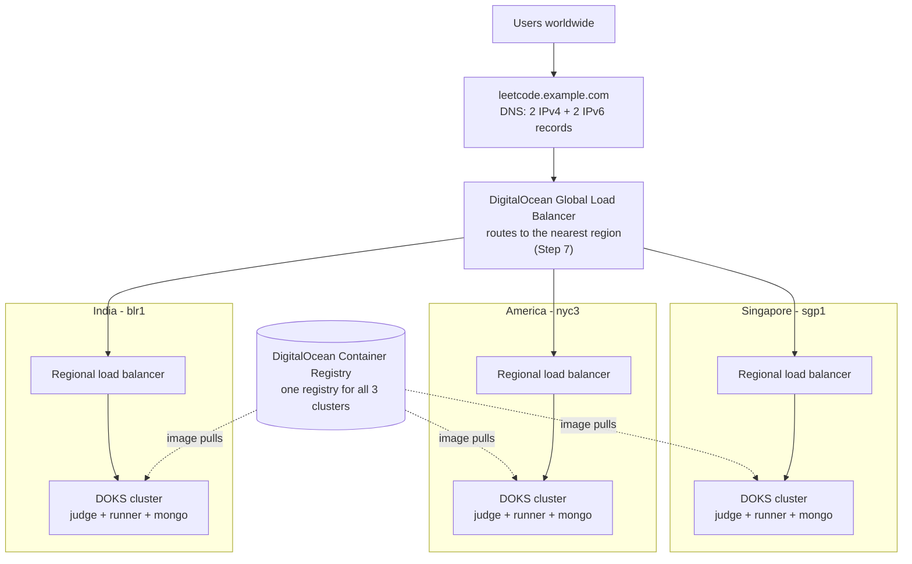
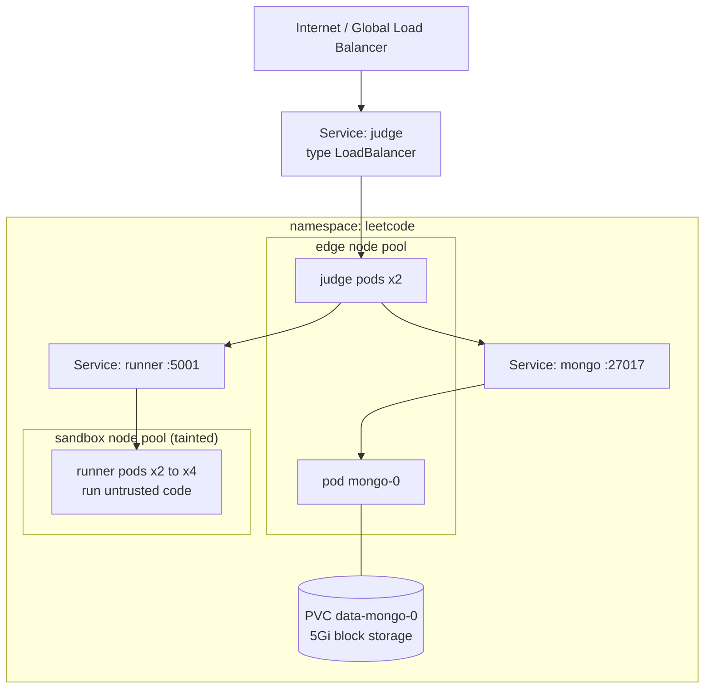
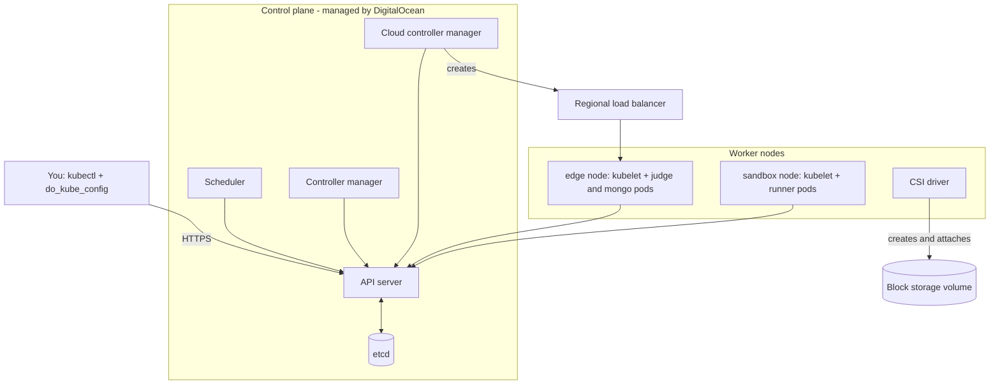
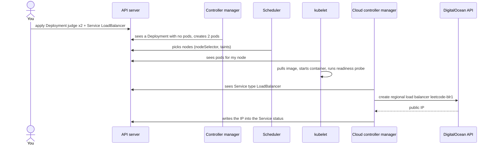
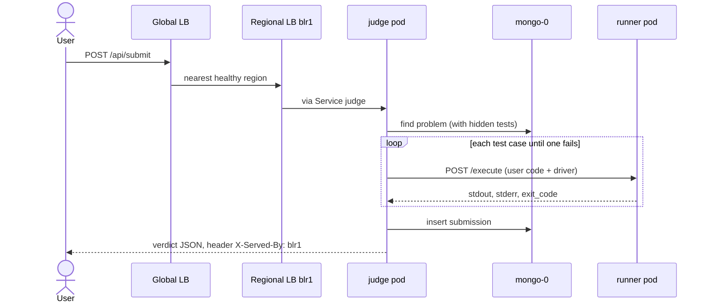
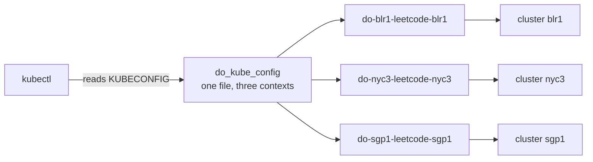

# Mini LeetCode on DigitalOcean Kubernetes: 3 Regions, One Global Entry Point (command-line edition)

India (Bangalore) · America (New York) · Singapore

> This edition has **no shell scripts**. Clusters, kubeconfig, registry connection and deployment are all done by typing commands (`doctl`, `kubectl`, `docker`, `envsubst`). The diagrams are Mermaid: they render on GitHub and in most Markdown viewers.

## Part 0: What you are building



Each cluster is a full copy: a public **judge**, a private **runner** and its own **MongoDB**.

### The command-line flow in one list

| Step | You type | Result |
|---|---|---|
| 2 | `docker buildx build ... --push` (twice) | Images in DigitalOcean Container Registry |
| 3 | `doctl kubernetes cluster create` (three times) | 3 clusters, 2 node pools each |
| 4 | `doctl kubernetes cluster kubeconfig show` + `kubectl config view --flatten` | One file, `do_kube_config`, with 3 contexts |
| 5 | `doctl kubernetes cluster registry add` (three times) | Registry connected to all 3 clusters |
| 6 | `kubectl create namespace/secret`, `envsubst ... \| kubectl apply -f -` (per region) | App running in all 3 clusters |
| 7 | Terraform (or control panel) | Global Load Balancer |
| 8 | DNS records + `curl` | Public name, verified routing |

### Read this first (honest notes)

- **Anycast comes from DigitalOcean's Global Load Balancer (GLB)**, which routes users to the nearest available backend. "Nearest" means nearest by network, not by country. Step 9 shows how to test it. To force an order, the GLB supports `region_priorities`.
- **The GLB can only sit in front of *regional HTTP* load balancers.** Newer DOKS versions create *network* load balancers by default, so the manifest sets `do-loadbalancer-type: REGIONAL`. Don't remove that line.
- **Each region has its own MongoDB.** Starter problems are identical everywhere; submissions stay in the region where they were made.
- **MongoDB is a single pod.** No replica set, so no failover inside a region (the GLB still fails over *between* regions). Back up before deleting anything.
- **Untested against a real DigitalOcean account.** The Python code and manifest were checked locally; the `doctl` flags and the GLB Terraform come from DigitalOcean's docs. If a flag is rejected, run the command with `--help`. The tests use `mongomock`, so the first real-MongoDB run happens on your cluster.
- **Images live in DigitalOcean Container Registry (DOCR).** Two images = two repositories, so the free Starter plan (1 repository) is not enough. Use **Basic** (5 repositories, 5 GiB; $5 per month when I checked, so verify current pricing).
- **Security:** container limits stop accidents, not determined attackers. The runner is isolated (own node pool, no network, non-root, read-only filesystem), but for public traffic add a stronger sandbox (gVisor) or a hosted judge such as Judge0.

---

## Part 1: What you need installed

| Tool | Why | Check |
|---|---|---|
| DigitalOcean account + API token | Create everything | control panel → API → Tokens |
| `doctl` | Creates clusters, registry, kubeconfig | `doctl version` |
| `kubectl` | Talks to Kubernetes | `kubectl version --client` |
| `terraform` | Only for the Global Load Balancer (Step 7) | `terraform version` |
| `docker` with buildx | Builds images | `docker buildx version` |
| `envsubst` (package `gettext`) | Fills `${REGION}` in the manifest | `envsubst --version` |
| `openssl` | Generates the MongoDB password | `openssl version` |
| Python 3.12 | Local tests | `python3 --version` |
| A domain name | The public address | |

```bash
export DIGITALOCEAN_TOKEN="your-token-here"   # Terraform and doctl both read this
doctl auth init -t "$DIGITALOCEAN_TOKEN"
```

## Part 2: Project layout

```
leetcode/
├── runner/runner.py              ← Step 1a
├── judge/judge.py                ← Step 1b
├── judge/index.html              ← Step 1c
├── tests/test_judge.py           ← Step 1d
├── docker/Dockerfile.runner      ← Step 2
├── docker/Dockerfile.judge       ← Step 2
├── k8s/leetcode.yaml             ← Step 6
├── terraform/glb/main.tf         ← Step 7
├── .gitignore                    ← Step 4
└── do_kube_config                ← generated in Step 4, never commit it
```

```bash
mkdir -p leetcode/runner leetcode/judge leetcode/tests leetcode/docker leetcode/k8s leetcode/terraform/glb
cd leetcode
```

---

## Part 2b: Kubernetes explained (skip if you know it)

You don't tell Kubernetes *what to do*; you write down *what you want to exist* and it keeps reality matching. If a pod crashes, it starts another.

| Word | Plain meaning | In this project |
|---|---|---|
| **Cluster** | Machines managed together | `blr1`, `nyc3`, `sgp1` |
| **Node** | One machine (a Droplet) | `edge` and `sandbox` pools |
| **Pod** | One running container; disposable | `judge-xxxx`, `runner-xxxx`, `mongo-0` |
| **Deployment** | "Keep N identical pods running" | judge, runner |
| **StatefulSet** | Like a Deployment, but fixed name and own disk | mongo |
| **Service** | Stable address in front of pods | `runner`, `mongo`, `judge` |
| **Namespace** | A folder for objects | `leetcode` |
| **Secret** | Small sensitive values (base64 is encoding, not encryption) | `mongo-auth` |
| **PVC / PV / StorageClass** | A disk that outlives pods | `data-mongo-0`, 5Gi |
| **HPA** | Autoscale pods on load | runner 2 to 4 |
| **NetworkPolicy** | Firewall between pods | runner and mongo lockdown |

- **Labels and selectors** connect things: a pod has `labels: {app: judge}`, a Service finds it with `selector: {app: judge}`.
- **Readiness probes** decide whether a pod receives traffic. **requests/limits** reserve and cap CPU and memory.
- Every manifest object has `apiVersion`, `kind`, `metadata`, `spec`. One file can hold many objects separated by `---`. `kubectl apply -f` is repeatable.
- `${REGION}`, `${IMAGE_PREFIX}`, `${TAG}` are **not** Kubernetes syntax: `envsubst` fills them before the file reaches `kubectl`.

### One cluster



### Storage

A pod's filesystem dies with it, so MongoDB uses a **PVC** (a request: "5Gi of `do-block-storage`"). DigitalOcean creates the real volume (the **PV**) and attaches it to the node.

| Event | Data |
|---|---|
| Pod `mongo-0` crashes or restarts | Kept |
| You update the StatefulSet or image | Kept |
| You delete the StatefulSet | Kept (the PVC stays) |
| You delete the namespace or the PVC | Usually deleted with the DigitalOcean volume (depends on reclaim policy) |

`fsGroup: 999` in the manifest makes the disk writable by the `mongo` user; without it MongoDB fails with "permission denied" on `/data/db`.

### CRDs (and why we didn't use one)

A **CRD** adds new object kinds to Kubernetes; an **operator** is a program that watches those objects and does the real work (replica sets, backups, failover). Our MongoDB is one pod, so a plain StatefulSet is easier to learn from. For a 3-member replica set with failover, look at a MongoDB operator (check each project's current docs) or a managed database.

```bash
kubectl get crd              # custom types installed (probably empty on fresh DOKS)
kubectl api-resources        # every kind the cluster knows
kubectl explain statefulset.spec
```

### `kubectl` cheat sheet

We have three clusters, so say *which*: each is a **context** in `do_kube_config` (created in Step 4), e.g. `do-blr1-leetcode-blr1`.

```bash
export KUBECONFIG="$PWD/do_kube_config"
kubectl config get-contexts
CTX=do-blr1-leetcode-blr1
alias k="kubectl --context $CTX -n leetcode"
```

| I want to... | Command |
|---|---|
| See everything | `k get pods` · `k get all` · `k get pods -o wide` |
| Why is a pod stuck? | `k describe pod <name>` (read **Events**) |
| Recent problems | `k get events --sort-by=.lastTimestamp` |
| Logs | `k logs deploy/judge` · `k logs <pod> --previous` |
| Shell in a pod | `k exec -it mongo-0 -- bash` |
| Reach a service locally | `k port-forward svc/judge 8080:80` |
| Scale / restart / roll back | `k scale deploy/judge --replicas=3` · `k rollout restart deploy/judge` · `k rollout undo deploy/judge` |
| CPU and memory | `k top pods` · `kubectl --context $CTX top nodes` |

Pod status words: `Pending` (waiting for node or disk), `ContainerCreating` (pulling image), `CrashLoopBackOff` (read `logs --previous`), `ImagePullBackOff` (can't download the image).

---

## Part 2c: Kubernetes architecture (what runs inside a cluster)

A DOKS cluster has a **control plane** (managed by DigitalOcean, you can't log in), **worker nodes** (your Droplets) and **add-ons**.



| Component | Job | In this project |
|---|---|---|
| API server | The only front door | Every `kubectl` command goes here |
| etcd | Stores every Kubernetes *object* | Deployments, Secret `mongo-auth` (not MongoDB's data) |
| Scheduler | Picks a node per pod | Runner to `sandbox`, judge and mongo to `edge` |
| Controller manager | Loops that fix "asked vs actual" | Keeps 2 judges alive, drives the HPA |
| Cloud controller manager | Talks to the DigitalOcean API | Creates load balancer `leetcode-<region>` from the annotations |
| kubelet | Node agent: starts containers, probes, mounts | Readiness checks, `/data/db`, injects the password |
| CNI / CoreDNS | Pod networking, NetworkPolicy, names like `runner` | Why `http://runner:5001` works |
| CSI driver | Creates and attaches volumes | The 5Gi disk |
| metrics-server | CPU and memory numbers | Feeds the HPA |
| Cluster autoscaler | Adds or removes Droplets | `edge` 1 to 2, `sandbox` 1 to 2 |

```bash
kubectl --context do-blr1-leetcode-blr1 -n kube-system get pods    # what runs in your cluster
```

### What happens on `kubectl apply`



### Life of one submission



### Self-healing

| What breaks | What happens |
|---|---|
| Judge or runner pod crashes | Container restarts or a replacement is created |
| Readiness probe fails (e.g. MongoDB down) | Pod removed from the Service |
| A node dies | Stateless pods recreated elsewhere; `mongo-0` waits for its disk |
| Runner busy | HPA adds pods (2 to 4) |
| No room | Autoscaler adds a Droplet |
| Every judge in a region unhealthy | Regional health check fails, GLB routes elsewhere |
| Registry unavailable | Running pods unaffected; new pods needing an uncached image wait in `ImagePullBackOff` |

### Check NetworkPolicy is really enforced (run after Step 6)

```bash
export KUBECONFIG="$PWD/do_kube_config"
alias k="kubectl --context do-blr1-leetcode-blr1 -n leetcode"

k top pods ; k get hpa                       # HPA TARGETS should be a percentage, not <unknown>

# judge -> runner: allowed. Expect {"status":"ok"}
k exec deploy/judge -- python -c "import urllib.request; print(urllib.request.urlopen('http://runner:5001/', timeout=3).read())"

# any other pod -> runner: blocked. Expect a timeout
k run np-test --rm -it --restart=Never --image=busybox:1.36 -- wget -qO- -T 3 http://runner:5001/

# runner -> internet: blocked. Expect an error
k exec deploy/runner -- python -c "import urllib.request; urllib.request.urlopen('http://example.com', timeout=3)"
```

**If the second test succeeds or the third succeeds, your cluster is not enforcing NetworkPolicy** and the runner is not isolated. Do not expose this to untrusted users until all three behave as expected.

---

## Step 1: The Python files

### 1a. `runner/runner.py`: runs submitted code

```python
# RUNNER SERVICE (the "worker"): take Python code, run it with limits, return what it printed.
import os, resource, subprocess, sys, tempfile
from flask import Flask, request, jsonify

app = Flask(__name__)


def set_limits():
    """Runs inside the child process just before the user's code starts."""
    resource.setrlimit(resource.RLIMIT_CPU, (5, 5))                    # max 5 sec of CPU
    resource.setrlimit(resource.RLIMIT_AS, (128 * 2**20,) * 2)         # max 128 MB memory
    resource.setrlimit(resource.RLIMIT_NPROC, (64, 64))                # max 64 processes (fork bombs)
    resource.setrlimit(resource.RLIMIT_FSIZE, (2**20, 2**20))          # max 1 MB file writes


@app.route("/")
def health():
    return jsonify(status="ok")


@app.route("/execute", methods=["POST"])
def execute():
    code = (request.get_json(silent=True) or {}).get("code")
    if not isinstance(code, str) or not code:
        return jsonify(error="send JSON like {'code': '...'}"), 400

    with tempfile.TemporaryDirectory() as folder:          # folder is deleted afterwards
        path = os.path.join(folder, "script.py")
        with open(path, "w") as f:
            f.write(code)
        try:
            result = subprocess.run(
                [sys.executable, "-I", path],
                capture_output=True, text=True,
                timeout=5,                                  # kill after 5 seconds
                preexec_fn=set_limits,
                cwd=folder, env={},                         # empty env: no secrets leak in
            )
        except subprocess.TimeoutExpired:
            return jsonify(error="timeout"), 408

    return jsonify(stdout=result.stdout, stderr=result.stderr, exit_code=result.returncode)


if __name__ == "__main__":
    app.run(port=int(os.environ.get("PORT", 5001)))
```

### 1b. `judge/judge.py`: problems, test cases, verdicts

Problems, hidden tests and submissions live in **MongoDB** (pymongo). Starter problems are inserted on first start. The `REGION` setting and `X-Served-By` header show which cluster answered.

```python
# JUDGE SERVICE (the "boss"): show problems, receive submissions, ask the runner to run the
# code on each test case, compare answers, return a verdict. Data lives in MongoDB.
import json, os, time
from urllib.parse import quote_plus

import requests
from flask import Flask, request, jsonify, send_from_directory
from pymongo import MongoClient
from pymongo.errors import PyMongoError

app = Flask(__name__)

REGION = os.environ.get("REGION", "local")


@app.after_request
def add_region_header(resp):
    resp.headers["X-Served-By"] = REGION
    return resp


RUNNER_URL = "http://" + os.environ.get("RUNNER_HOSTPORT", "localhost:5001")


# ---------- 1) DATABASE: MongoDB ----------
def build_mongo_uri():
    """Kubernetes passes MONGO_HOST/USER/PASSWORD. For local dev you can set MONGO_URI instead."""
    if os.environ.get("MONGO_URI"):
        return os.environ["MONGO_URI"]
    host = os.environ.get("MONGO_HOST")
    if not host:
        return None
    user = quote_plus(os.environ["MONGO_USER"])
    password = quote_plus(os.environ["MONGO_PASSWORD"])
    return f"mongodb://{user}:{password}@{host}:27017/?authSource=admin"


MONGO_URI = build_mongo_uri()
client = MongoClient(MONGO_URI or "mongodb://localhost:27017", serverSelectionTimeoutMS=3000)
db = client["leetcode"]          # collections: problems, submissions

SEED_PROBLEMS = [
    {
        "_id": "two-sum",
        "title": "Two Sum (Easy)",
        "description": "Return the indices of the two numbers in `nums` that add up to `target`.\n"
                       "Example: nums=[2,7,11,15], target=9 -> [0,1]",
        "function": "twoSum",
        "starter": "class Solution:\n    def twoSum(self, nums, target):\n        pass\n",
        "tests": [
            {"args": [[2, 7, 11, 15], 9], "expected": [0, 1]},
            {"args": [[3, 2, 4], 6], "expected": [1, 2]},
            {"args": [[3, 3], 6], "expected": [0, 1]},
            {"args": [[-1, -2, -3, -4, -5], -8], "expected": [2, 4]},
            {"args": [[0, 4, 3, 0], 0], "expected": [0, 3]},
        ],
    },
    {
        "_id": "valid-parentheses",
        "title": "Valid Parentheses (Easy)",
        "description": "Return True if the brackets in string `s` are closed in the correct order.\n"
                       'Example: "()[]{}" -> True,  "(]" -> False',
        "function": "isValid",
        "starter": "class Solution:\n    def isValid(self, s):\n        pass\n",
        "tests": [
            {"args": ["()"], "expected": True},
            {"args": ["()[]{}"], "expected": True},
            {"args": ["(]"], "expected": False},
            {"args": ["([)]"], "expected": False},
            {"args": ["{[]}"], "expected": True},
            {"args": ["("], "expected": False},
        ],
    },
]


def seed_problems(database):
    """Insert each problem ONLY if it doesn't exist yet ($setOnInsert).
    After that MongoDB is the source of truth: edits are never overwritten."""
    for p in SEED_PROBLEMS:
        fields = {k: v for k, v in p.items() if k != "_id"}
        database.problems.update_one({"_id": p["_id"]}, {"$setOnInsert": fields}, upsert=True)


def wait_and_seed():
    """MongoDB may start after the judge does, so retry for a while."""
    for _ in range(20):
        try:
            seed_problems(db)
            print("MongoDB ready, problems seeded", flush=True)
            return
        except PyMongoError as e:
            print("waiting for MongoDB...", e, flush=True)
            time.sleep(2)
    print("WARNING: could not reach MongoDB", flush=True)


if MONGO_URI:        # only in Kubernetes / local runs; the tests use a fake database
    wait_and_seed()


@app.errorhandler(PyMongoError)
def database_down(err):
    return jsonify(error="database unavailable"), 503


# ---------- 2) TALK TO THE RUNNER ----------
def call_runner(code):
    r = requests.post(RUNNER_URL + "/execute", json={"code": code}, timeout=15)
    return r.status_code, r.json()


def same(got, expected):
    # Two Sum may answer [1,0] or [0,1], so compare lists in sorted order.
    if isinstance(got, list) and isinstance(expected, list):
        return sorted(got) == sorted(expected)
    return got == expected


# ---------- 3) THE JUDGING LOGIC ----------
def judge(problem, user_code):
    tests = problem["tests"]
    for number, test in enumerate(tests, start=1):
        args, expected = test["args"], test["expected"]
        script = (user_code + "\n\nimport json\n"
                  f"print('RESULT:' + json.dumps(Solution().{problem['function']}(*{args!r})))\n")
        try:
            status, out = call_runner(script)
        except requests.RequestException:
            return {"verdict": "Judge Error", "passed": number - 1, "total": len(tests)}

        if status == 408:
            return {"verdict": "Time Limit Exceeded", "passed": number - 1, "total": len(tests)}
        if out["exit_code"] != 0:
            return {"verdict": "Runtime Error", "passed": number - 1, "total": len(tests),
                    "error": out["stderr"][-500:]}

        lines = [l for l in out["stdout"].splitlines() if l.startswith("RESULT:")]
        got = json.loads(lines[-1][len("RESULT:"):]) if lines else None
        if not same(got, expected):
            return {"verdict": "Wrong Answer", "passed": number - 1, "total": len(tests)}

    return {"verdict": "Accepted", "passed": len(tests), "total": len(tests)}


# ---------- 4) WEB ROUTES ----------
@app.route("/")
def home():
    return send_from_directory(os.path.dirname(os.path.abspath(__file__)), "index.html")


@app.route("/health")
def health():
    return jsonify(status="ok")                       # process is alive


@app.route("/ready")
def ready():
    client.admin.command("ping")                      # raises if MongoDB is down -> 503
    return jsonify(status="ready")


@app.route("/api/problems")
def list_problems():
    cursor = db.problems.find({}, {"title": 1}).sort("_id", 1)
    return jsonify([{"id": p["_id"], "title": p["title"]} for p in cursor])


@app.route("/api/problems/<pid>")
def get_problem(pid):
    # The projection hides "tests", so hidden test cases never leave the server.
    p = db.problems.find_one({"_id": pid}, {"description": 1, "starter": 1})
    if not p:
        return jsonify(error="not found"), 404
    return jsonify(description=p["description"], starter=p["starter"])


@app.route("/api/submit", methods=["POST"])
def submit():
    data = request.get_json(silent=True) or {}
    pid, code = data.get("problem_id"), data.get("code")
    # isinstance(str) matters: a dict like {"$ne": null} would be a MongoDB injection.
    if not isinstance(pid, str) or not isinstance(code, str) or not code.strip():
        return jsonify(error="need problem_id and code"), 400
    problem = db.problems.find_one({"_id": pid})
    if not problem:
        return jsonify(error="unknown problem"), 400

    result = judge(problem, code)
    db.submissions.insert_one({"problem_id": pid, "at": time.time(), **result})
    return jsonify(result)


@app.route("/api/submissions")
def submissions():
    cursor = db.submissions.find({}, {"_id": 0, "at": 0}).sort("at", -1).limit(10)
    return jsonify(list(cursor))


if __name__ == "__main__":
    app.run(port=int(os.environ.get("PORT", 5000)))
```

### 1b+. How `judge()` decides

For every test case the judge glues a tiny **test driver** under the user's code (`print('RESULT:' + json.dumps(Solution().twoSum(*args)))`), asks the runner to execute it, then checks in a fixed order. The first problem found ends judging:

| Check | Verdict |
|---|---|
| Runner unreachable (`RequestException`) | Judge Error |
| HTTP 408 (over 5 s) | Time Limit Exceeded |
| `exit_code != 0` (exception, syntax error, no `Solution` class, out of memory) | Runtime Error (last 500 chars of stderr) |
| Last `RESULT:` line doesn't match via `same()` | Wrong Answer (expected value is never shown) |
| Loop finishes | Accepted |

`same()` ignores order when both values are lists (`[1,0]` equals `[0,1]`), otherwise uses `==`. Each test runs in a fresh process, so one infinite loop gets its own 5 seconds and no state leaks between tests.

**Known limitations** (the judge protects your *server*, not the scoring):

1. A returned mixed-type list like `[1, "a"]` makes `sorted()` raise `TypeError`, so `/api/submit` returns 500.
2. Code that prints `RESULT:oops` then calls `sys.exit(0)` makes `json.loads` raise, also a 500.
3. Scoring can be gamed (print a `RESULT:` line and exit, or read its own source, which contains the test arguments).
4. Out-of-memory is a Runtime Error; burning the 5 s of CPU may show as either Time Limit Exceeded or Runtime Error.
5. Numbers must match exactly, so floats would need a tolerance.

Optional hardening for 1 and 2 (not in the files above):

```python
def same(got, expected):
    try:
        if isinstance(got, list) and isinstance(expected, list):
            return sorted(got) == sorted(expected)
    except TypeError:
        return False
    return got == expected
```

```python
        try:
            got = json.loads(lines[-1][len("RESULT:"):]) if lines else None
        except ValueError:
            got = None
```

### 1c. `judge/index.html`

```html
<!DOCTYPE html>
<html>
<head><meta charset="utf-8"><title>Mini LeetCode</title></head>
<body>
  <h1>Mini LeetCode</h1>

  <select id="problem"></select>
  <pre id="description"></pre>

  <textarea id="code" rows="14" cols="80"></textarea><br>
  <button id="submit">Submit</button>

  <h3>Result</h3>
  <pre id="result">-</pre>

  <h3>Recent submissions</h3>
  <pre id="history">-</pre>

<script>
const $ = id => document.getElementById(id);

async function showProblem() {
  const res = await fetch("/api/problems/" + $("problem").value);
  const p = await res.json();
  $("description").textContent = p.description;
  $("code").value = p.starter;
}

async function showHistory() {
  const res = await fetch("/api/submissions");
  const list = await res.json();
  $("history").textContent = list
    .map(s => s.problem_id + "  " + s.verdict + "  " + s.passed + "/" + s.total)
    .join("\n") || "-";
}

$("submit").onclick = async () => {
  $("result").textContent = "Running...";
  const res = await fetch("/api/submit", {
    method: "POST",
    headers: { "Content-Type": "application/json" },
    body: JSON.stringify({ problem_id: $("problem").value, code: $("code").value })
  });
  $("result").textContent = JSON.stringify(await res.json(), null, 2);
  showHistory();
};

(async () => {
  const res = await fetch("/api/problems");
  const problems = await res.json();
  $("problem").innerHTML = problems
    .map(p => '<option value="' + p.id + '">' + p.title + "</option>").join("");
  $("problem").onchange = showProblem;
  showProblem();
  showHistory();
})();
</script>
</body>
</html>
```

### 1d. `tests/test_judge.py`

Uses `mongomock` (an in-memory fake MongoDB), so no database is needed.

```python
import os, sys
root = os.path.dirname(os.path.dirname(__file__))
sys.path += [os.path.join(root, "runner"), os.path.join(root, "judge")]

import mongomock
import runner, judge

judge.db = mongomock.MongoClient()["leetcode"]
judge.seed_problems(judge.db)

runner_client = runner.app.test_client()

def fake_call_runner(code):
    r = runner_client.post("/execute", json={"code": code})
    return r.status_code, r.get_json()

judge.call_runner = fake_call_runner
client = judge.app.test_client()

def submit(problem_id, code):
    return client.post("/api/submit", json={"problem_id": problem_id, "code": code}).get_json()


def test_two_sum_correct():
    code = """class Solution:
    def twoSum(self, nums, target):
        seen = {}
        for i, n in enumerate(nums):
            if target - n in seen:
                return [seen[target - n], i]
            seen[n] = i
"""
    assert submit("two-sum", code)["verdict"] == "Accepted"


def test_parentheses_correct():
    code = """class Solution:
    def isValid(self, s):
        stack, pair = [], {')': '(', ']': '[', '}': '{'}
        for c in s:
            if c in pair:
                if not stack or stack.pop() != pair[c]:
                    return False
            else:
                stack.append(c)
        return not stack
"""
    assert submit("valid-parentheses", code)["verdict"] == "Accepted"


def test_wrong_answer():
    code = "class Solution:\n    def twoSum(self, nums, target):\n        return [0, 0]\n"
    assert submit("two-sum", code)["verdict"] == "Wrong Answer"


def test_crash():
    assert submit("two-sum", "this is not python")["verdict"] == "Runtime Error"


def test_infinite_loop():
    code = "class Solution:\n    def isValid(self, s):\n        while True: pass\n"
    assert submit("valid-parentheses", code)["verdict"] == "Time Limit Exceeded"


def test_problems_come_from_mongodb_and_hide_tests():
    listing = client.get("/api/problems").get_json()
    assert {p["id"] for p in listing} == {"two-sum", "valid-parentheses"}
    one = client.get("/api/problems/two-sum").get_json()
    assert "tests" not in one and "starter" in one


def test_submissions_saved_in_mongodb():
    before = judge.db.submissions.count_documents({})
    submit("two-sum", "class Solution:\n    def twoSum(self, nums, target):\n        return [0, 0]\n")
    assert judge.db.submissions.count_documents({}) == before + 1
    history = client.get("/api/submissions").get_json()
    assert history[0]["problem_id"] == "two-sum" and "_id" not in history[0]


def test_seeding_never_overwrites_edits():
    judge.db.problems.update_one({"_id": "two-sum"}, {"$set": {"title": "Edited in MongoDB"}})
    judge.seed_problems(judge.db)
    assert judge.db.problems.find_one({"_id": "two-sum"})["title"] == "Edited in MongoDB"
    assert judge.db.problems.count_documents({}) == 2


def test_injection_is_rejected():
    r = client.post("/api/submit", json={"problem_id": {"$ne": None}, "code": "print(1)"})
    assert r.status_code == 400
```

### 1e. Run the tests locally

```bash
pip install flask gunicorn requests pymongo mongomock pytest
pytest -v                      # expect: 9 passed (one test waits ~5 s on purpose)
```

Optional, run it for real in three terminals:

```bash
docker run --rm -p 27017:27017 mongo:7.0                                  # terminal 1
(cd runner && python runner.py)                                           # terminal 2, port 5001
(cd judge && MONGO_URI=mongodb://localhost:27017 python judge.py)         # terminal 3, http://localhost:5000
```

---

## Step 2: Docker images and the container registry

### Dockerfiles

`docker/Dockerfile.runner`

```dockerfile
FROM python:3.12-slim
RUN pip install --no-cache-dir flask==3.0.3 gunicorn==22.0.0
WORKDIR /app
COPY runner/runner.py .
USER 10001
CMD ["gunicorn", "runner:app", "--bind", "0.0.0.0:5001", "--workers", "2"]
```

`docker/Dockerfile.judge`

```dockerfile
FROM python:3.12-slim
RUN pip install --no-cache-dir flask==3.0.3 gunicorn==22.0.0 requests==2.32.3 pymongo==4.10.1
WORKDIR /app
COPY judge/judge.py judge/index.html ./
USER 10001
CMD ["gunicorn", "judge:app", "--bind", "0.0.0.0:8080", "--workers", "1", "--threads", "4", "--timeout", "120"]
```

### Create the registry (once)

| Plan | Repositories | Storage | Price (when I checked) |
|---|---|---|---|
| Starter | 1 | 500 MiB | $0 |
| **Basic** | **5** | **5 GiB** | **$5 per month** |
| Professional | Unlimited | 100 GiB | $20 per month |

We push two images (one repository each), so **Basic** is the minimum. The name must be globally unique, 3 to 63 characters (letters, numbers, dashes) and **cannot be renamed**. Pick a region near your other resources; one registry serves all three clusters, so far clusters pull across regions.

```bash
export REGISTRY=leetcode-yourname                 # your own unique name
doctl registries create "$REGISTRY" --subscription-tier basic --region nyc3
doctl registries login                            # lets docker push and pull
```

If a flag is rejected, `doctl registries create --help` lists the exact ones.

### Build and push (two commands, no script)

```bash
export IMAGE_PREFIX=registry.digitalocean.com/$REGISTRY
export TAG=v1

docker buildx build --platform linux/amd64 -f docker/Dockerfile.runner \
  -t $IMAGE_PREFIX/leetcode-runner:$TAG --push .

docker buildx build --platform linux/amd64 -f docker/Dockerfile.judge \
  -t $IMAGE_PREFIX/leetcode-judge:$TAG --push .
```

Confirm both repositories exist:

```bash
doctl registries repository list-v2 "$REGISTRY"
```

**Use version tags like `v1`, not `latest`.** `:latest` is re-pulled on every pod start; versioned tags reuse what's on the node (fewer cross-region downloads, less registry dependence, and you know what's running). Old versions eat your 5 GiB, so clean them up per DigitalOcean's "Clean Up Container Registry" docs.

**Optional: mirror MongoDB's image** (avoids Docker Hub rate limits; a third repository, still within Basic):

```bash
docker pull --platform linux/amd64 mongo:7.0
docker tag mongo:7.0 $IMAGE_PREFIX/mongo:7.0
docker push $IMAGE_PREFIX/mongo:7.0
# then in k8s/leetcode.yaml change  image: mongo:7.0  to  image: ${IMAGE_PREFIX}/mongo:7.0
```

---

## Step 3: Create the three clusters with `doctl`

Each region gets two node pools so untrusted code never shares a machine with the public website:

| Pool | Runs | Size | Autoscaling | Label | Taint |
|---|---|---|---|---|---|
| `edge` | judge + mongo | `s-1vcpu-2gb` | 1 to 2 nodes | `pool=edge` | none |
| `sandbox` | runner | `s-1vcpu-2gb` | 1 to 2 nodes | `pool=sandbox` | `dedicated=sandbox:NoSchedule` |

This is the small "basic" setup: one `s-1vcpu-2gb` node per pool to start, growing to at most two. It is tight on memory (the edge node holds 2 judge pods plus MongoDB), so if `mongo-0` or a judge pod is `OOMKilled` or stays `Pending`, raise the edge size to `s-2vcpu-4gb` (or its max-nodes).

The **taint** repels every pod from sandbox nodes, the runner's **toleration** lets it in, and its **nodeSelector** forces it there.

Look up valid values first:

```bash
doctl kubernetes options regions      # confirm blr1, nyc3, sgp1
doctl kubernetes options sizes        # confirm s-1vcpu-2gb
doctl kubernetes options versions
```

How to read each `--node-pool` string (settings separated by `;`):

| Setting | Meaning |
|---|---|
| `name=edge` | Pool name |
| `size=s-1vcpu-2gb` | Machine type |
| `count=2` | Starting nodes |
| `auto-scale=true;min-nodes=1;max-nodes=2` | Autoscale between 1 and 2 |
| `label=pool=edge` | Label on every node (the judge's `nodeSelector` uses it) |
| `taint=dedicated=sandbox:NoSchedule` | `key=value:effect`; repels pods without a matching toleration |

### India (blr1)

```bash
doctl kubernetes cluster create leetcode-blr1 \
  --region blr1 --version latest \
  --node-pool "name=edge;size=s-1vcpu-2gb;count=1;auto-scale=true;min-nodes=1;max-nodes=2;label=pool=edge" \
  --node-pool "name=sandbox;size=s-1vcpu-2gb;count=1;auto-scale=true;min-nodes=1;max-nodes=2;label=pool=sandbox;taint=dedicated=sandbox:NoSchedule"
```

### America (nyc3)

```bash
doctl kubernetes cluster create leetcode-nyc3 \
  --region nyc3 --version latest \
  --node-pool "name=edge;size=s-1vcpu-2gb;count=1;auto-scale=true;min-nodes=1;max-nodes=2;label=pool=edge" \
  --node-pool "name=sandbox;size=s-1vcpu-2gb;count=1;auto-scale=true;min-nodes=1;max-nodes=2;label=pool=sandbox;taint=dedicated=sandbox:NoSchedule"
```

### Singapore (sgp1)

```bash
doctl kubernetes cluster create leetcode-sgp1 \
  --region sgp1 --version latest \
  --node-pool "name=edge;size=s-1vcpu-2gb;count=1;auto-scale=true;min-nodes=1;max-nodes=2;label=pool=edge" \
  --node-pool "name=sandbox;size=s-1vcpu-2gb;count=1;auto-scale=true;min-nodes=1;max-nodes=2;label=pool=sandbox;taint=dedicated=sandbox:NoSchedule"
```

Each command waits several minutes. To save time, open three terminals and run one in each (the clusters are independent), or add `--wait=false` if your `doctl` supports it, then poll with `doctl kubernetes cluster list`. doctl may also add the cluster to your default `~/.kube/config`; that is harmless, we use our own file.

Check the result:

```bash
doctl kubernetes cluster list
doctl kubernetes cluster node-pool list leetcode-blr1      # expect two pools: edge and sandbox
```

Change things later (example). An update **removes** labels and taints you don't repeat, so repeat them:

```bash
doctl kubernetes cluster node-pool update leetcode-blr1 edge \
  --auto-scale --min-nodes 1 --max-nodes 3 --label pool=edge
# For the sandbox pool also repeat:  --label pool=sandbox --taint "dedicated=sandbox:NoSchedule"
```

---

## Step 4: Get the kubeconfig into one file, `do_kube_config`

A **kubeconfig** tells `kubectl` where each cluster is and how to log in. We want all three in one file.



`doctl kubernetes cluster kubeconfig show NAME` prints a cluster's kubeconfig; `>` saves it to a file. Download all three, then merge:

```bash
mkdir -p /tmp/kc
doctl kubernetes cluster kubeconfig show leetcode-blr1 > /tmp/kc/blr1.yaml
doctl kubernetes cluster kubeconfig show leetcode-nyc3 > /tmp/kc/nyc3.yaml
doctl kubernetes cluster kubeconfig show leetcode-sgp1 > /tmp/kc/sgp1.yaml

# Merge into one standalone file (--flatten embeds the certificates)
KUBECONFIG=/tmp/kc/blr1.yaml:/tmp/kc/nyc3.yaml:/tmp/kc/sgp1.yaml \
  kubectl config view --flatten > do_kube_config
chmod 600 do_kube_config          # it contains credentials
rm -rf /tmp/kc

export KUBECONFIG="$PWD/do_kube_config"
kubectl config get-contexts                     # three contexts
kubectl --context do-blr1-leetcode-blr1 get nodes
kubectl --context do-nyc3-leetcode-nyc3 get nodes
kubectl --context do-sgp1-leetcode-sgp1 get nodes
```

Good to know:

- **`export KUBECONFIG=...` lasts only for that terminal.** Re-run it in each new terminal, or add it to your shell profile.
- **The file holds credentials.** Keep it out of git with this `.gitignore` (it also covers Terraform state, which can hold secrets):

```gitignore
do_kube_config
*.tfstate
*.tfstate.*
.terraform/
terraform.tfvars
```

- **Credentials expire.** DigitalOcean's docs say `kubeconfig show` credentials last 7 days by default. When `kubectl` says `Unauthorized`, repeat the download-and-merge commands above.
- **Alternative:** `doctl kubernetes cluster kubeconfig save leetcode-blr1` adds a cluster to your default `~/.kube/config` and, per the docs, renews credentials automatically.

---

## Step 5: Add the registry to all three clusters

A private registry needs credentials. Connecting the registry to a cluster makes DigitalOcean:

| Action | Why |
|---|---|
| Create a pull secret named after your registry in `kube-system` | Holds the credentials |
| Copy it into every other namespace | Any namespace can pull |
| Add it to each namespace's `default` service account as an `imagePullSecret` | Pods use it automatically, so our manifest needs no extra settings |

**Notes from DigitalOcean's docs:** the cluster must be on the latest Kubernetes patch version (ours are, via `--version latest`), and each connected cluster can pull from **every registry your account owns**.

```bash
doctl kubernetes cluster registry add leetcode-blr1
doctl kubernetes cluster registry add leetcode-nyc3
doctl kubernetes cluster registry add leetcode-sgp1
```

Check that each cluster has the secret (the secret is named after your registry):

```bash
export KUBECONFIG="$PWD/do_kube_config"
kubectl --context do-blr1-leetcode-blr1 -n kube-system get secret $REGISTRY
kubectl --context do-nyc3-leetcode-nyc3 -n kube-system get secret $REGISTRY
kubectl --context do-sgp1-leetcode-sgp1 -n kube-system get secret $REGISTRY
```

Each should print one row. `NotFound` means that cluster isn't connected yet; repeat its `registry add` command.

Our `leetcode` namespace doesn't exist yet. Step 6 creates it and DigitalOcean copies the secret in; Step 6 includes a check.

**Manual fallback** (if you prefer not to use the integration): `doctl registries kubernetes-manifest | kubectl --context CTX apply -f -`, then also create the secret in the `leetcode` namespace and patch its `default` service account. See DigitalOcean's "How to Use Your Private DigitalOcean Container Registry with Docker and Kubernetes".

---

## Step 6: Deploy the manifest to all three clusters

### The manifest: `k8s/leetcode.yaml`

One file, applied unchanged to all three clusters. Only `${REGION}` differs.

- **runner**: only on the tainted `sandbox` pool, internal-only Service, NetworkPolicy allowing only the judge in and nothing out.
- **judge**: only on `edge`, with a `LoadBalancer` Service that makes DigitalOcean create a **regional** load balancer `leetcode-<region>`.
- **mongo**: StatefulSet with a 5Gi disk, headless Service, NetworkPolicy allowing only the judge. Password comes from Secret `mongo-auth` (created in the commands below, never in git).
- **HPA**: runner 2 to 4 pods above 70% CPU.

```yaml
# ${REGION}, ${IMAGE_PREFIX}, ${TAG} are filled in by envsubst before kubectl sees this file.
apiVersion: v1
kind: Namespace
metadata: {name: leetcode}
---
# ================= RUNNER: private, runs untrusted code =================
apiVersion: apps/v1
kind: Deployment
metadata: {name: runner, namespace: leetcode}
spec:
  replicas: 2
  selector: {matchLabels: {app: runner}}
  template:
    metadata: {labels: {app: runner}}
    spec:
      nodeSelector: {pool: sandbox}
      tolerations:
        - {key: dedicated, operator: Equal, value: sandbox, effect: NoSchedule}
      topologySpreadConstraints:
        - maxSkew: 1
          topologyKey: kubernetes.io/hostname
          whenUnsatisfiable: ScheduleAnyway
          labelSelector: {matchLabels: {app: runner}}
      automountServiceAccountToken: false
      securityContext: {runAsNonRoot: true, runAsUser: 10001}
      containers:
        - name: runner
          image: ${IMAGE_PREFIX}/leetcode-runner:${TAG}
          ports: [{containerPort: 5001}]
          securityContext:
            allowPrivilegeEscalation: false
            readOnlyRootFilesystem: true
            capabilities: {drop: ["ALL"]}
          resources:
            requests: {cpu: 250m, memory: 256Mi}
            limits: {cpu: "1", memory: 512Mi}
          readinessProbe: {httpGet: {path: /, port: 5001}}
          volumeMounts: [{name: tmp, mountPath: /tmp}]
      volumes: [{name: tmp, emptyDir: {sizeLimit: 128Mi}}]
---
apiVersion: v1
kind: Service
metadata: {name: runner, namespace: leetcode}
spec:
  selector: {app: runner}
  ports: [{port: 5001, targetPort: 5001}]
---
apiVersion: networking.k8s.io/v1
kind: NetworkPolicy
metadata: {name: runner-lockdown, namespace: leetcode}
spec:
  podSelector: {matchLabels: {app: runner}}
  policyTypes: [Ingress, Egress]
  ingress:
    - from: [{podSelector: {matchLabels: {app: judge}}}]
      ports: [{port: 5001}]
  egress: []
---
apiVersion: autoscaling/v2
kind: HorizontalPodAutoscaler
metadata: {name: runner, namespace: leetcode}
spec:
  scaleTargetRef: {apiVersion: apps/v1, kind: Deployment, name: runner}
  minReplicas: 2
  maxReplicas: 4
  metrics:
    - type: Resource
      resource: {name: cpu, target: {type: Utilization, averageUtilization: 70}}
---
# ================= MONGODB: stores problems + submissions =================
apiVersion: apps/v1
kind: StatefulSet
metadata: {name: mongo, namespace: leetcode}
spec:
  serviceName: mongo
  replicas: 1                         # single node: simple, NOT highly available
  selector: {matchLabels: {app: mongo}}
  template:
    metadata: {labels: {app: mongo}}
    spec:
      nodeSelector: {pool: edge}
      automountServiceAccountToken: false
      securityContext: {runAsNonRoot: true, runAsUser: 999, runAsGroup: 999, fsGroup: 999}
      containers:
        - name: mongo
          image: mongo:7.0
          ports: [{containerPort: 27017}]
          env:
            - name: MONGO_INITDB_ROOT_USERNAME
              valueFrom: {secretKeyRef: {name: mongo-auth, key: username}}
            - name: MONGO_INITDB_ROOT_PASSWORD
              valueFrom: {secretKeyRef: {name: mongo-auth, key: password}}
          resources:
            requests: {cpu: 250m, memory: 512Mi}
            limits: {cpu: "1", memory: 1Gi}
          readinessProbe:
            exec: {command: ["mongosh", "--quiet", "--eval", "db.adminCommand('ping').ok"]}
            initialDelaySeconds: 15
            periodSeconds: 10
          volumeMounts: [{name: data, mountPath: /data/db}]
  volumeClaimTemplates:
    - metadata: {name: data}
      spec:
        accessModes: ["ReadWriteOnce"]
        storageClassName: do-block-storage
        resources: {requests: {storage: 5Gi}}
---
apiVersion: v1
kind: Service
metadata: {name: mongo, namespace: leetcode}
spec:
  clusterIP: None
  selector: {app: mongo}
  ports: [{port: 27017}]
---
apiVersion: networking.k8s.io/v1
kind: NetworkPolicy
metadata: {name: mongo-lockdown, namespace: leetcode}
spec:
  podSelector: {matchLabels: {app: mongo}}
  policyTypes: [Ingress]
  ingress:
    - from: [{podSelector: {matchLabels: {app: judge}}}]
      ports: [{port: 27017}]
---
# ================= JUDGE: public website + API =================
apiVersion: apps/v1
kind: Deployment
metadata: {name: judge, namespace: leetcode}
spec:
  replicas: 2
  selector: {matchLabels: {app: judge}}
  template:
    metadata: {labels: {app: judge}}
    spec:
      nodeSelector: {pool: edge}
      topologySpreadConstraints:
        - maxSkew: 1
          topologyKey: kubernetes.io/hostname
          whenUnsatisfiable: ScheduleAnyway
          labelSelector: {matchLabels: {app: judge}}
      automountServiceAccountToken: false
      securityContext: {runAsNonRoot: true, runAsUser: 10001}
      containers:
        - name: judge
          image: ${IMAGE_PREFIX}/leetcode-judge:${TAG}
          ports: [{containerPort: 8080}]
          env:
            - {name: REGION, value: "${REGION}"}
            - {name: RUNNER_HOSTPORT, value: "runner:5001"}
            - {name: MONGO_HOST, value: "mongo"}
            - name: MONGO_USER
              valueFrom: {secretKeyRef: {name: mongo-auth, key: username}}
            - name: MONGO_PASSWORD
              valueFrom: {secretKeyRef: {name: mongo-auth, key: password}}
          securityContext:
            allowPrivilegeEscalation: false
            readOnlyRootFilesystem: true
            capabilities: {drop: ["ALL"]}
          resources:
            requests: {cpu: 100m, memory: 128Mi}
            limits: {cpu: 500m, memory: 256Mi}
          readinessProbe: {httpGet: {path: /ready, port: 8080}}
          volumeMounts: [{name: tmp, mountPath: /tmp}]
      volumes: [{name: tmp, emptyDir: {sizeLimit: 64Mi}}]
---
apiVersion: v1
kind: Service
metadata:
  name: judge
  namespace: leetcode
  annotations:
    # Must be REGIONAL (HTTP): newer DOKS defaults to a network LB, which can't go behind a GLB.
    service.beta.kubernetes.io/do-loadbalancer-type: "REGIONAL"
    service.beta.kubernetes.io/do-loadbalancer-name: "leetcode-${REGION}"
    service.beta.kubernetes.io/do-loadbalancer-protocol: "http"
    service.beta.kubernetes.io/do-loadbalancer-healthcheck-protocol: "http"
    service.beta.kubernetes.io/do-loadbalancer-healthcheck-path: "/health"
spec:
  type: LoadBalancer
  selector: {app: judge}
  ports:
    - {name: http, port: 80, targetPort: 8080}
```

### Deploy, one region at a time (typed commands, no script)

Set these once per terminal:

```bash
export KUBECONFIG="$PWD/do_kube_config"
export IMAGE_PREFIX=registry.digitalocean.com/$REGISTRY
export TAG=v1                       # must match the tag you pushed in Step 2
```

**Run the block below once for each region.** First set the two variables for that region:

| Region | `REGION` | `CTX` |
|---|---|---|
| India | `blr1` | `do-blr1-leetcode-blr1` |
| America | `nyc3` | `do-nyc3-leetcode-nyc3` |
| Singapore | `sgp1` | `do-sgp1-leetcode-sgp1` |

```bash
# ---- pick the region (example: India) ----
export REGION=blr1
export CTX=do-blr1-leetcode-blr1

# 1. Create the namespace (so the Secret has somewhere to live)
kubectl --context $CTX create namespace leetcode

# 2. Check the registry pull secret has reached the namespace.
#    Expect the secret's name (your registry name). Empty? wait ~30 s and repeat;
#    still empty? run  doctl kubernetes cluster registry add leetcode-$REGION  (Step 5).
kubectl --context $CTX -n leetcode get serviceaccount default \
  -o jsonpath='{.imagePullSecrets[*].name}'; echo

# 3. Create the MongoDB password Secret, ONCE per cluster. Don't re-create it later:
#    MongoDB stored the first password on its disk, so a new one would lock the app out.
kubectl --context $CTX -n leetcode create secret generic mongo-auth \
  --from-literal=username=leetcode_admin \
  --from-literal=password="$(openssl rand -hex 16)"

# 4. Fill in the placeholders and apply everything
envsubst '${REGION} ${IMAGE_PREFIX} ${TAG}' < k8s/leetcode.yaml \
  | kubectl --context $CTX apply -f -

# 5. Wait for MongoDB, then the app
kubectl --context $CTX -n leetcode rollout status statefulset/mongo --timeout=300s
kubectl --context $CTX -n leetcode rollout status deploy/runner --timeout=300s
kubectl --context $CTX -n leetcode rollout status deploy/judge --timeout=300s

# 6. Wait for the regional load balancer (EXTERNAL-IP appears after ~1-2 min), note the IP
kubectl --context $CTX -n leetcode get svc judge -w          # Ctrl+C when EXTERNAL-IP is set
```

Then repeat with `REGION=nyc3 CTX=do-nyc3-leetcode-nyc3`, and again with `REGION=sgp1 CTX=do-sgp1-leetcode-sgp1`. Step 3 (the Secret) is the only step that must not be re-run on an existing cluster; if you re-deploy later, skip steps 1 and 3.

What you should see: `mongo-0` goes `Pending → Running` (waiting for the disk first), then judge pods become `1/1 Ready` once MongoDB answers.

Test one region directly:

```bash
curl -i http://<blr1-ip>/health      # expect  X-Served-By: blr1
```

Stuck pod? `kubectl --context $CTX -n leetcode describe pod <name>`.

### Check MongoDB and its disk

```bash
export CTX=do-blr1-leetcode-blr1
alias k="kubectl --context $CTX -n leetcode"

k get pvc                      # data-mongo-0 should say Bound
k get pods                     # mongo-0 1/1, judge x2 1/1, runner x2 1/1
PW=$(k get secret mongo-auth -o jsonpath='{.data.password}' | base64 -d)

k exec -it mongo-0 -- mongosh -u leetcode_admin -p "$PW" --authenticationDatabase admin leetcode \
  --eval 'db.problems.find({}, {title: 1}); db.submissions.countDocuments()'
```

Add your own problem straight into MongoDB (no redeploy), then refresh the page in that region:

```bash
k exec -it mongo-0 -- mongosh -u leetcode_admin -p "$PW" --authenticationDatabase admin leetcode --eval '
db.problems.insertOne({
  _id: "add-two", title: "Add Two Numbers (Easy)",
  description: "Return a + b.", function: "add",
  starter: "class Solution:\n    def add(self, a, b):\n        pass\n",
  tests: [{args: [1, 2], expected: 3}, {args: [-5, 5], expected: 0}]
})'
```

Prove the disk works: `k delete pod mongo-0`, wait until it's `Running`, and the data is still there. Also run the NetworkPolicy checks from Part 2c now.

---

## Step 7: Anycast configuration (Global Load Balancer)

The GLB is the single global front door. The three regional load balancers sit behind it; DigitalOcean routes each user to the nearest healthy one and fails over if a region goes unhealthy. The GLB is the one piece still done with Terraform, because its settings are easiest to review with `terraform plan`. A control-panel fallback follows.

`terraform/glb/main.tf`

```hcl
# ONE Global Load Balancer in front of the 3 regional load balancers.
# Run AFTER Step 6 (the regional LBs must already exist).
terraform {
  required_providers {
    digitalocean = {
      source  = "digitalocean/digitalocean"
      version = "~> 2.0"
    }
  }
}

provider "digitalocean" {}

variable "domain" {
  description = "Public hostname, e.g. leetcode.example.com"
  type        = string
}

variable "dns_on_digitalocean" {
  description = "true if the domain's DNS zone is in DigitalOcean"
  type        = bool
  default     = false
}

data "digitalocean_loadbalancer" "regional" {
  for_each = toset(["blr1", "nyc3", "sgp1"])
  name     = "leetcode-${each.key}"
}

resource "digitalocean_loadbalancer" "global" {
  name   = "leetcode-global"
  type   = "GLOBAL"
  region = "nyc3"

  forwarding_rule {
    entry_port      = 80
    entry_protocol  = "http"
    target_port     = 80
    target_protocol = "http"
  }

  healthcheck {
    port     = 80
    protocol = "http"
    path     = "/health"
  }

  glb_settings {
    target_protocol = "http"
    target_port     = 80
    cdn {
      is_enabled = false
    }
    # Optional: prefer regions in a fixed order instead of "nearest":
    # region_priorities  = { blr1 = 1, sgp1 = 2, nyc3 = 3 }
    # failover_threshold = 50
  }

  domains {
    name       = var.domain
    is_managed = var.dns_on_digitalocean
  }

  target_load_balancer_ids = [for lb in data.digitalocean_loadbalancer.regional : lb.id]
}

output "global_lb_id" { value = digitalocean_loadbalancer.global.id }
output "global_lb_ip" { value = digitalocean_loadbalancer.global.ip }
```

```bash
cd terraform/glb
terraform init
terraform plan  -var="domain=leetcode.example.com"     # read this carefully
terraform apply -var="domain=leetcode.example.com"
cd ../..
```

Add `-var="dns_on_digitalocean=true"` if your DNS is on DigitalOcean. If `terraform plan` rejects an argument, compare with the `digitalocean_loadbalancer` page in DigitalOcean's Terraform reference (I couldn't run this block). **Control-panel fallback:** Create → Load Balancer → Global, then add `leetcode-blr1`, `leetcode-nyc3`, `leetcode-sgp1` as backends (all backends in a GLB must be the same type).

---

## Step 8: DNS configuration

The GLB has **two IPv4 and two IPv6 addresses**; add all four as records.

**Option A: DNS on DigitalOcean.** Add the domain if needed, then apply the GLB with `dns_on_digitalocean=true`; the A and AAAA records are created for you.

```bash
doctl compute domain create example.com
```

**Option B: DNS elsewhere.** Open Networking → Load Balancers → `leetcode-global` in the control panel to read the four addresses, then create:

| Type | Name | Value |
|---|---|---|
| A | `leetcode` | first IPv4 |
| A | `leetcode` | second IPv4 |
| AAAA | `leetcode` | first IPv6 |
| AAAA | `leetcode` | second IPv6 |

- **Cloudflare:** set these to **"DNS only" (grey cloud)**. The orange-cloud proxy answers users itself and bypasses DigitalOcean's global routing.
- When migrating an existing site, lower the old records' TTL first, add the new records, wait out the old TTL, then remove the old ones.

```bash
dig +short A    leetcode.example.com      # two IPv4 addresses
dig +short AAAA leetcode.example.com      # two IPv6 addresses
```

**HTTPS (after HTTP works).** This guide ships HTTP only. With DNS on DigitalOcean: GLB → Settings → Connect a Domain → Generate a new SSL certificate (free Let's Encrypt; if you have CAA records, authorize `letsencrypt.org` or `pki.goog`). With DNS elsewhere: upload your own certificate and key. After any control-panel change, run `terraform plan` in `terraform/glb` and update `main.tf` to match, or Terraform will try to undo it.

---

## Step 9: Verify the routing

```bash
curl -s -D - -o /dev/null http://leetcode.example.com/health | grep -i -E "^HTTP|x-served-by"
# HTTP/1.1 200 OK
# X-Served-By: blr1        <- the cluster that answered you
```

**Prove it per region.** Create the smallest Droplet in blr1, nyc3 and sgp1, SSH into each, run the same `curl`, and expect `X-Served-By` to match the Droplet's region. Delete the Droplets afterwards. Droplets sit inside DigitalOcean's network, so this proves the routing logic but not an ISP's exact path; for real users, run the `curl` from machines in different countries.

**Test failover:**

```bash
kubectl --context do-blr1-leetcode-blr1 -n leetcode scale deploy/judge --replicas=0
curl -s -D - -o /dev/null http://leetcode.example.com/health | grep -i x-served-by   # from India: now nyc3 or sgp1
kubectl --context do-blr1-leetcode-blr1 -n leetcode scale deploy/judge --replicas=2
```

Failover isn't instant: the health checks need a few failed probes first.

**Submit real code:** open `http://leetcode.example.com`, pick a problem, submit a solution.

---

## Part 3: Updating, cleaning up, troubleshooting

All `kubectl` commands assume `export KUBECONFIG="$PWD/do_kube_config"` in this terminal.

### Ship a new version

```bash
export TAG=v2
docker buildx build --platform linux/amd64 -f docker/Dockerfile.runner -t $IMAGE_PREFIX/leetcode-runner:$TAG --push .
docker buildx build --platform linux/amd64 -f docker/Dockerfile.judge  -t $IMAGE_PREFIX/leetcode-judge:$TAG  --push .

# Re-apply in each region (skip namespace and Secret creation: they already exist)
export REGION=blr1 CTX=do-blr1-leetcode-blr1
envsubst '${REGION} ${IMAGE_PREFIX} ${TAG}' < k8s/leetcode.yaml | kubectl --context $CTX apply -f -
kubectl --context $CTX -n leetcode rollout status deploy/judge
# ...then repeat with nyc3 and sgp1
```

### Back up MongoDB (before deleting anything)

```bash
PW=$(kubectl --context do-blr1-leetcode-blr1 -n leetcode get secret mongo-auth -o jsonpath='{.data.password}' | base64 -d)
kubectl --context do-blr1-leetcode-blr1 -n leetcode exec mongo-0 -- \
  mongodump -u leetcode_admin -p "$PW" --authenticationDatabase admin --db leetcode --archive --gzip > leetcode-blr1.gz
```

If `mongodump` isn't found, snapshot the volume in the control panel instead.

### Tear everything down (order matters)

```bash
# 1. Global load balancer
(cd terraform/glb && terraform destroy -var="domain=leetcode.example.com")

# 2. Namespaces: removes the regional load balancers AND the MongoDB disks (back up first)
kubectl --context do-blr1-leetcode-blr1 delete namespace leetcode
kubectl --context do-nyc3-leetcode-nyc3 delete namespace leetcode
kubectl --context do-sgp1-leetcode-sgp1 delete namespace leetcode

# 3. Clusters (asks you to confirm each)
doctl kubernetes cluster delete leetcode-blr1
doctl kubernetes cluster delete leetcode-nyc3
doctl kubernetes cluster delete leetcode-sgp1

# 4. The registry is separate and keeps billing until deleted
doctl registries delete $REGISTRY
```

If you skip step 2, load balancers and volumes can be left behind and keep billing. Check Networking → Load Balancers, and:

```bash
doctl compute load-balancer list
doctl compute volume list
```

### What costs money

Per region: node pools (edge 1 to 2, sandbox 1 to 2), one regional load balancer, one 5Gi volume. Globally: the Global Load Balancer and the registry (Basic: $5 per month when I checked). Check DigitalOcean's pricing pages before you create anything.

### Troubleshooting

| Symptom | Likely cause and fix |
|---|---|
| `kubectl` says `Unauthorized` or `You must be logged in` | `do_kube_config` credentials expired (7 days). Repeat the Step 4 download-and-merge commands. |
| Wrong cluster, or `connection refused` | `KUBECONFIG` isn't set in this terminal. `export KUBECONFIG="$PWD/do_kube_config"` and check `kubectl config get-contexts`. |
| `kubeconfig show` says cluster not found | The cluster doesn't exist yet. `doctl kubernetes cluster list`. |
| `doctl kubernetes cluster create` says the name exists | You already created it. `doctl kubernetes cluster list`. |
| `terraform plan` in `glb/` can't find `leetcode-blr1` | Step 6 isn't finished, or the Service lacks `do-loadbalancer-name`. `doctl compute load-balancer list`. |
| GLB rejects the regional load balancers | They are *network* LBs. Keep `do-loadbalancer-type: "REGIONAL"` and re-apply the manifest. |
| Runner pods stay `Pending` | Sandbox pool not ready, or no toleration. `kubectl describe pod`, `kubectl get nodes --show-labels`. |
| `ImagePullBackOff` | `k describe pod <name>`, read Events. `not found`: image name or tag missing (compare `IMAGE_PREFIX` and `TAG` with what you pushed). `unauthorized`: pull secret missing, so run `doctl kubernetes cluster registry add leetcode-<region>`. |
| The `imagePullSecrets` check in Step 6 prints nothing | Registry not connected to that cluster, or the secret hasn't been copied yet. Wait 30 s, then run `registry add` for that cluster. |
| `docker push` says `unauthorized` or `denied` | Login expired. Run `doctl registries login` again. |
| `docker push` fails on repository or storage limit | You're on Starter (1 repository, 500 MiB). Upgrade to Basic in the control panel. |
| `registry add` complains | The cluster may already be connected, or isn't on the latest Kubernetes patch version. |
| Verdict is `Judge Error` | Judge can't reach the runner. Check runner pods are Ready and the NetworkPolicy is applied. |
| Everyone gets the same region | DNS is proxied (Cloudflare orange cloud), or you're testing from one location. |
| `mongo-0` stays `Pending` | `k get pvc` (should be `Bound`), `k describe pvc data-mongo-0`, `kubectl get storageclass`. |
| `mongo-0` `CrashLoopBackOff`, "permission denied" on `/data/db` | Keep `fsGroup: 999` in the StatefulSet. |
| Judge pods `0/1`, logs say "waiting for MongoDB" | MongoDB not up yet, or Secret wrong. `k logs mongo-0`, `k get secret mongo-auth`. |
| Authentication failed after re-creating the Secret | MongoDB kept the *old* password on its disk. Restore the old Secret, or wipe the disk (data loss): delete the StatefulSet and PVC. |
| Problems or submissions differ between regions | Expected: each region has its own MongoDB. |
| Terraform wants to change the GLB after a panel edit | Update `terraform/glb/main.tf` to match, or re-apply to overwrite. |